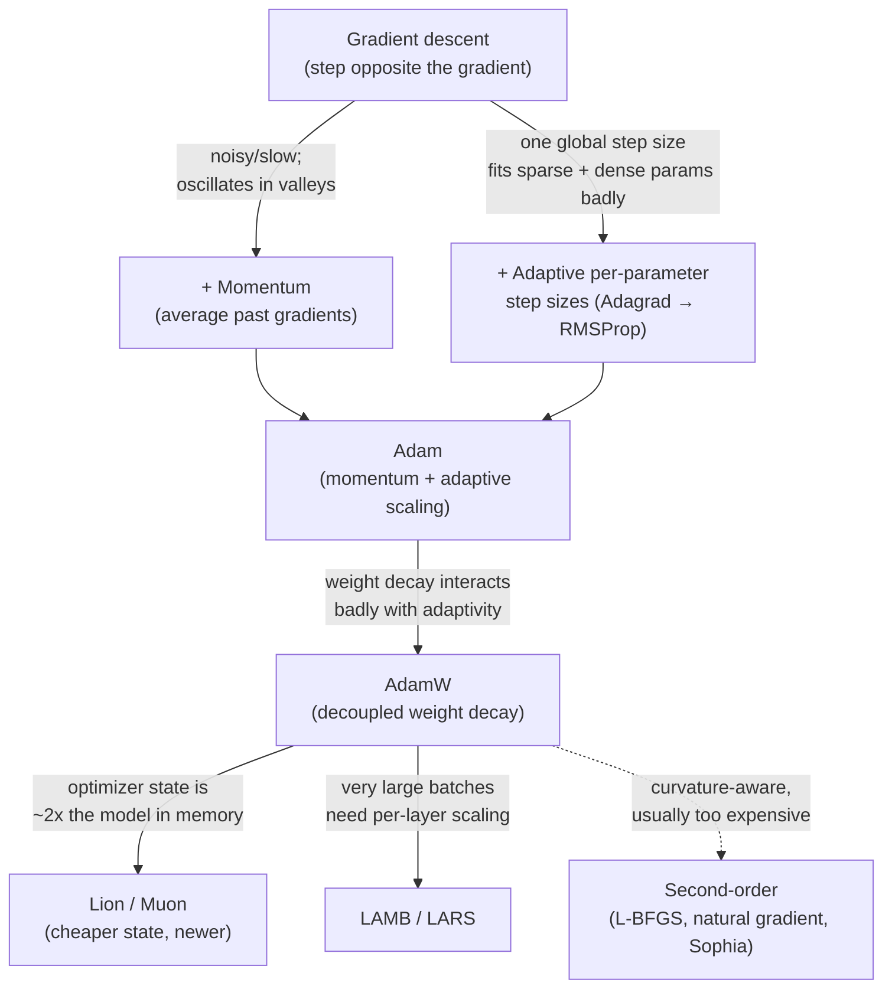

# 优化算法

根据本文的基本原理, 从逻辑回归到数万亿参数的专家混合模型**损失函数**(一个数字衡量模型的预测是多么错误;见[loss-functions.md](loss-functions.md)优化算法是"调整参数"部分. 这份文件涵盖了从第一原则到2026年实际使用的边界模型训练.

整个家庭最好理解为一个单一的想法"损失下降步骤"连续的改进被上来解决特定的问题.下面的图表是整个文件的地图;每个箭头是"...但这有问题,所以我们添加了:".



## 渐进下降:基层情况

**定义.**渐进降低是一种减小函数的反复步骤,以减少它最快的方向.

**起源.**这种方法是19世纪的数学 (考希,1847) 对一个非常不同的问题 (解决方程系统) 应用;其用于训练神经网络的使用可以追溯到1980年代的后扩散时代工作 (Rumelhart,Hinton和Williams,1986),该方法为计算损失函数的梯度提供了实际的方式,与多层网络中的每个参数相对于.

**核心机制.**输出函数 L(θ) 告诉你模型在训练示例中平均表现得多差,对于给定的设置 θ.**缩**L(θ) 是对每个参数的部分衍生物向量*最强的增长*为了减少损失,你会朝着相反的方向走.

```
θ ← θ − η · ∇L(θ)
```

现在** ()**是什么?**学习率**一个小的正数控制你迈出了多大的步骤.这个单一行是几乎所有深度学习培训的机械核心.

通过:在每一步,你计算了损失会如何改变,如果你轻微推进每个参数,然后你推进每个参数,

**具体的一步步例子.**假设整个"模型"是单个参数 θ,损失是 L(θ) = θ2 (一个抛物线,其最小值为 θ = 0).梯度是 L = 2θ.从 θ = 5,以 η = 0.1:

- 步骤1:梯度 = 2·5 = 10;更新 θ ← 5 − 0.1·10 = 4.0.
- 步骤2:梯度=2·4=8;更新 θ ← 4 −0.1·8 = 3.2. 现在的损失是10.24.
- 步骤3:梯度=2·3.2=6.4; θ ← 3.2 −0.64=2.56. 现在的损失为6.55.

每一步都向0 (最小) 移动 θ,步骤自动得到 *较小的*现在想象一下,这不是一个参数,而是数十亿个参数同时发生,每个参数都有自己的部分衍生,你有了训练每个模型的机械心脏. 另外,注意的是 η = 1.1 相反会发生什么:步骤 1将给 θ ← 5 − 1.1·10 = −6,*进一步*这是从一个太大的学习率,具体的分歧.

只有在每个步骤前使用多少数据来估计L的不同:

- **批次 (或"全批次") 梯度下降**计算梯度使用*整体*训练设置在一步前. 这给出了准确的梯度,但对于任何比玩具大大的数据集来说是非常缓慢的,而且需要记忆.
- **缩梯度下降 (SGD)**通过一个*单身*随机选择的每步训练示例. 这种方法是廉价的每步训练,并将噪音注入轨道 (这可以帮助逃离浅的本地最小值),但每步梯度估计非常有噪音,因此到最低的路径是的.
- **迷你批次梯度下降**现在几乎普遍使用的实际中途:每步计算一个小的随机子集中的梯度 (通常是"迷你批量",通常是数以数万个) 这使现代平行硬件 (GPU/TPU 构建以同时进行许多类似的乘法) 损失得很大,并且比单例 SGD 产生了较少噪音的梯度估计.在现代使用中,"SGD"是宽松地用来表示"迷你批量梯度下降,可选的是与动力"

**为什么这很重要.**梯度下降 (及其微量级形式) 是唯一的优化策略,它可以扩展到数十亿参数的模型,因为它只需要本地信息 (梯度) 而不是任何全球的损失表面的视图 ("损失景观" 损失函数的形状与所有参数值相比绘制;一个形,高维度的表面你试图找到一个低点).

**现状.**无条件地,不是原始的SGD,而是基板,下面的每个优化器都建立在.

## 动力

**定义.**动力积累了过去梯度的运行平均值,并使用该平均值而不是仅仅是当前梯度来确定步骤方向.

**起源.**波利亚克 (1964) 在数值优化文献中;自1980年代至90年代以来广泛使用的SGD与momentum形式适应神经网络培训.

**核心机制.**保持速度向量v,更新每一步为:

```
v ← β·v + (1 − β)·∇L(θ)
θ ← θ − η·v
```

 (β,通常是~通过:如果你只对当前梯度进行反应,你会保留最近梯度方向的"记忆"并将其与新的方向混合.如果梯度继续以大致相同的方式指向,速度会增加,你会朝着那个方向移动更快.如一颗滚球向下滚动,并获得速度.如果梯度方向逐步翻转 (在损失景观的狭窄谷中常见的模式),振荡会部分取消,减弱了 SGD 在这些区域中显示的条.

对于文法的说明,因为它让人们在比较教科书方程与实际代码时感到丧:上面的表格 (与`(1 − β)`因素是*指数移动平均值*速度是过去梯度的真实权重平均值.*经典*例如,PyTorch的内置SGD优化器使用的Polyak形式省略了这个因素`v ← β·v + ∇L(θ)`所以速度积累而不是平均值,有效步骤大小大约是1/(1−β) 两者等于重新扩展学习速度,这就是为什么两者都在文献中交换起来;当论文中的方程不完全匹配你的框架中的方程时,不要抛弃.

**为什么这很重要.**简单的SGD在损失景观中缓慢和振荡,在一方向的曲率,在另一方向的曲率浅 (神经网络损失的非常常见形状). 动力使这一情况平滑,并且在不需要额外的梯度计算的情况下大幅加速了化.

**尼斯特罗夫加速梯度 (NAG)**(Nesterov,1983年,适应了2010年代初的深度学习训练) 是一个改进:*之后*通过应用当前速度 (一个"前景"梯度). 这给优化器在过射之前,而不是之后,更有可能纠正路径. 在实践中,NAG对经典动力提供了适度,一致的改善,并且在大多数训练框架中是一种标准选择.

**现状.**虽然目前的LLM培训中没有单独使用 Momentum,但其积累理念被入了亚当和其下游的一切 (见下面).

## 适应学习率方法

动力仍然使用了*其他*学习率为每一个参数.但在一个巨大的网络中,一些参数 (例如,与罕见的特征或罕见的激活路径相关的参数) 比其他更少,更稀疏的梯度信号.固定的全球学习率是不适合同时的.这种方法给每个参数自己的有效学习率,根据个人收到的梯度历史.

### 亚达格拉德

**起源.**杜奇,哈桑和歌手 (2011).

**核心机制.**适应分为每个参数的学习速度,以此参数的过去梯度的平方根的平方根:

```
G ← G + ∇L(θ)²          (element-wise, accumulated over all steps so far)
θ ← θ − η / (√G + ε) · ∇L(θ)
```

 (epsilon) 是一个小常数,防止零分. 通过:历史上获得大梯度的参数得到了有效步骤大小缩小 (他们的G积累快);很少获得大梯度的参数保持了相对较大的有效步骤大小.这对于稀缺的特征非常好 (使用包字样式输入的早期NLP模型),但对于长时间的训练运行具有致命的缺陷:G只会增长,因此有效学习率单调缩到零,训练最终会停滞.

**现状.**曲式衰变问题,仍然偶尔用于具有真正稀疏梯度的曲式问题.

### 子

**起源.**杰弗里·希顿在2012年未发表的Coursera讲座中介绍了它 (一个"纸"是著名的幻灯片,而不是杂志出版物)

**核心机制.**通过使用一个 *指数移动平均值*平方梯度而不是运行总数:

```
G ← β·G + (1 − β)·∇L(θ)²
θ ← θ − η / (√G + ε) · ∇L(θ)
```

通过:因为G现在是一个衰退的平均值而不是不断增长的数量,旧梯度"老化"而不是永久缩小未来的步骤. 这使得Adagrad的适应性学习率利没有停滞.

**现状.**今天很少直接使用,但是亚当 (下面) 的两个直接数学祖先之一.

### 亚当

**定义.**亚当 (Adaptive Moment Estimation) 结合动力 (梯度的移动平均值"第一时刻") 和RMSProp式的适应性扩展 (二次梯度的移动平均值"第二时刻").

**起源.**基恩玛和巴,"亚当: Stochastic优化方法" (2015年初发布为预印2014年底).

**核心机制.**

```
m ← β₁·m + (1 − β₁)·∇L(θ)               (first moment: momentum)
v ← β₂·v + (1 − β₂)·∇L(θ)²              (second moment: RMSProp-style)
m̂ ← m / (1 − β₁ᵗ)                        (bias correction)
v̂ ← v / (1 − β₂ᵗ)                        (bias correction)
θ ← θ − η · m̂ / (√v̂ + ε)
```

典型默认: β1 = 0.9, β2 = 0.999. 通过:m追踪最近的平均值 *方向*向 (momentum);v跟踪最近的平均值*度二*根据参数的梯度 (适应性扩展,如RMSProp). 分割m̂为√v̂意味着:在平滑梯度方向上移动,但对于最近的梯度大小的参数采取较小的步骤 (它们已经变化很快,所以要更加小心) 和较大的相对步骤.对小,一致的梯度的参数进行较大的相对步骤.偏差纠正术语 (分为1 − βt,其中t是步数) 存在于m和v在零开始,因此在早期步骤中偏向于零.

**记忆成本,做成混凝土.**观察亚当保持*两人*对于一个具有混合精度训练的N参数模型,一个常见的会计是,参数本身,它们的梯度和亚当的两个时刻缓冲器,每参数需要16字节的顺序 (确切的数字取决于精度选择,但关键点是乘数).对于一个70亿参数模型,仅仅是训练状态的内存太字节远超过模型的自身权重,这正是为什么[distributed-training.md](../05-training-methodology/distributed-training.md)为了实现这一目标, 美国政府花费了大量的精力,

**为什么重要。** Adam 把此前十年优化器研究中两个最有用的特性(来自动量的方向平滑、来自 RMSProp 的逐参数缩放)结合进同一个优化器,只需极少调参就能在非常广泛的架构和问题上"开箱即用"。这使它成为 2015-2020 年深度学习热潮中大多数情况下的默认选择,而它的后代(下文的 AdamW)截至 2026 年末仍是训练大语言模型的默认选择。

**现状.**亚当W (下面) 已经有效地取代了普通亚当的大型培训,但亚当仍然在较小规模和非LLM深度学习工作中非常常见.

### 脱的体重衰减

**定义.**AdamW是体重衰减的Adam (一个调节技术,每步将体重缩小到零,从而阻止过度大的参数值见[regularization-techniques.md](regularization-techniques.md)) 作为一个*单独*步骤,与基于梯度的更新分离,而不是折叠成梯度本身.

**起源.**洛希洛夫和哈特, "脱节体重衰减规律化" (2019).

**核心机制.**在经典L2调节的SGD中,加减权重与加减值的术语相当,并且通过简单地在更新前加 λθ在梯度上实现.但在亚当中,这意味着减权重的术语被除了√v̂以及其他所有参数*减少*减肥是减肥的意图反向的 (它应该以不论其梯度有多杂的速度缩小所有权重到零).而亚当W则在适应量化尺度机器之外,将减肥作为其自己的独立减法:

```
θ ← θ − η·(m̂ / (√v̂ + ε) + λ·θ)
```

通过:适应梯度步骤和"缩小一切"步骤现在是独立的操作,所以权重衰减行为是它应该的方式 (一个恒定的比例拉向零) 无论参数的梯度历史.

**为什么重要。** 这修复了多年来 Adam 与正则化结合方式中一个隐蔽但真实的缺陷,并以几乎可以忽略的额外成本,在经验上带来明显更好的泛化能力(即在模型未见过的数据上的表现,而不只是记住训练数据)。这就是为什么截至 2026 年末,大多数主要 LLM 预训练仍以 AdamW(而非 Adam)作为标准优化器(下文的 Muon 是前沿规模上第一个重要例外)。

**现状.**亚当W是目前生产的几乎所有基于Transformer的模型的预训练和精细调节的默认优化器选择.

## 较新的优化器:狮子,索菲亚,LAMB/LARS

### 狮子

**起源.**等 (谷歌), "优化算法的象征性发现" (2023)  特别,狮子通过一个自动化程序搜索过程发现了可能更新规则的大量空间,而不是手动取而来.

**核心机制 (简单).**狮子只追踪一个动力周期 (没有像亚当这样的第二时/变量追踪),而不是使用原始动力值来更新,它只使用其*标志*根据学习速度进行的规模:

```
θ ← θ − η · sign(β₁·m + (1 − β₁)·∇L(θ))
```

通过:每个参数每步 (η) 移动的速度在目前的方向上是相同的.  没有参数的规模扩展. 这是一个比亚当的更简单的更新规则,使用了优化状态内存的半个 (没有v 进行跟踪),这在100B+参数模型的规模上很重要,优化状态可以占总内存的很大一部分.

**现状。** 一些机构将其用于大规模训练,据报道在部分预训练中以更低的内存成本达到或略超 AdamW,但并未取代 AdamW 成为默认选择;截至 2026 年末,其采用是真实存在的,但相对 AdamW 仍属少数。

### 索菲亚

**起源.**等人",索菲亚:语言模型预训练可扩展的二级优化器" (2023).

**核心机制 (简单).**索菲亚是对第二级方法的轻量级近似 (见下) 它估计曲率 (梯度本身在变化速度,即大约是赫西亚的角形,第二次衍生物的矩阵) 便宜,并使用它进一步调整每参数步骤尺寸超出亚当的v术语捕获的,通过剪切机制来保持估计稳定.

**现状。** 原论文的预训练实验报告了相对 AdamW 的加速;截至 2026 年末,在原作者基准之外的采用仍然有限——应视为有前景,但(尚)不是业界默认。

### Muon

**起源。** Jordan 等(2024),此后在 2024-2025 年间有一系列扩展和改进工作;在 Moonshot 的 Kimi K2(2025 年 7 月)中以 **MuonClip** 的形式扩展到万亿参数规模训练。

**核心机制(简述)。** Muon 专为网络内部的二维权重*矩阵*(注意力层和前馈层中的大矩阵——见 [transformer-architecture.md](../03-deep-learning-architectures/transformer-architecture.md))设计,把它们的更新当作一个矩阵来处理,而不是一袋彼此独立的数字。它取动量平均后的梯度,先施加一个**正交化(orthogonalization)**步骤,再将其用作更新——正交化用几次 **Newton–Schulz 迭代**廉价地近似(一小段矩阵乘法循环,把矩阵推向最接近的正交矩阵,即把它的所有奇异值都变为约等于 1),而不是做昂贵的精确分解。直观地说,这会重新平衡更新,让它在矩阵可以变化的所有不同"方向"上以更均匀的力度推进,而不是让少数几个主导方向吸收大部分步长——经验上,这能让训练在每单位计算上迈出更有效的步子。Muon 通常与 AdamW 之类的标准优化器搭配使用,后者负责非矩阵参数(嵌入、偏置、归一化缩放系数),因为这些参数没有可供利用的二维结构。

**规模化:MuonClip 与 QK-clip(2025)。** 在超大规模下使用 Muon 的主要障碍,最终被证明是一种特定的不稳定性:**注意力 logit 爆炸**。注意力 logit 指 softmax 之前的原始分数 q·k(见 [transformer-architecture.md](../03-deep-learning-architectures/transformer-architecture.md));如果 query 和 key 的权重矩阵 W_Q 和 W_K 变得很大,一些 logit 就会变得极大,softmax 饱和,训练会出现损失尖峰甚至发散。Moonshot 用于训练 Kimi K2(约 1T 总参数 / 32B 激活参数的混合专家模型——见 [mixture-of-experts.md](../03-deep-learning-architectures/mixture-of-experts.md))的解决办法是 **MuonClip** = Muon + **QK-clip**。其大致流程如下:

```
每个优化器步之后,对每个注意力头 h:
    m_h = 头 h 在本批次中产生的最大注意力 logit (q·k)
    若 m_h > τ:                               (τ = 固定阈值)
        把 W_Q,h 和 W_K,h 按乘积为 τ / m_h 的两个因子缩小
```

逐项解读:由于 logit(大致)是 query 与 key 的乘积,把两个权重矩阵一起缩小、使乘积缩小为原来的 τ / m_h,就能把最大的 logit 拉回到阈值,而表现正常的头则不受影响。注意这里裁剪的对象:是更新之后的*权重本身*——而不是像普通梯度裁剪(见下文)那样裁剪梯度。它是一种只在问题出现的地方、出现的时候才施加的定向修复。有了这一补充,Kimi K2 成为被广泛引用的、证明 Muon 系优化器能在万亿参数规模上工作的范例。

**为什么值得收录。** Muon 是自 Adam 以来最早在大规模语言模型预训练中获得真正的、被广泛报道的实际应用、而不只是停留在基准测试上的优化器之一——据报道,它在有意义的规模上提高了计算效率,同时比 Adam 占用更少的优化器状态内存(对它所处理的矩阵只需维护一个动量缓冲区)。到 2026 年末,它已不再只是"有前景的挑战者":除 Kimi K2 外,DeepSeek 的 V4 技术报告(2026 年 4 月,据报道)称 V4 系列模型(总参数最高达 1.6T)使用 Muon 训练。尽管如此,AdamW 仍是最常见的默认选择,而 Muon 的履历仍只是少数几次前沿训练,而非多年的广泛使用。

**现状。** 已在至少两个开放权重前沿模型系列中于前沿规模上得到生产验证(Kimi K2,通过 MuonClip;DeepSeek-V4,据报道)。但它仍不是通用默认——AdamW 依然是稳妥、无处不在的选择,尤其是在微调和较小规模训练中,而且 Muon 自身的非矩阵参数仍依赖 AdamW。

### 长批训练

**起源.**拉斯:你,吉特曼,和金斯堡 (2017);LAMB:你等 (2019,专门适用于BERT规模的预训).

**核心机制 (简单).**在训练非常大的批量时 (需要有效地使用数千个加速器并行),单一的全球学习率变得不适合,因为不同层面的权重标准与梯度标准比率非常不同.LAMB和LARS将每个层的更新量重新调整为该层的参数标准与更新标准的比例,以便与其自身规模相比,没有单层的权重发生过度快的变化.LAMB专门将这一技巧放在亚当的每参数适应性扩展量上.

**为什么这很重要.**这些使得扩展批量到数万个,而没有培训变得不稳定,这使得组织通过在非常大的加速器集群中并行地减少了预训时间.

**现状.**大规模预训练的最大批次阶段标准;通常不用于细调或小批次训练,而AdamW仍然是标准的.

## 学习率时间表

几乎所有现代培训课程都随着时间的推移而变化**时间表**.

- **步骤衰退**在预设的时代/步骤里程碑时,以固定因素 (例如 ×0.1) 降低 η.[cnn-family.md](../03-deep-learning-architectures/cnn-family.md)).
- **子**在训练过程中从初始值下降到 (接近) 零的可西因曲线后轻松分解 η.广泛用于LLM预训练,因为它避免了步骤衰变的突然跳跃,其形状是一个单一,易于调整的参数 (总步骤).
- **线性加热**在主程开始之前,在 (或接近) 零开始 η,并在训练的第一部分 (通常是总步骤的1-5%) 上线上升.
- **预热 + 衰减组合**——当今 LLM 预训练的标准配方是线性(有时更短、更激进)预热,随后是余弦衰减(或越来越多地采用更简单的线性衰减),降到峰值学习率的一小部分。这种组合形状——先爬升,再保持或缓慢衰减,然后更陡地衰减——截至 2026 年末在各主要预训练中几乎是通用的。
- **热化稳定衰退 (WSD)**一个新型,越来越受欢迎的变体,*常数*实际上,它具有实用性,即"稳定"阶段在任何一段时间都会产生可用的检查点 (你没有像曲线的方法一样承诺固定整体训练长度,这将终点成曲线形状),并且你可以在决定停止时分分离一个短的衰退阶段.

快速的直觉*为什么?*时间表是很重要的:学习速度控制着探索和定居之间的紧张性. 起初,你想要在损失景观中迅速移动到一个好地区 (但不太大,你会分歧,因此温暖化会放松你). 在训练中晚些时候,你希望小步骤确切地定居在一个好的最低值中,而不是跳转 (因此衰退).

## 梯度裁剪

**定义.**在应用更新之前,梯度切割将梯度 (或每个参数梯度) 的大小限制,防止任何单个步骤过大.

**为什么重要。** 深度网络——尤其是循环网络(见 [rnn-lstm-gru.md](../03-deep-learning-architectures/rnn-lstm-gru.md))以及处于训练早期的大型 Transformer——偶尔会产生幅度极大的梯度(即"梯度爆炸"——梯度在经过许多层或时间步反向传播时,其尺度以乘法方式急剧膨胀;与之相反的失效模式是"梯度消失",即尺度缩向零)。一个巨大且未被裁剪的梯度可能造成一次灾难性的更新,破坏甚至毁掉数天的训练进展。**梯度范数裁剪(gradient norm clipping)**——标准做法——会重新缩放整个梯度向量,使其总体范数(长度)永不超过固定阈值,保留方向但限制幅度。如今这已是 LLM 预训练中几乎通用的安全机制,无论当前是否正在发生爆炸,每一步都会应用。(不要与上文 Muon 一节中的 QK-clip 混淆,后者重新缩放的是注意力*权重*,而不是梯度。)

## 第二阶段方法:L-BFGS和自然梯度

**定义.**第二级优化方法使用曲率信息 (赫西式或接近它) 来采取更聪明,更知情的曲率步骤,而不是仅仅依赖于第一派生梯度.

**子子**(限度记忆的布莱登弗莱彻戈德法尔布桑诺,一个比深度学习更早的经典数值优化算法) 使用有限的过去梯度历史接近 (反向) 赫西亚,提供了一步方向,解释了损失表面的曲线程度,而不是的程度. **自然梯度下降**通过Fisher信息矩阵重新调度梯度步骤,该矩阵对模型的几何性进行了计算.*输出分布*而不是原始参数空间,更有原则性但更昂贵的"向下降"概念.

**为什么他们很少在法学士级使用.**两个方法都需要计算,存储或接近一个与矩阵相关的东西,在极限中,是 (参数数数量) 的尺寸 () 完全不可能实现,即使是约为数十亿参数的网络.即使使这些方法为小/中型模型实用的"限量内存"近似也没有达到现代LLM参数计数,而迷你批量训练的性使得精确的曲线估计不靠谱.第一级适应方法 (Adam/AdamW) 通过每参数变化跟踪便宜地获得"足够"的曲线意识,这就是为什么它们在理论上变化程度不那么复杂的规模中取得了成功.

## 总结表

| 算法 | 年份 | 关键创新 | 是否仍然重要(2026)? |
|---|---|---|---|
| (批量/小批量)梯度下降 | 1847 / 1986(用于神经网络) | 利用局部梯度的基础迭代最小化 | 是——通用基础 |
| 动量 / NAG | 1964 / 1983 | 利用梯度历史平滑轨迹 | Adam 的组成部分;很少单独使用 |
| Adagrad | 2011 | 逐参数自适应学习率 | 已被取代(单调衰减缺陷) |
| RMSProp | 2012 | 衰减平均的自适应缩放(修复 Adagrad) | 很少单独使用;Adam 的前身 |
| Adam | 2015 | 动量 + RMSProp 式缩放相结合 | 常见,尤其是在 LLM 预训练之外 |
| AdamW | 2019 | 将权重衰减与自适应梯度步解耦 | LLM 训练的主导默认选择(Muon 现为前沿规模上的替代方案) |
| Lion | 2023 | 基于符号的更新,优化器内存为 Adam 的一半 | 有实际采用,但属少数 |
| Sophia | 2023 | 轻量级二阶曲率估计 | 有前景,采用有限 |
| Muon / MuonClip | 2024 / 2025 | 正交化(Newton–Schulz)矩阵更新,状态少于 Adam;QK-clip 保证大规模稳定性 | 已在前沿规模上得到生产验证(Kimi K2;DeepSeek-V4,据报道);尚非通用默认 |
| LAMB / LARS | 2017 / 2019 | 面向大批量的逐层学习率重缩放 | 大批量预训练阶段的标准做法 |
| L-BFGS / 自然梯度 | 深度学习之前 | 真正的二阶/曲率感知步长 | 大规模下罕见——成本过高 |

## 与其他算法的关系

- 这里的每个优化器都用于最小化 [loss-functions.md](loss-functions.md) 中定义的损失函数。
- 权重衰减(AdamW 中使用)是一种正则化技术——经典 L2 正则化与自适应优化器中解耦权重衰减的区别,在 [regularization-techniques.md](regularization-techniques.md) 中有更深入的讨论。
- LAMB/LARS 大批量训练与 [distributed-training.md](../05-training-methodology/distributed-training.md) 直接相关:那里讨论的是*为什么*需要大批量(为了并行使用许多加速器),而本文件关注的是*如何*让大批量训练保持稳定。
- Muon/MuonClip 的万亿规模验证是在一个混合专家模型上完成的——见 [mixture-of-experts.md](../03-deep-learning-architectures/mixture-of-experts.md);QK-clip 作用于 [transformer-architecture.md](../03-deep-learning-architectures/transformer-architecture.md) 中介绍的注意力 logit。
- 梯度裁剪对循环架构尤为重要——梯度消失/爆炸问题在其最初、最尖锐的背景下的讨论见 [rnn-lstm-gru.md](../03-deep-learning-architectures/rnn-lstm-gru.md)。

## 来源

- Cauchy, "Méthode générale pour la résolution des systèmes d'équations simultanées"(1847)
- Rumelhart, Hinton, Williams, "Learning representations by back-propagating errors"(1986)
- Polyak, "Some methods of speeding up the convergence of iteration methods"(1964)
- Nesterov, "A method for solving the convex programming problem with convergence rate O(1/k²)"(1983)
- Duchi, Hazan, Singer, "Adaptive Subgradient Methods for Online Learning and Stochastic Optimization"(2011)
- Hinton, RMSProp, Coursera 神经网络课程讲义(2012,未正式发表的幻灯片——按惯例被广泛引用)
- Kingma, Ba, "Adam: A Method for Stochastic Optimization"(2014/2015)
- Loshchilov, Hutter, "Decoupled Weight Decay Regularization"(2019)
- Chen 等, "Symbolic Discovery of Optimization Algorithms"(2023)[Lion]
- Liu 等, "Sophia: A Scalable Stochastic Second-Order Optimizer for Language Model Pre-training"(2023)
- Jordan 等, "Muon: An optimizer for the hidden layers of neural networks"(2024)[Muon;在后续扩展工作中被报道和改进]
- Moonshot AI, Kimi K2 技术报告(2025)[MuonClip / QK-clip;约 1T 参数的 MoE]
- DeepSeek-AI, DeepSeek-V4 技术报告(2026 年 4 月,据报道)[V4 训练使用 Muon]
- You, Gitman, Ginsburg, "Large Batch Training of Convolutional Networks"(2017)[LARS]
- You 等, "Large Batch Optimization for Deep Learning: Training BERT in 76 minutes"(2019)[LAMB]
- Amari, "Natural Gradient Works Efficiently in Learning"(1998)
