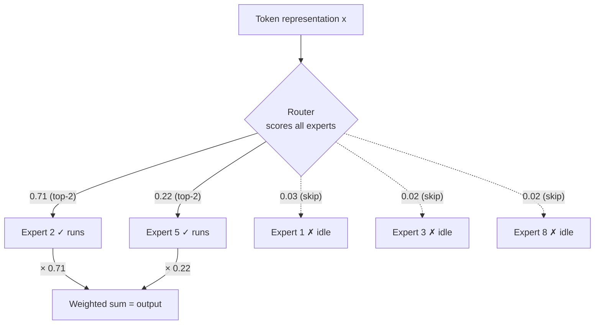

# 混合专家(Mixture of Experts)

混合专家(Mixture of Experts,MoE)是一种架构模式,它把模型的总参数量与处理单个词元的计算成本解耦——让模型拥有的参数远多于它在任一输入上实际用到的参数。这是大多数前沿 LLM 相对 2017 年原始 Transformer 所做的第二大改动(第一大改动是 RoPE 式位置编码),理解它需要 [transformer-architecture.md](transformer-architecture.md) 中的 Transformer 背景知识。

## 动机:让参数量与计算量脱钩

**问题所在。** 在标准("稠密")Transformer 中,每个参数都参与处理每个词元——模型参数量翻倍,处理每个词元所需的计算量(以浮点运算次数,即 FLOPs 计)也大致翻倍,训练和推理时都是如此。这是一种僵硬的耦合:你无法在不付出"每词元更多计算"的情况下获得"更多知识容量",尽管直觉上,一个超大模型所"知道"的很多东西可能只与其输入中的一小部分相关(专门的事实、特定的语言、特定的领域)。

**MoE 的思路。** 把 Transformer 模块中单个稠密的前馈子层(见 [transformer-architecture.md](transformer-architecture.md))替换为许多并行的前馈子网络——称为**专家(experts)**——外加一个小的**路由器(router)**(或称"门控")网络:对每个词元,路由器只选出一小部分专家(通常是几十个甚至更多专家中的 1-2 个)来实际处理该词元。其余专家对该词元完全跳过,因此它们的参数存在(计入模型总规模和内存占用),但对这个词元不产生任何计算成本。

用一个具体例子说明:设想一个模型每个 MoE 层有 8 个专家,每个专家与普通前馈子层一样大,但路由器每个词元只激活 2 个专家。该层的总参数量大约是稠密层的 8 倍,而每词元的计算成本只有大约 2 倍——你得到了一个总容量大得多的模型("知识"分散在众多专家中),而处理每个词元所需的计算并没有成比例增加。这就是 MoE 的核心价值主张:更多参数(经验上通常也意味着更好的质量),而计算成本更接近一个较小的稠密模型。

## 路由机制:top-k 门控

**核心机制。** 路由器通常是一个简单的线性层,它接收词元的隐藏表示,为每个专家打一个分数;softmax(或更简单的归一化)把这些分数转换为权重,只有得分最高的 top-k 个专家会真正运行,它们的输出(按路由器分数加权)组合成该层对这个词元的最终输出。

```
scores = x · W_router
top_k_experts, weights = TopK(softmax(scores), k)
output = Σ_{i in top_k_experts} weights_i · Expert_i(x)
```



逐项解读:对每个词元,路由器实际上是在问"我的哪些专家与这个具体输入最相关?",并且只为运行这些专家付出计算成本(上图中的实线箭头——比如专家 2 和 5);其余专家对这个词元保持空闲(虚线箭头)。由于这一决策是逐词元做出的(而不是逐序列或逐批次),同一序列中的不同词元可以被路由到完全不同的专家——这与"不同类型的内容(比如代码与散文,或不同语言)可能受益于专门子网络"的直觉天然契合。关键的账目是:8 个专家、top-2 路由时,模型拥有单专家层约 8 倍的参数,却只付出约 2 倍的每词元计算,因为对任一词元,8 个专家中有 6 个被跳过。"你拥有的参数"与"你每个词元付出的计算"之间的这道差距,正是 MoE 存在的全部理由。

## 负载均衡损失

**它要解决的问题。** 如果不加约束,一个纯粹为最小化模型主损失而训练的路由器,很容易塌缩为几乎所有事情都只用少数几个"宠儿"专家,让大多数专家长期训练不足,使拥有众多专家的意义完全落空——这是典型的"富者愈富"动态:用得越多的专家获得越多的梯度信号,于是对路由器越有吸引力。

**核心机制。** 在训练目标中加入一个辅助的**负载均衡损失(load balancing loss)**,惩罚路由器把太多词元送给太少的专家——通常的设计是鼓励在一个批次内,路由到每个专家的词元比例大致相等。该损失以一个较小的权重系数加到主任务损失上(而不是取代它),从而把路由行为推向均衡,同时不会压过模型的主要训练信号。

**为什么重要。** 没有负载均衡,MoE 训练在经验上是不稳定的,且极易陷入上述的专家塌缩失效模式;负载均衡损失几乎是所有实用 MoE 训练配方的标准组成部分。

### 无辅助损失的负载均衡(基于偏置)

**辅助损失的问题。** 负载均衡损失有效,但它内含一个冲突:它的梯度流入的是与主损失相同的路由器权重,因此模型会不断被推向*均衡*而非*最优*的路由选择。权重设得太低,专家会塌缩;设得太高,质量会受损。调这个系数是众所周知的痛点。

**起源。** Wang 等(DeepSeek),"Auxiliary-Loss-Free Load Balancing Strategy for Mixture-of-Experts"(2024);在 DeepSeek-V3(2024 年 12 月)中被大规模采用。

**核心机制。** 给每个专家 i 一个偏置 bᵢ,它*只在选择使用哪 top-k 个专家时*被加到路由分数上——而在给专家输出加权时不使用:

```
selected  = TopK( scoreᵢ + bᵢ , k )                 (偏置影响"选谁")
output    = Σ_{i in selected} gateᵢ(scoreᵢ) · Expert_i(x)   (偏置不影响"占多少权重")
每个训练步之后,对每个专家 i:
    若专家 i 收到的词元多于其应得份额:  bᵢ ← bᵢ − γ
    若少于应得份额:                   bᵢ ← bᵢ + γ
```

逐项解读:这些偏置根本不是通过梯度下降学习的——它们由一条简单的反馈规则调整,γ 是一个固定的小步长。一个有用的直觉是"高峰溢价":过载的专家被小幅"涨价"(偏置下调),于是那些在它与另一个专家之间几乎无所谓的边缘词元会流向较空闲的那个;空闲的专家则获得"折扣"。由于偏置只影响*选择*,且从不进入损失函数,主训练目标不会被扭曲——路由器仍然纯粹为做出好的预测而训练,均衡则由旁边一个独立的控制器来保证。DeepSeek 报告称,在均衡程度相当的情况下,其质量优于传统辅助损失(根据 DeepSeek-V3 技术报告,它仍保留了一个非常小的补充性均衡项作为保险)。

**现状。** 自 DeepSeek-V3 把它纳入前沿规模的训练配方以来,该方法颇具影响力并被广泛讨论;但它并未完全取代辅助损失——DeepSeek-V3 本身就把偏置控制器与一个极小的辅助项搭配使用,而传统辅助损失在其他地方仍很常见。

## Switch Transformer

**起源。** Fedus、Zoph、Shazeer(Google),"Switch Transformer: Scaling to Trillion Parameter Models with Simple and Efficient Sparsity"(2021),建立在更早的、面向 LSTM 的稀疏门控 MoE 工作(Shazeer 等,2017)之上。

**核心贡献。** Switch Transformer 把路由简化到了极致:top-1 路由(每个词元恰好只去一个专家,而不是若干专家的混合)。作者证明,在配合适当的负载均衡和其他稳定化技巧的情况下,它仍能稳定训练,同时比早期 MoE 工作中常见的 top-2 或更多路由更简单、计算效率更高。这一简化是让 MoE 在超大规模上变得实用的关键一步。

**为什么重要。** Switch Transformer 证明了 MoE 架构可以扩展到前所未有的总参数量(达到万亿级,在当时是一个惊人的数字),同时保持每词元计算成本可控,直接验证了 MoE 是一条无需成比例增加计算预算即可做大模型的可行路径。

## GShard

**起源。** Lepikhin 等(Google),"GShard: Scaling Giant Models with Conditional Computation and Automatic Sharding"(2020)。

**核心贡献。** GShard 的主要贡献与其说是路由算法本身,不如说是大规模实际训练 MoE 模型所需的分布式系统工程:把不同专家自动分片(切分)到许多加速器设备上,并高效地把词元路由到存放其所分配专家的设备——解决了"专家多到没有任何单个加速器能全部放下"这一实际问题。

**为什么重要。** GShard 的分片技术是此后几乎所有大规模 MoE 训练的基础设施,与 [distributed-training.md](../05-training-methodology/distributed-training.md) 中的分布式训练技术直接相关。

## Mixtral

**起源。** Mistral AI,"Mixtral of Experts"(2024,此前已于 2023 年底首次发布开放权重)。

**核心贡献。** Mixtral 是一个知名且被广泛使用的开放权重示范,证明 MoE 架构(具体而言,原始 Mixtral 8x7B 中每层 8 个专家、top-2 路由)相对于其激活计算成本能取得强劲性能,使 MoE 在"每推理 FLOP 的精度"上的优势在最大的闭源实验室之外也变得可感知、可复现。

**为什么重要。** Mixtral 的开放发布显著拓宽了更广泛的研究界和开源社区对 MoE 架构的实际动手理解与采用,而不再局限于此前发表过 MoE 研究的少数几家大型实验室。

### 细粒度专家与共享专家(2024 年以来的改进)

较新的开放权重 MoE 模型(DeepSeek-MoE 系列是被广泛引用的例子)从两个方面改进了基本设计,这对了解当前格局很有必要。其一,**细粒度专家(fine-grained experts)**:不用少数几个大专家,而用许多*更小*的专家,并让每个词元路由到其中更多个(例如 64 选 8,而不是 8 选 2)。其道理在于组合:专家更多、更小时,一个词元可被路由到的专家*组合*数量会急剧增长,在相同激活参数量下给模型更细粒度的专门化。其二,**共享专家(shared experts)**:指定一个或少数几个专家,让*每个*词元除了其路由到的专家外都必经这些专家。共享专家吸收每个词元都需要的通用计算(这样被路由的专家就不必各自重复学习这些内容),让它们能更干净地专门化。截至 2026 年末,这种"细粒度 + 共享"模式已成为高效 MoE 设计的常见模板,也是该领域在基本 Switch/Mixtral 思路之上持续进行渐进式架构改进的一个好例子。

## 2025-2026 年的趋势:总量更大,激活超稀疏

2025-2026 年最显眼的 MoE 趋势是:开放权重前沿 MoE 模型的*总*参数量持续上升,而每个词元的*激活*参数量大致持平——于是**激活比例**(激活参数 ÷ 总参数)降到了百分之几。处于这一区间的设计常被称为**超稀疏(ultra-sparse)** MoE。

| 模型 | 发布时间 | 总参数 | 每词元激活参数 | 激活比例(约) |
|---|---|---|---|---|
| Mixtral 8x7B(作为参照) | 2023 | ~47B | ~13B | ~28% |
| DeepSeek-V3 | 2024 年 12 月 | 671B | 37B | ~5.5% |
| Kimi K2(Moonshot) | 2025 年 7 月 | ~1T | 32B | ~3.2% |
| Qwen3.5-397B-A17B | 2026 年初 | 397B | 17B | ~4.3% |
| DeepSeek-V4-Flash(据报道) | 2026 年 4 月 | 284B | 13B | ~4.6% |
| DeepSeek-V4-Pro(据报道) | 2026 年 4 月 | 1.6T | 49B | ~3.1% |

逐项解读:在"AxxB"命名惯例中,Qwen3.5-397B-A17B 表示总参数 397B、激活(**a**ctive)参数 17B。比例一列只是两个报告数字的简单相除。这张表具体说明了什么:DeepSeek-V4-Pro 处理一个词元时触及的权重量与一个中等规模的稠密模型相当,而整个模型存储的参数是它的三十多倍。

**超稀疏为何变得可行。** 本文件上文和本知识库其他地方的若干要素叠加在了一起:细粒度 + 共享专家(更多、更小的专家使极低的激活比例仍有足够表达力);更好的负载均衡(基于偏置的均衡能让数百个专家都保持忙碌,而不与主损失相冲突);万亿参数规模下的训练稳定性工作(例如训练 Kimi K2 所用的 MuonClip 优化器——见 [optimization-algorithms.md](../01-foundations/optimization-algorithms.md));以及让巨大内存占用变得可承受的低精度格式(DeepSeek-V3 的 FP8 训练;OpenAI 的 gpt-oss 模型发布时其 MoE 权重原生采用 4 位 MXFP4 格式——见 [quantization.md](../06-inference-optimization/quantization.md))。超稀疏 MoE 还经常与混合注意力搭配使用(Qwen3-Next 和 Qwen3.5 把它与 Gated DeltaNet 层结合——见 [state-space-models.md](state-space-models.md)),使每个模块的前馈部分和序列混合部分在每词元成本上都很低。(DeepSeek-V3 还引入了多词元预测(Multi-Token Prediction,MTP)训练目标,其额外的预测头可兼作推测解码的草稿模型;这并非 MoE 特有,见 [speculative-decoding.md](../06-inference-optimization/speculative-decoding.md)。)

**它没有改变什么。** 内存问题变得*更糟*而非更好:一个 1.6T 参数的模型仍然必须存放在某处,即使每个词元只有 49B 参数在工作,这把部署推向多 GPU 服务、专家并行和激进的量化。此外,这些数字来自开发者自己的技术报告——这里的比较说明的是设计趋势,而不是质量排名。

### RL 微调中的一个麻烦

事实证明,对 MoE 模型做强化学习微调不如稠密模型稳定——据报道,一个原因是微小的权重更新就可能改变词元被路由到哪些专家,从而让 GRPO 式的逐词元重要性比率变得嘈杂;Qwen 的 GSPO(2025)转而在整个序列层面计算重要性比率并进行裁剪来解决这一问题(见 [rl-for-llms.md](../07-reinforcement-learning/rl-for-llms.md))。

## 当前前沿的使用模式

截至 2026 年末,多家前沿实验室在其最大的通用模型中使用 MoE 架构,上文讨论的每一个领先的开放权重前沿发布(DeepSeek、Kimi、Qwen、gpt-oss)都是 MoE;闭源前沿模型的架构大多未公开,因此其中 MoE 的占比并不为公众所知。随着目标模型规模增长,稀疏性带来的"每单位计算的精度"优势越来越有吸引力,因为 MoE 提供了一种持续扩大总容量、而不必让服务每个词元所需的(在前沿规模下非常昂贵的)计算成比例增长的方法。话虽如此,MoE 并不是放之四海皆准的默认选择:在较小规模和对延迟敏感的部署中,稠密模型仍然常见,因为 MoE 带来了实实在在的额外复杂性——路由/负载均衡机制、把专家分片到多个设备上的分布式系统复杂性(见 [distributed-training.md](../05-training-methodology/distributed-training.md)),以及不会因为每词元计算减少就随之缩小的内存占用(所有专家都必须可加载,尽管每个词元只运行其中几个),而这对服务成本很重要(见 [serving-and-batching.md](../06-inference-optimization/serving-and-batching.md))。

## 优势与局限

- 优势:在超大规模下,每计算 FLOP 的精度显著更高;模型总"知识容量"可以在很大程度上独立于每词元推理成本而增长;在多家实验室公开的架构中,已在前沿规模上被经验证明有效,如今激活比例已低至百分之几。
- 局限:完整模型的内存占用依然很大(所有专家都必须驻留在某处,即使某个词元用不到它们),即使计算成本占优,这对部署成本也很重要——而超稀疏设计让这一差距更大;训练不如稠密模型稳定、也更复杂(路由塌缩、负载均衡调参),RL 微调也有其 MoE 特有的不稳定性;分布式服务/训练基础设施比稠密模型复杂得多;路由决策有些不透明、难以解释。

## 对比表

| 系统 | 年份 | 关键创新 | 是否仍然重要(2026)? |
|---|---|---|---|
| 稀疏门控 MoE(基于 LSTM) | 2017 | 最早的 top-k 专家路由概念 | 历史意义——已被 Transformer MoE 取代 |
| GShard | 2020 | 跨设备的自动专家分片 | 是——基础性的分布式训练技术 |
| Switch Transformer | 2021 | 简化的 top-1 路由,万亿参数规模 | 是——路由简化这一谱系仍有影响 |
| Mixtral | 2023-2024 | 强有力的开放权重 top-2 MoE 示范 | 是——被广泛使用/引用的开放权重 MoE |
| DeepSeek-MoE / DeepSeek-V3 | 2024 | 细粒度 + 共享专家;无辅助损失(基于偏置)的均衡 | 是——许多 2025-26 年开放权重 MoE 的模板 |
| Kimi K2 | 2025 | 约 1T 总参数 / 32B 激活;用 MuonClip 训练 | 是——万亿规模的超稀疏 MoE |
| Qwen3-Next / Qwen3.5 | 2025-2026 | 超稀疏 MoE 与 Gated DeltaNet 混合注意力结合 | 是——旗舰开放权重系列 |
| DeepSeek-V4(据报道) | 2026 | 1.6T / 49B(Pro)与 284B / 13B(Flash) | 是——最新的大规模数据点 |

## 与其他算法的关系

- MoE 替换的是 Transformer 模块中的稠密前馈子层——该模块的完整结构见 [transformer-architecture.md](transformer-architecture.md)。
- 跨设备的专家分片是 [distributed-training.md](../05-training-methodology/distributed-training.md) 中模型/张量并行技术的一种具体应用。
- 基于偏置的负载均衡、MuonClip(见 [optimization-algorithms.md](../01-foundations/optimization-algorithms.md))以及用于 RL 的 GSPO(见 [rl-for-llms.md](../07-reinforcement-learning/rl-for-llms.md)),在某种程度上都是对 MoE 特有训练不稳定性的回应。
- 超稀疏 MoE 经常与混合线性注意力层搭配——见 [state-space-models.md](state-space-models.md)。
- MoE 在内存占用与计算之间的权衡与 [serving-and-batching.md](../06-inference-optimization/serving-and-batching.md) 和 [quantization.md](../06-inference-optimization/quantization.md) 直接相关,二者都讨论了部署超大模型的成本。

## 来源

- Shazeer 等, "Outrageously Large Neural Networks: The Sparsely-Gated Mixture-of-Experts Layer"(2017)
- Lepikhin 等, "GShard: Scaling Giant Models with Conditional Computation and Automatic Sharding"(2020)
- Fedus, Zoph, Shazeer, "Switch Transformer: Scaling to Trillion Parameter Models with Simple and Efficient Sparsity"(2021)
- Mistral AI, "Mixtral of Experts"(2024)
- Dai 等(DeepSeek), "DeepSeekMoE: Towards Ultimate Expert Specialization in Mixture-of-Experts Language Models"(2024)[细粒度 + 共享专家]
- Wang 等(DeepSeek), "Auxiliary-Loss-Free Load Balancing Strategy for Mixture-of-Experts"(2024)
- DeepSeek-AI, "DeepSeek-V3 Technical Report"(2024 年 12 月)[671B/37B;基于偏置的均衡;MTP;FP8]
- Moonshot AI, Kimi K2 技术报告(2025)[约 1T/32B;MuonClip]
- Qwen 团队, Qwen3-Next(2025 年 9 月)与 Qwen3.5(2026 年初)发布 [超稀疏 MoE;Qwen3.5-397B-A17B 据报道]
- OpenAI, gpt-oss 模型卡(2025 年 8 月)[MoE 权重采用 MXFP4]
- DeepSeek-AI, DeepSeek-V4 技术报告(2026 年 4 月,据报道)[V4-Pro 1.6T/49B;V4-Flash 284B/13B]
- Zheng 等(Qwen), "Group Sequence Policy Optimization"(2025)[GSPO]
