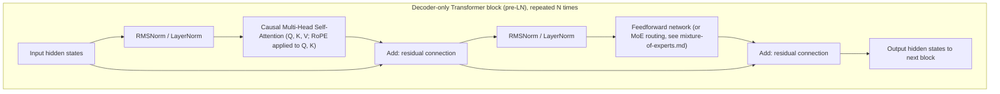

# Transformer架构

这是本知识库的基石文件。本库其他地方讨论的几乎所有大模型——[rlhf-and-alignment.md](../05-training-methodology/rlhf-and-alignment.md) 中的每一个 LLM、[04-generative-models](../04-generative-models/) 中涉及文本(以及越来越多地涉及图像/视频/音频)的每一个生成模型,以及 [06-inference-optimization](../06-inference-optimization/) 中的大多数推理优化技术——都是 Transformer 或其直接改编。本文件从第一性原理出发逐步构建这一机制:自注意力,然后是多头注意力,然后是位置编码,然后是三种主要布局变体(编码器-解码器、仅编码器、仅解码器)、pre-LN 与 post-LN 之争、对 2025-2026 年模块改进(门控注意力、局部/全局注意力、超连接)的简要介绍、从 2017 年原始论文到当今前沿模型的历史谱系,以及把架构选择与算力和数据预算联系起来的扩展定律(scaling laws)。

## 为什么需要注意

根据[rnn-lstm-gru.md](rnn-lstm-gru.md)根据Bahdanau/Long attention,一个seq2seq解码器可以回顾每个编码器位置,而不是依赖于一个瓶向量.但该设置中的编码器和解码器仍然是RNNs 处理其序列一次一次,每个步骤都取决于前一个.这有两个值得明确命名的后果:它固有的序列 (直到计算时间步骤50才可以计算49),这限制了它在构建的硬件上如何并行一次做许多独立计算 (GPU/TPU);它仍然遭受消失的梯度-超距离问题,因为过去的信息必须通过许多隐藏的序列状态更新流向一个词元的注意力.Transformer的核心机制是将整个信息在一个隐藏的状态中完全放弃,但不会影响整个重复状态.

## 自我注意,逐步增强

**目标.**为了在序列中的每个位置,生成一个新的表示,以动态的方式从其他位置中包含相关信息,基于内容而不是固定模式.

**问题,关键和价值观,从第一原则.**对于每个输入位置 (例如,一个词元的嵌入向量 查看"嵌入"的词典),模型通过乘以三个独立的学习权重矩阵来计算三个不同的向量:

```
q = x · W_Q      (query)
k = x · W_K      (key)
v = x · W_V      (value)
```

通过直观的比喻来推广:把这看作是一种软而可分化的词典.**查询**根据目前的位置计算,它代表"我目前正在寻找什么".**关键**根据每一个位置 (包括当前位置) 计算的"我包含/广告什么"**价值**为了决定给定的位置应该如何关注其他位置,你将该位置的查询与每个位置的关键进行比较 (通过点数值一个相似度测量:指向相似的两个向量具有一个大点值);这种比较,在一些正常化后,产生了一组注意力权重,而位置的新表示是每个位置的权重总和*价值*运用这些权重.

值得注意的是:与CNN过器不同 (固定权重,不论内容如何,相同的计算)[cnn-family.md](cnn-family.md)注意力权重 是从推理/训练时间的序列实际内容动态计算出来的,而不是预先固定出来的. 这就是使注意力成为一个**基于内容**机械制而不是**基于位置**虽然位置编码,下面涵盖,添加位置信息回,因为原始的注意力根本没有固有的秩序概念.

## 标量点产品关注

**现在我们要做什么?**

```
Attention(Q, K, V) = softmax(Q·Kᵀ / √d_k) · V
```

经历,一词一词:
- Q,K,V是矩阵,每个位置在序列中,分列为一个查询/关键/值向量.
- Q·KT计算每个查询的点数对每个键,产生原始相似度分数矩阵 (每个查询位置的一行,每个键位置的一列为 n × n 矩阵为长度 n 的序列).
- √d 分为_没有这种扩展,作为d_由于它们是d的总和,所以它们的总数是d._缩为度,即缩为度,即缩为度,即缩为度,即缩为度,即缩为度._无需维度, k保持点产品在良好的范围.
- 软max将每一行原始分数转换为有效的概率分布 (总共为1) 见[loss-functions.md](../01-foundations/loss-functions.md)对于软max机械.
- 乘以V取取,每个查询位置,每一个位置的值向量的权重总和,使用查询的注意权重行作为权重.

净效果:每个位置的新表示是每个其他位置的信息的内容依赖混合,混合权重取决于每个位置的关键对该位置查询有多相关.

**数据流量,作为一个图片.**对于一个单个查询位置,在3个词元序列中进行:

```
                 ┌──────── keys ────────┐
   query q ──┬──►  k₁      k₂      k₃
             │    (dot)   (dot)   (dot)      ← q·kᵢ : "how relevant is each position to me?"
             │      │       │       │
             │   ÷√d_k    ÷√d_k   ÷√d_k       ← scale down
             │      └───────┼───────┘
             │           softmax               ← turn scores into weights that sum to 1
             │         w₁   w₂   w₃            e.g.  0.1  0.7  0.2
             │          │    │    │
   values ───┼──►  v₁   v₂   v₃                ← each position also offers a value vector
             │       ×0.1 ×0.7 ×0.2
             └────────►  Σ  = output           ← weighted sum: 0.1·v₁ + 0.7·v₂ + 0.2·v₃
```

**作为一个小的实例,所以"权重的值总数"是具体的.**假设计算和扩展点产品后,一个查询的三个分数是[1.0, 3.0, 1.0]软max将这些转化为权重[0.11, 0.79, 0.11]如果三个值向量发生为v1 = [2, 0]子[0, 4]子[1, 1]对于此查询的输出为0.11·[2,0] + 0.79·[0,4] + 0.11·[1,1] ≈ [0.33, 3.28]被v2压倒性地塑造,因为查询发现位置2最相关.这是整个机制:相关性分数变成权重,权重混合值.转换器中的其他一切都是围绕这个操作进行账本.

**原因掩盖 (简短预览).**仅用于解码器,自动降低生成 (见 [autoregressive-generation.md](../04-generative-models/autoregressive-generation.md)),每位职位只能参加*之前*位置 (它不应该得到"看到未来"它应该预测). 这只是通过设置任何位置-对的原始注意力分数实现,关键位置在查询位置后到负无限之前,软max 软max然后分配这些位置完全零权重.

**解决一个常见的困惑.**"一次处理整个序列"是正确的.*培训*对于一个变化器的首页优势,但在一个变化器的首页优势是*产物*词元50仍然是每次一个词元的产品 (它不能在决定词元50之前计算词元51),因为词元50成为词元51的输入的一部分).*培训时间*由于这些数据的数据的流程,KV缓存 (见[kv-cache-and-attention-optimization.md](../06-inference-optimization/kv-cache-and-attention-optimization.md)存储已生成的词元的密钥和值,所以不需要在每一个连续生成步骤中重新计算.

## 多头注意力

**想到的.**而不是计算一个单一的注意力模式, 分开Q,K,V成几个小的"头",每个都有自己的独立学习W_问,W_,_在每个头部内,运行分别的点产品关注,并将结果连接在一起 (随后再进行一个学习的线性投影).

```
head_i = Attention(Q·W_Q_i, K·W_K_i, V·W_V_i)
MultiHead(Q, K, V) = Concat(head_1, ..., head_h) · W_O
```

通过:一个单一的注意头只能一次表达一个"类型"的相关性模式 (例如",关注句子的主题").多个头让模型同时追踪几个不同的关系,并行一个头可能学习跟踪语法依赖 (如主题-动词协议),另一个可能追踪核心引用 (代名词指的是哪个名词),另一个可能主要关注附近的位置,等等每个在自己的低维子空间内,然后通过最终W结合所有这些观点_类似于CNN层如何同时学习许多不同的过器,而不是只学习一个过器 (见[cnn-family.md](cnn-family.md)),使该层具有更大的代表性能力,

## 输入前置子层 (块的另一半)

Transformer的重点是重点,但这仅仅是半个块,根据参数数,通常是小的一半.**关注后由位置式传输网络 (FFN)**总体而言,FFN约占区块参数的三分之二,并且占其计算的比较量.

**这是什么.**由于它是一个由两个层组成的神经网络,*独立和同样对每个位置*(每个词元的权重相同):它将每个位置的向量投射到更大的隐藏维度 (通常是模型宽度的4x),应用非线性,并向下投射.

```
FFN(x) = W₂ · nonlinearity(W₁ · x + b₁) + b₂
```

**劳动分工.**一个有用的 (如果简化) 心理模型:注意力是标志的所在*混合和交换*投资者可以在投资平台上获得信息 ("我应该注意什么?"),而FFN是每个词元的位置.*过程和转变*关注将信息移动到位置之间;FFN对此进行位置计算.这对其余的仓库来说很重要:FFN是专家混合器用许多平行专家取代的子层 (见[mixture-of-experts.md](mixture-of-experts.md) MoE基本上是"换一个FFN为许多,并将每个词元转向少数"),以及大量的解释性研究 (见[open-problems.md](../09-roadmaps/open-problems.md)) 表明模型存储的大部分事实"知识"在这些FFN权重中生活,而不是在注意层中.

**没有线性.**早期的Transformer使用了ReLU (见 [cnn-family.md](cnn-family.md));大多数现代LLM使用更平滑的门变体,如GELU或,很常见地,SwiGLU (一个门的单元,其中一个线性投影调节另一个).

## 位置编码

**问题是什么?**自注意力,如上所述,**变量等等式**如果您混输入位置的顺序,计算的输出将会被混同样,没有其他变化 (等式意味着"输入输入,输出输出输出相同";这微妙地不同于输出输出.*变态*无论如何,结果都是相同的,这是一个问题:注意力没有内置的概念*序列*对于"狗咬人"而言,这很重要.

**鼻状位置编码**(在原始2017年Transformer中使用).在每个位置的输入嵌入中添加一个固定 (未学习) 矢量,其中每个维度是位置的或函数,每个维度的频率不同:

```
PE(pos, 2i)   = sin(pos / 10000^(2i/d))
PE(pos, 2i+1) = cos(pos / 10000^(2i/d))
```

穿越:这为每一个位置产生了一个独特的"指纹"向量,使用一系列频率 (某些维度与位置之间迅速振荡,其他缓慢),作者特别选择了此类变形,因为突体具有方便的数学特性:位置编码 (pos + k) 可以被表达为位置编码的固定线性转变,作者假设将使模型更容易学习通过*相对*位置.

**学习了位置编码.**简单的替代方案:只需给每个位置自己的学习嵌入向量 (从表上看,就像词元嵌入),通过像任何其他参数一样的背扩散训练,而不是预先固定. 这更容易实现,但不会自动将其归结为比训练中看到的长度更长的序列长度 (模型从未遇到的位置索引没有学习嵌入),而状编码原则上可以计算任意位置.

**RoPE(Rotary Position Embedding,旋转位置编码)。** 截至 2026 年末,这是大语言模型中占主导地位的方法。

- **起源.**苏及其他研究人员"RoFormer:增强转变器与旋转位置嵌入" (2021).
- **核心机制.**转换为 输入嵌入式,*旋转*在计算注意点产品之前,查询和关键向量 (以维对,被视为2D平面) 按与其在序列中的位置相比例的角度进行.
- **为什么这很重要.**这种结构具有优雅的特性:在位置m的查询和位置n的键之间,两者都被 RoPE 旋转后,最终只依赖于它们的点数.*相对*这给了"相对位置意识",而非其绝对位置.这只暗示了突形编码的确切,数学上清洁的形式,并且往往更好地将其概括到训练中看到的序列长度之外 (这是一个重要的实践属性,因为生产LLM通常被要求处理比最初训练的较长的文本) 虽然远远超越训练长度仍然通常需要额外的技术 (旋转频率的插入/抽插方案) 才能在实践中运作良好.
- **现状。** 截至 2026 年末,RoPE 是大多数现代开放权重模型和前沿 LLM 的默认位置编码方案,在大规模语言模型预训练中已取代了正弦位置编码和简单的可学习位置编码。

## 编码-解码器,仅编码和仅解码器架构

原始的Transformer纸引入了一个**编码器-解码器**设计:一个编码堆处理整个输入序列 (使用不受限制的"双向"自注意,每个位置都能看到其他位置,因为全部输入都可先使用),而一个解码堆生成输出序列一次的词元,使用因果化掩饰的自注意对它迄今为止产生的东西,加上**交叉注意力**(一个变体,查询来自解码器,但键/值来自编码器输出,让解码器回顾输入,直接类似于Bahdanau/Long注意). 这种布局是自然适合具有真正不同的输入和输出任务 (机器翻译是论文的原始目标任务).

两种简化变体出现,

**只有编码器 (BERT式).**起源:Devlin等人",BERT:深度双向转换器预训练语言理解" (2018).仅使用编码器堆,在整个输入上没有限制的双向注意力.通过面具语言建模训练 (随机隐藏一些输入词元并从周围的环境中预测它们在两方向见[pretraining-strategies.md](../05-training-methodology/pretraining-strategies.md)只有编码器模型能够产生丰富的表示效果.*了解*任务 (分类,从一段经文中提取答案跨度,句子相似性/嵌入任务) 但它们自然不适合开放式生成,因为生成需要一次生产词元,而不需要看到你尚未生成的"未来"词元

**只有解码器 (GPT式).**起源:Radford等人 (OpenAI), "通过生成预训练提高语言理解" (GPT-1, 2018).仅使用解码器堆 (因果化伪装的自我注意,没有交叉注意,因为没有单独的编码器),通过下一个代码预测 (预测每个词元从之前的词元中预测) 查看[autoregressive-generation.md](../04-generative-models/autoregressive-generation.md)).

**为什么仅解码器架构在生成式 LLM 中胜出。** 有几个相互印证的原因,值得明确说出来,因为这是该领域近年来影响最深远的架构决策之一:(1)在原始、无标注文本上做下一个词元预测,是一种几乎拥有无限免费监督信号的训练目标——每篇文档中的每个词元同时都是一个训练样本,无需人工标注,也无需设计掩码方案,一旦要使用互联网规模的文本,这一点就极其重要;(2)单个仅解码器模型天然地统一了"理解"与"生成"——同一个下一词元预测目标,在足够大的规模上应用,就能得到一个也会回答问题、做摘要、遵循指令的模型,而无需为每种能力准备特定任务的架构或微调头;(3)仅解码器模型在架构上更简单(没有独立的编码器,没有交叉注意力),在每一点架构复杂度都有真实工程成本的规模下,这简化了训练和服务基础设施;(4)从经验上看,大规模训练的仅解码器模型仅靠提示(零样本和少样本——见术语表)就能泛化到极其广泛的下游任务,这一能力成为 GPT-2/GPT-3 系列工作的核心发现(见 [08-history/timeline-2017-2023.md](../08-history/timeline-2017-2023.md))。截至 2026 年末,基本上所有前沿通用 LLM(各大实验室皆然)都是仅解码器架构;仅编码器模型仍在嵌入/检索和分类任务中被实际使用——这些任务中双向上下文是真正的优势,且不需要开放式生成;而真正的编码器-解码器 Transformer 则仍存在于一些翻译专用及其他序列到序列形态的应用中。

## Pre-LN 与 Post-LN

**问题是什么?**哪里,应该准确地进行层正常化 (见[regularization-techniques.md](../01-foundations/regularization-techniques.md)) 与Transformer块的注意力和输送次层相对?

**后LN (原始2017年设计).**每个子层的输出通过残留连接加入其输入 (见[cnn-family.md](cnn-family.md)对于一般概念而言,*接下来*正常化`output = LayerNorm(x + Sublayer(x))`.

**预LN (现在是主导选择).**适用于正常化*在之前*低层,剩余连接完全绕过正常化: `output = x + Sublayer(LayerNorm(x))`.

**pre-LN 为什么胜出。** 在 post-LN 中,残差路径本身要经过一次归一化操作;人们发现,这会让训练变得不那么稳定——在训练早期尤其如此,对于由许多 Transformer 模块组成的极深堆叠更是如此——往往需要精心设计、缓慢的学习率预热(warmup)计划(见 [optimization-algorithms.md](../01-foundations/optimization-algorithms.md))来避免发散。在 pre-LN 中,残差路径是一条干净、畅通的恒等连接(不对其做任何直接操作),从而完整保留了残差连接本应提供的梯度"高速公路",并在经验上让更深的 Transformer 堆叠能以不那么脆弱的超参数调优稳定训练。代价是,pre-LN 模型的最终输出在原理上可能归一化得不那么充分(因为最后一步操作本身不是归一化),这就是为什么许多 pre-LN 架构会在整个堆叠之后、输出投影之前再加一层最终的 LayerNorm/RMSNorm。截至 2026 年末,pre-LN(或其小幅变体)是基本上所有大规模 Transformer 预训练的标准选择。

## 架构图



## 模块的近期改进(2025-2026)

上面的核心模块自 2021 年前后就相当稳定,但有几项改进在 2025-2026 年获得了实际应用。之所以值得了解,是因为它们如今已出现在已发布的前沿级模型中。这里刻意写得简短;另外两大类变化在其他文件中介绍:

- **更廉价的注意力变体**——分组查询注意力(GQA)、多头潜在注意力(Multi-head Latent Attention,MLA,为每个词元缓存一个小的压缩潜向量,而不是完整的 key 和 value),以及稀疏注意力(每个 query 只关注过去词元中被选出的一个子集,例如 DeepSeek Sparse Attention)——见 [kv-cache-and-attention-optimization.md](../06-inference-optimization/kv-cache-and-attention-optimization.md)。
- 用线性注意力/SSM 层替换大部分注意力层的**混合架构**(例如 Gated DeltaNet 与全注意力按 3:1 比例混合)见 [state-space-models.md](state-space-models.md)。

### 门控注意力与注意力汇聚点(attention sinks)

**问题:注意力汇聚点。** 由于 softmax 强制每个 query 的注意力权重之和为 1,一个找不到*任何*相关内容的头仍然必须把权重放在某处。训练出来的模型会学会把这些多余的权重倾倒在少数几个几乎不携带信息的词元上——最常见的是序列的第一个词元。这些词元被称为**注意力汇聚点(attention sinks)**(由 Xiao 等在 2023 年关于流式长输入的工作中发现)。汇聚点与"巨量激活(massive activations)"相关(少数隐藏状态数值比其余数值大好几个数量级),这会给低精度训练和量化带来麻烦(见 [quantization.md](../06-inference-optimization/quantization.md)),也可能破坏训练稳定性。有些设计则改为显式添加一个可学习的"汇聚点",专门用来接收这部分剩余权重。

**解决办法:门控注意力。** Qwen 的门控注意力工作(2025;获 NeurIPS 2025 最佳论文奖)在每个头的输出上加了一个逐元素的 sigmoid 门,位置紧接在缩放点积注意力(SDPA)之后、输出投影之前:

```
o = SDPA(Q, K, V) ⊙ σ(x · W_g)
```

逐项解读:σ(sigmoid 函数)把该词元输入 x 经过可学习投影后的每个分量压缩到 0-1 之间,⊙ 表示逐元素相乘。当某个头对当前词元没有有用的贡献时,门可以直接关闭(取值接近 0)——于是这个头不再需要靠把注意力停放在汇聚点词元上来伪装成"空操作"。论文报告称,这一简单改动提高了训练稳定性,并在很大程度上消除了注意力汇聚点和巨量激活。例如,Qwen3-Next 和 Qwen3.5 的全注意力层就采用了它。

### 局部与全局(滑动窗口)注意力交错

**机制。** 在**滑动窗口(局部)注意力**中,每个词元只关注最近的 W 个词元(比如几千个),而不是整个前缀,因此无论上下文多长,该层每个词元的计算量和 KV 缓存都以 W 为上限。纯局部注意力无法直接连接相距很远的词元,所以现代设计把局部层与偶尔出现的**全局**(全注意力)层**交错**排列:局部层以低成本处理邻近结构,全局层提供长程查找。滑动窗口至少可以追溯到 Longformer(2020)和 Mistral 7B(2023);2024-2026 年的模式是固定的局部:全局层排布——例如 Google 的 Gemma 2 和 Gemma 3 中的局部:全局层模式,以及 OpenAI 的 gpt-oss(2025),它交替使用带状窗口注意力层和稠密注意力层。它可以看作 [state-space-models.md](state-space-models.md) 中混合思想的"纯注意力版表亲":大多数层廉价且内存有界,少数层昂贵但精确。

### 超连接与 DeepSeek 的 mHC

**背景。** 残差连接(`x + Sublayer(x)`,见上文 pre-LN 一节)是模块中自 2015-2017 年以来几乎没有变过的少数部分之一。每一层都从同一条"残差流(residual stream)"读取,并把结果写回其中——残差流就是在网络中逐层流动的那个隐藏状态向量。

**超连接(Hyper-connections)**(字节跳动,2024)对此做了推广:不再只有一条残差流,而是保留 *n* 条并行的流(比如隐藏向量的 4 个副本),并用小的可学习矩阵来决定每条流有多少输入到该层、该层的输出如何写回各条流,以及各条流在层与层之间如何相互混合。这为信息跨深度传递提供了更灵活的路径。问题在于:这些混合矩阵不受约束,把一百多层的这些矩阵连乘起来,可能会放大或缩小信号——从而丧失**恒等映射性质**(一个毫无贡献的层会把输入原样传下去),而这一性质正是残差连接最初得以稳定的原因。据报道,这在大规模下会导致训练不稳定。

**mHC——流形约束超连接(Manifold-Constrained Hyper-Connections)**(DeepSeek,2025 年 12 月 / 2026 年 1 月)把流混合矩阵约束为**双随机矩阵(doubly stochastic)**:所有元素非负,且每一行、每一列之和都为 1(所有这类矩阵构成的集合称为 Birkhoff 多胞形)。该约束通过 **Sinkhorn 归一化**来实现——交替地把行和列重新缩放到和为 1,重复几次即可。为什么这有帮助:双随机矩阵只会在各条流之间*重新分配*信号——类似于洗牌加取平均——所以它既不会让总量爆炸,也不会把它缩向零;双随机矩阵的乘积仍是双随机矩阵,因此堆叠很多层后依然表现良好;而单位矩阵本身就是双随机矩阵,所以普通残差连接仍作为特例保留下来。DeepSeek 报告称,mHC 在大规模下保持了普通残差的训练稳定性,同时保留了多流的好处;它也是 DeepSeek-V4 架构的一部分(据报道,2026 年 4 月)。它能否在 DeepSeek 之外成为标准,仍是未知数。

## 谱系:从"Attention Is All You Need"到现代前沿模型

**起源.**瓦斯瓦尼等人 (谷歌), "注意力是你需要的" (2017) 引入了上面描述的完整架构 (多头自注意,突形定位编码,编码器-解码器布局,LN后),最初是机器翻译.

从这个起点出发,与本知识库最相关的谱系大致如下:仅编码器(BERT,2018)和仅解码器(GPT-1,2018)作为专门化变体分叉出来 → GPT 系列(GPT-2,2019;GPT-3,2020)证明,在不改变架构的情况下扩大仅解码器模型的参数量和训练数据,会产生越来越通用、具备少样本能力的行为 → 随着模型变深,pre-LN 成为标准 → RoPE(2021)取代了正弦/可学习位置编码 → 混合专家变体(见 [mixture-of-experts.md](mixture-of-experts.md))开始让参数量与每词元计算成本脱钩 → 分组查询注意力和多查询注意力(见 [kv-cache-and-attention-optimization.md](../06-inference-optimization/kv-cache-and-attention-optimization.md))被采用,以降低长上下文模型的服务成本 → 到 2020 年代中期,各实验室的前沿模型在架构上都是使用 RoPE 和 pre-LN/RMSNorm 的仅解码器 Transformer(常带 MoE 层),它们之间的差异更多在于规模、训练数据和后训练方法(见 [05-training-methodology](../05-training-methodology/)),而非基础架构。这种趋同——许多实验室得出了非常相似的核心架构选择——本身就是该领域近期历史中一个显著且被广泛观察到的现象。自 2025 年以来,这种趋同在边缘处有所松动——门控注意力、局部/全局交错、压缩与稀疏注意力、混合线性注意力层以及多流残差(均见上一节或其链接)如今在各实验室之间有所不同——但"仅解码器、pre-norm、RoPE 加 MoE"的骨架仍是共同核心。

## 扩展定律:Kaplan 等与 Chinchilla

**卡普兰等人",神经语言模型的扩展法则" (2020年).**这篇论文显示,一个Transformer语言模型的损失遵循一个顺利的,可预测的权力法关系,三个数量:模型大小 (参数计数),数据集大小 (词元见),和计算预算 (大约是参数 ×词元处理) 每个更大的值,相对于其他进行适当的处理,可靠地产生较低的损失,以准确的方式提前抽出和规划大规模的训练运行,而不是通过试错发现正确的规模.本文的一个具体,影响力的结论是,鉴于固定的计算预算,更好花在一个较大的模型上训练相对较少的数据,而不是花在更平衡的方法上 这个指点的实践者对训练非常大的模型的数据集进行了训练,后期,这些模型的规模较小.

**霍夫曼等人 (DeepMind), "训练计算最佳大语言模型" (2022) "辛奇拉"论文.**这项研究重新审视了计算分配问题,并通过更广泛的实验,**计算最佳**模型大小和数据大小之间的分比比比卡普兰等人最初的指导建议要更接近. 大概,模型大小和训练词元应该随着计算的增长而相似比例一起扩展 (论文中的常见指南是每参数约20个训练词元,尽管准确的比例取决于实验设置的具体情况,不应该被视为一个刚性普遍常数).他们的标题实验证明是Chinchilla,一个较小的模型训练在比当代模型更多的数据上,在同一个计算预算中优于较大的"训练不足相对大小"模型.

**这与建筑有关,而不仅仅是训练方法.**扩展法则直接告诉一个模型的层次,注意力头和隐藏的尺寸应该是多大的给定目标计算/数据预算,而对更多培训数据的智拉式重新平衡 (与卡普兰时代指导相对于) 是2022年以来的边界预训练运行强调数据量和质量的一个原因 (见[curriculum-and-data-strategies.md](../05-training-methodology/curriculum-and-data-strategies.md)它们本身并不能预测下游任务的性能,训练后的行为或RLHF等技术的影响.[rlhf-and-alignment.md](../05-training-methodology/rlhf-and-alignment.md)),这些都已经成为了至少与原始预训规模一样重要的,

## 比较表

|变量|注意力模式|通过|最适合的|仍有相关性 (2026) |
|---|---|---|---|---|
|编码器-解码器|双向 (编码器) +因果性 +跨向注意力 (解码器) |具体任务 (例如翻译对) |不同输入/输出序列任务|位 (特定于翻译系统) |
|仅使用编码器 (BERT式) |双向|面具语言建模|类别,嵌入,检索|是的  嵌入/检索中占主导地位|
|仅使用解码器 (GPT式) |原因 (掩盖) |下一个标志预测|开放式生成,通用 LLM |是的 在边界一般用途模型中占主导地位|

## 与其他算法的关系

- 自注意力的 Q/K/V 机制是 Bahdanau/Luong 注意力的直接推广——见 [rnn-lstm-gru.md](rnn-lstm-gru.md)。
- 残差连接和归一化层的一般性介绍见 [cnn-family.md](cnn-family.md) 和 [regularization-techniques.md](../01-foundations/regularization-techniques.md);本文件介绍的是它们在 Transformer 模块中的具体位置。
- 在现代 MoE 架构中,混合专家路由插入的位置正是 Transformer 模块中的前馈子层——见 [mixture-of-experts.md](mixture-of-experts.md)。
- 注意力在序列长度 n 上的 O(n²) 成本,是状态空间模型(见 [state-space-models.md](state-space-models.md))以及 [06-inference-optimization](../06-inference-optimization/) 中大部分内容(FlashAttention、KV 缓存管理、GQA/MQA、推测解码)的直接动机。
- 更廉价的注意力变体(GQA/MQA、MLA、稀疏注意力)见 [kv-cache-and-attention-optimization.md](../06-inference-optimization/kv-cache-and-attention-optimization.md);混合线性注意力/全注意力堆叠(Gated DeltaNet)见 [state-space-models.md](state-space-models.md)。
- 注意力汇聚点和巨量激活对低精度格式有影响——见 [quantization.md](../06-inference-optimization/quantization.md)。
- 下一词元预测训练的深入介绍见 [autoregressive-generation.md](../04-generative-models/autoregressive-generation.md) 和 [pretraining-strategies.md](../05-training-methodology/pretraining-strategies.md)。

## 来源

- Vaswani 等, "Attention Is All You Need"(2017)
- Devlin, Chang, Lee, Toutanova, "BERT: Pre-training of Deep Bidirectional Transformers for Language Understanding"(2018)
- Radford 等, "Improving Language Understanding by Generative Pre-Training"(2018)[GPT-1]
- Radford 等, "Language Models are Unsupervised Multitask Learners"(2019)[GPT-2]
- Brown 等, "Language Models are Few-Shot Learners"(2020)[GPT-3]
- Su 等, "RoFormer: Enhanced Transformer with Rotary Position Embedding"(2021)
- Kaplan 等, "Scaling Laws for Neural Language Models"(2020)
- Hoffmann 等, "Training Compute-Optimal Large Language Models"(2022)[Chinchilla]
- Xiao 等, "Efficient Streaming Language Models with Attention Sinks"(2023)
- Qwen 团队, "Gated Attention for Large Language Models"(2025;NeurIPS 2025 最佳论文奖)[门控注意力]
- Beltagy, Peters, Cohan, "Longformer: The Long-Document Transformer"(2020);Jiang 等, "Mistral 7B"(2023)[滑动窗口注意力]
- Gemma 团队(Google),Gemma 2(2024)与 Gemma 3(2025)技术报告;OpenAI,gpt-oss 模型卡(2025)[局部/全局注意力交错]
- Zhu 等(字节跳动), "Hyper-Connections"(2024)
- DeepSeek-AI, "mHC: Manifold-Constrained Hyper-Connections"(2025 年 12 月 / 2026 年 1 月)
- Sinkhorn, Knopp, "Concerning nonnegative matrices and doubly stochastic matrices"(1967)[Sinkhorn 归一化]
- DeepSeek-AI, DeepSeek-V4 技术报告(2026 年 4 月,据报道)[mHC 投入生产]
