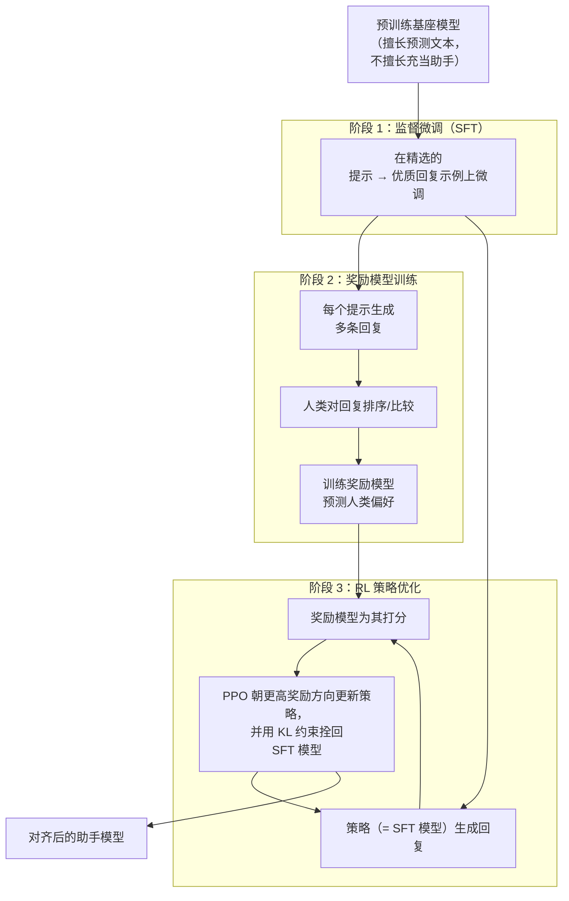

# RLHF 与对齐

RLHF（Reinforcement Learning from Human Feedback，基于人类反馈的强化学习）是一种训练方法：它把一个只会预测下一个词元的原始预训练模型（见 [pretraining-strategies.md](pretraining-strategies.md)）变成一个能遵循指令、避免有害输出、总体上按开发者意图行事的助手——这一过程统称为**对齐（alignment）**。本文件先从头到尾走一遍完整流水线，再介绍自 RLHF 普及以来重塑这一领域的免 RL 替代方案（DPO）及相关技术（RLAIF、Constitutional AI）。本文件假定读者熟悉 [07-reinforcement-learning](../07-reinforcement-learning/) 中的基本 RL 概念——尤其是策略梯度方法和 PPO（见 [policy-gradient-methods.md](../07-reinforcement-learning/policy-gradient-methods.md)）——并与 [rl-for-llms.md](../07-reinforcement-learning/rl-for-llms.md) 大量交叉链接，后者是这一具体应用从 RL 理论通往实践的桥梁。

## 为什么仅有预训练还不够

**差距所在。** 一个纯粹在互联网文本上通过下一词元预测训练出来的模型（见 [pretraining-strategies.md](pretraining-strategies.md)），学会的是预测在类似其训练数据的文本中，接下来*统计上最可能*出现什么词元——这与"给出用户真正想要的回复""忠实地遵循指令"或"拒绝有害请求"是不同的目标。给原始预训练模型一个问题，它同样可能接上一段看似合理却毫无帮助的续写（例如再列出一串类似的问题，因为这在网页文本中很常见），而不是给出直接、有用的回答。RLHF 正是为弥合这一差距而存在：以人类判断作为训练信号，把模型的行为塑造成人们真正希望助手具备的样子，而不是仅仅依赖原始文本的统计模式。

## RLHF 流水线：从头到尾

经典的 RLHF 流水线分为三个阶段，每个阶段产出一个供下一阶段使用的产物：



### 阶段 1：监督微调（SFT）

**机制。** 在进行任何 RL 之前，先在一个精选的高质量示例对话数据集上对预训练模型进行微调（见 [finetuning-and-peft.md](finetuning-and-peft.md)）——这些数据是提示与人类示范者认为优质的回复（有帮助、格式良好、适度谨慎）的配对。这是标准的监督学习：训练模型直接模仿这些由人类撰写或认可的示例回复，使用与预训练相同的下一词元交叉熵损失（见 [loss-functions.md](../01-foundations/loss-functions.md)），只不过数据集小得多、经过精选，且是"指令—回复"形式。

**为什么需要这一阶段。** SFT 让模型大致进入正确的"模式"——以助手的格式回应指令，而不是像原始预训练模型那样接着续写文本——从而为后续的 RL 阶段提供一个比原始预训练模型好得多的起点。

### 阶段 2：奖励模型训练

**机制。** 收集大量提示，为每个提示生成多条候选回复（通常来自 SFT 模型），请人类标注员对这些回复排序或比较（常用两两比较："这两条回复哪条更好？"——比起打一个绝对分数，人类更容易、也更能一致地做出这种判断）。然后训练一个独立的神经网络——**奖励模型（reward model）**——来预测这些人类偏好判断：给定一个提示和一条回复，输出一个标量分数，使人类偏好的回复得分高于不被偏好的回复。

**为什么要单独一个模型，为什么用分数而不是直接监督。** 在 RL 训练期间，策略可能生成的每一条回复都去找人类做比较判断，会慢得无法接受、也贵得无法承受——RL 训练需要在整个过程中评估海量的生成回复。奖励模型只需在数量可控的真实人类比较数据上训练一次，之后便在随后（规模大得多的）RL 训练中充当一个快速、自动化的人类评审替身——一个可以即时、无限次查询的人类偏好代理。

### 阶段 3：RL 策略优化（基于 PPO）

**机制。** SFT 模型（此时称为**策略（policy）**——RL 中"被训练来做决策的东西"的术语，这里的决策就是生成哪些词元）继续用强化学习训练：对给定提示，策略生成一条回复，奖励模型给这条回复打分，然后更新策略参数（通过 PPO——近端策略优化，其完整机制见 [policy-gradient-methods.md](../07-reinforcement-learning/policy-gradient-methods.md)），使高奖励的回复在今后更可能出现。

**防止偏离 SFT 模型的 KL 惩罚。** 一个关键细节：RL 目标并不单纯最大化奖励模型分数。它还包含一个惩罚项——当前策略的输出分布与原始 SFT 模型输出分布之间的 KL 散度（见 [loss-functions.md](../01-foundations/loss-functions.md)）——用来阻止策略偏离起点太远：

```
objective = 𝔼[reward_model_score] − β · D_KL(policy ‖ SFT_model)
```

解读：没有这个惩罚，RL 过程就有动机去利用（不完美的、从有限样本中学到的）奖励模型的任何缺陷——找到某种狭窄、甚至怪异的输出模式，奖励模型恰好给它打高分，但人类其实并不会认为它好（这种失效模式通常称为**奖励投机（reward hacking）**，在这里更具体地说是"奖励模型过度优化"）。KL 惩罚就像一根牵引绳，让策略的行为锚定在 SFT 模型那经过更广泛验证的行为附近，用一部分潜在的奖励模型分数增益，换取策略输出始终保持在可辨识的合理范围内。

**为什么整条流水线如此重要。** 经 InstructGPT（Ouyang 等，2022）以及随后的 ChatGPT 推广的 RLHF，正是把能力强却难以驾驭的预训练语言模型，变成乐于助人、遵循指令的助手的方法论，这些助手从 2022 年起定义了 LLM 这一产品类别——这一时刻在领域整体历史中的位置见 [08-history/timeline-2017-2023.md](../08-history/timeline-2017-2023.md)。

### GRPO——一种因推理而走红的更简单的 RL 算法

为了对现状有准确的认识，值得了解：经典 RLHF 使用 PPO，它需要在策略之外再训练一个独立的**价值模型（value model）**（即"评论家（critic）"——见 [policy-gradient-methods.md](../07-reinforcement-learning/policy-gradient-methods.md)）来估计每个部分回复有多好，这大致让需要训练的模型所占内存翻倍。**GRPO（Group Relative Policy Optimization，组相对策略优化）**由 DeepSeek 在 DeepSeekMath（2024）中提出，在 DeepSeek-R1（2025 年 1 月）中被大规模使用，此后被广泛采用（尤其是面向推理的训练——见 [rl-for-llms.md](../07-reinforcement-learning/rl-for-llms.md)）。它用一个简单的技巧去掉了独立的价值模型：对每个提示，采样一*组*若干条回复，全部打分，然后把这组的*平均*分作为衡量每条回复的基线（比组平均好的回复得到正的学习信号，比组平均差的得到负的）。"把每个答案与其兄弟答案的平均水平相比"这一做法，用一个廉价的即时统计量取代了学习型评论家的工作。回报是一个明显更简单、更省内存的 RL 循环，这让基于可验证奖励的大规模 RL（见 [rl-for-llms.md](../07-reinforcement-learning/rl-for-llms.md)）更加可行——GRPO 是与 2024-2025 年强大开放推理模型浪潮联系最紧密的算法之一。

**改进（2025）。** 大规模运行 GRPO 暴露出一些具体弱点，2025 年的三篇论文成为标准修复方案：**DAPO**（字节跳动 Seed）只抬高裁剪上界（"clip-higher"），使稀有但有益的词元仍能被提升；丢弃那些回复全对或全错的提示组（它们不携带任何学习信号）；并在词元层面而不是按回复对损失取平均。**Dr. GRPO** 去掉了 GRPO 的按回复长度归一化和按组标准差归一化——前者会把模型推向更长的错误答案，后者会给太简单或太难的问题过高的权重。**GSPO**（Qwen 团队）按*序列*而不是按词元计算重要性比率并进行裁剪，更加稳定，对混合专家（MoE）模型尤其如此。每一种方法的直观解释和公式见 [rl-for-llms.md](../07-reinforcement-learning/rl-for-llms.md)；它们与 PPO 裁剪的联系见 [policy-gradient-methods.md](../07-reinforcement-learning/policy-gradient-methods.md)。

## 直接偏好优化（DPO）——一种免 RL 的替代方案

**起源。** Rafailov 等，"Direct Preference Optimization: Your Language Model is Secretly a Reward Model"（2023）。

**DPO 要解决的问题。** 上面完整的 RLHF 流水线很复杂，实践中也可能很脆弱：它需要训练并维护一个独立的奖励模型，运行一个真正的 RL 训练循环（PPO 有其自身的稳定性挑战——见 [policy-gradient-methods.md](../07-reinforcement-learning/policy-gradient-methods.md)），还要在众多超参数中仔细调节 KL 惩罚系数 β——比一次标准的监督微调多出不少活动部件，也多出不少可能出错的地方。

**核心机制（概念层面）。** DPO 的关键数学洞见是：上述 RLHF 目标（在针对参考策略的 KL 惩罚下最大化奖励）在最优策略与一个隐式奖励函数之间存在闭式关系——这意味着你可以跳过显式奖励模型的训练，也完全跳过 RL，而是直接在人类偏好比较数据上优化策略，所用的损失函数隐式地编码了"让被偏好的回复相对于不被偏好的回复更可能出现，同时不要偏离参考模型太远"——这一切都通过一个普通的、监督学习式的训练循环完成（与标准微调相差无几），直接在（被偏好，不被偏好）回复对上计算。

**为什么重要。** DPO 在许多场景下取得了与完整 RLHF 大体相当的结果，同时实现起来简单得多、训练也更稳定——没有独立的奖励模型，没有 RL 训练循环，不需要调 PPO 特有的超参数——这让缺乏深厚 RL 基础设施和专业经验的团队也能方便地进行基于偏好的微调。

## RLAIF（基于 AI 反馈的强化学习）

**名称与定义。** RLAIF 用另一个 AI 模型生成的偏好判断来取代（或补充）人类偏好标签，从而减少所需的人工标注量。

**为什么会出现。** 收集大规模、高质量的人类偏好数据既慢又贵。如果一个足够强的 AI 模型给出的偏好判断与人类的判断高度相关，就可以用它来代替（或配合）人类标签，成本和时间只是其中的一小部分，使偏好数据集的规模超出单靠人工标注预算所能达到的程度。

**权衡。** RLAIF 能显著降低偏好数据收集的成本和周转时间，但它会继承评判用 AI 模型的偏见和盲区，其判断的可信度也仅取决于该模型自身的对齐程度与可靠性——这是一个真实存在、结构上无法回避的局限，值得直白地说明，而不是一笔带过。

## Constitutional AI（宪法式 AI）

**起源。** Bai 等（Anthropic），"Constitutional AI: Harmlessness from AI Feedback"（2022）。

**核心机制。** Constitutional AI 并不单纯依赖人类标注的"有害"与"可接受"输出示例，而是使用一组成文的明确原则（一部"宪法"），让模型依据这些原则批评并修改自己的输出，从而为两个阶段生成训练数据：一个监督微调阶段（自我批评与修改的示例），以及一个偏好比较阶段（输入到 RLAIF 式流程中）。这减少了专门针对避免伤害行为所需的人工标注量，同时使这些行为背后的指导原则比单纯从零散人类标签中学到的隐式模式更明确、更可审计。

**为什么重要。** 与从成千上万个单独的人类标注决定中推断出的纯隐式模式相比，这种方法让指导模型避免伤害行为的价值观更明确、更可直接检查（你可以直接阅读宪法本身），并减轻了专门针对安全相关行为的人工标注负担。

## RLHF 与 DPO 类方法的权衡

| 维度 | 完整 RLHF（奖励模型 + PPO） | DPO（及类似的直接偏好方法） |
|---|---|---|
| 复杂度 | 高（奖励模型 + RL 循环 + KL 调参） | 低（单一的监督式训练循环） |
| 训练稳定性 | 可能脆弱（RL 特有的不稳定性） | 总体更稳定 |
| 计算成本 | 较高（奖励模型训练 + RL rollout） | 较低 |
| 奖励信号可否复用于其他目的 | 可以（奖励模型是可复用的产物） | 不产生显式奖励模型 |
| 实证质量（据广泛报道） | 强，在前沿规模上有更长的验证记录 | 常常相当；采用日益广泛，但在所有场景下的完整对比仍是活跃的研究课题 |

**现状。** 截至 2026 年末，两种方法在整个领域都在积极使用——有些机构为求简单和稳定，主要依赖 DPO 类方法；另一些则继续使用完整 RLHF（或结合两者元素的混合流水线），尤其是在一个独立、可复用的奖励模型，或对训练过程更细粒度的、基于 RL 的控制很有价值的场合。这是实践仍在不断演进的领域，本仓库不会夸大一个尚不存在的定论。

## 2025-2026：流水线的走向

本文件开头的三阶段示意图，仍是理解*偏好*对齐的正确心智模型，但到 2026 年末，它只是一条更长的后训练流水线中的一部分。有三项进展值得了解；前两项在 [rl-for-llms.md](../07-reinforcement-learning/rl-for-llms.md) 中有深入介绍。

- **可验证奖励强化学习（RLVR）与推理模型。** 从 OpenAI 的 o1（2024 年 9 月）开始，再由 DeepSeek-R1（2025 年 1 月）公开并使之可复现，各实验室加入了大规模 RL 阶段，其奖励来自对答案的自动检查（数学答案、单元测试），而不是学习型奖励模型。结果就是**推理模型（reasoning model）**：一种被训练成在回答前先写出一段长思维链的模型，其准确率随推理时更多的"思考"（测试时计算）而提升。推理模型如今已是默认的产品形态，而在工具与代码环境中进行的智能体 RL 则把同样的思路扩展到多步任务上。
- **用在策略蒸馏整合专家模型。** 2026 年的流水线（据技术报告报道，并由 Lambert 与 Timbers 在 2026 年 6 月的综述中梳理）通常不做一次混合 RL 运行，而是先训练若干领域专家 RL 模型——数学、代码、智能体、通用对话——再通过**多教师在策略蒸馏（multi-teacher on-policy distillation）**把它们合并进一个学生模型：学生生成自己的回复，由相应的专家对每个词元打分。本文件中的基于偏好的方法（RLHF、DPO、RLAIF、Constitutional AI）仍留在流水线中，负责那些任何验证器都无法检查的行为——语气、有用性、拒答、需要判断力的场合。
- **对具备网络攻击能力的模型实行受限发布（据报道）。** 2026 年，前沿实验室开始因其最强模型具备进攻性网络安全能力，而对这些模型的发布进行限制或分阶段开放——例如最初只向经过审核的网络防御人员开放访问；据报道，Google 和 Anthropic 的模型都采取了这种做法。随后，美国于 2026 年 6 月 2 日发布了一项关于前沿 AI 与网络安全的行政命令（据报道）。对本文件而言，要点是：训练阶段的对齐（拒答训练、RLHF、宪法）塑造的是模型在被要求时*愿意*做什么，却无法可靠地去除模型已经学到的某种两用*能力*。发布限制是一种部署端的管控手段，它是对上述方法的补充，而非替代。

## 与其他算法的关系

- PPO 是经典 RLHF 背后的 RL 算法，其完整机制见 [policy-gradient-methods.md](../07-reinforcement-learning/policy-gradient-methods.md)；[rl-for-llms.md](../07-reinforcement-learning/rl-for-llms.md) 是把通用 RL 理论与这一具体应用连接起来的专门桥梁文件。
- 这里的 KL 散度惩罚与 [loss-functions.md](../01-foundations/loss-functions.md) 中介绍的是同一个数学对象。
- SFT（阶段 1）使用的微调机制与 [finetuning-and-peft.md](finetuning-and-peft.md) 中介绍的相同，为提高效率常通过 LoRA 等 PEFT 方法实施。
- 经 RLHF/DPO 调优的模型在训练完成后，常常是 [06-inference-optimization](../06-inference-optimization/) 中各种推理优化技术的作用对象。
- GRPO 的改进（DAPO、Dr. GRPO、GSPO）、推理模型、智能体 RL 和在策略蒸馏见 [rl-for-llms.md](../07-reinforcement-learning/rl-for-llms.md)；在策略蒸馏建立在 [pruning-and-distillation.md](../06-inference-optimization/pruning-and-distillation.md) 中的经典蒸馏之上。

## 来源

- Christiano 等，"Deep Reinforcement Learning from Human Preferences"（2017）——RLHF 的奠基性方法，早于其在 LLM 上的应用
- Ouyang 等（OpenAI），"Training language models to follow instructions with human feedback"（2022）[InstructGPT]
- Rafailov 等，"Direct Preference Optimization: Your Language Model is Secretly a Reward Model"（2023）
- Shao 等（DeepSeek），"DeepSeekMath: Pushing the Limits of Mathematical Reasoning in Open Language Models"（2024）[GRPO]
- Bai 等（Anthropic），"Constitutional AI: Harmlessness from AI Feedback"（2022）
- Bai 等（Anthropic），"Training a Helpful and Harmless Assistant with Reinforcement Learning from Human Feedback"（2022）
- OpenAI，"Learning to Reason with LLMs"（2024 年 9 月）[o1、推理模型、测试时计算]
- DeepSeek-AI，"DeepSeek-R1: Incentivizing Reasoning Capability in LLMs via Reinforcement Learning"（2025 年 1 月）
- Yu 等（字节跳动 Seed 及合作者），"DAPO: An Open-Source LLM Reinforcement Learning System at Scale"（2025）；Liu 等，"Understanding R1-Zero-Like Training: A Critical Perspective"（2025）[Dr. GRPO]；Zheng 等（Qwen 团队），"Group Sequence Policy Optimization"（2025）[GSPO]
- Lambert 与 Timbers，关于 LLM 后训练实践的综述（2026 年 6 月）[多教师在策略蒸馏]
- 关于具备网络攻击能力的前沿模型受限/分阶段发布，以及美国关于前沿 AI 与网络安全的行政命令（2026 年 6 月 2 日）的公开报道 [据报道]
