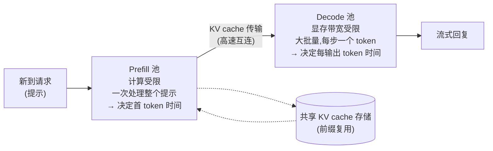

# 服务与批处理

本文介绍在生产环境中,发往已部署 LLM 的请求实际上是如何被调度和高效处理的——这是位于本节其他所有内容(量化、KV cache 管理、投机解码)之上的系统层,决定了这些技术如何转化为真实世界中的吞吐量和延迟。内容依次为:批处理(静态与连续);每个请求的两个阶段(prefill 与 decode),以及现代系统为何越来越多地把它们放在不同硬件上运行;前缀缓存;最后是推理模型的长输出如何重塑了服务负载。

## 吞吐量与延迟的权衡

**吞吐量(throughput)**是服务系统在单位时间内、跨所有用户合计能处理的请求(或 token)数量。**延迟(latency)**是从等待中的用户角度看,任意单个请求得到响应所需的时间。这两个目标常常相互冲突:把许多请求合成一批(同时处理)往往能提高吞吐量(更充分地利用加速器的并行计算能力——在为大规模并行而设计的 GPU 上一次只跑一个请求,会让其大部分算力闲置),却可能增加单个请求的延迟(请求可能要等一批凑满,或在完成前与其他并发请求分享算力)。本文中的大多数设计选择,归根结底都是这同一条权衡曲线上的不同取点。

对 LLM 而言,延迟通常被拆成用户真正能感受到的两个数字:**首 token 时间(time to first token,TTFT)**——回复开始出现之前要等多久;以及**每输出 token 时间(time per output token,TPOT)**,也叫 token 间延迟——回复开始后流式输出有多快。正如下文 prefill/decode 一节所解释的,这两个数字由计算的不同阶段决定。

## 静态批处理

**机制。** 收集一组固定的请求,把它们作为一批从头到尾一起处理,只有当上一批全部结束(其中每个请求都生成完完整的回复)后,才开始新的一批。

**局限。** 由于生成的回复长度差异很大(有的回复只有一句话,有的长达数页),一个静态批次的速度只取决于其中*最慢*的成员——批中较短的请求提前结束,但分配给它们的计算槽位会闲置下来,等待批中最长的请求完成,系统才能在这些槽位上开始服务新的请求。这浪费了大量潜在吞吐量,回复长度的差异越大越明显。

## 连续(动态)批处理

**机制。** 不再等整批结束才开始新工作,而是持续监视批次,一旦其中任何一个请求生成完回复,就立即换入一个等待中的新请求来占用空出的槽位——批次的组成随请求逐个动态变化,而不是在整个持续时间内固定不变。

**为什么重要。** 这直接修复了静态批处理的核心低效问题:由于已完成的请求被立即替换,而不是等到固定批处理周期结束,加速器的算力不会因等待批中最长的单个请求而闲置。据广泛报道,连续批处理(有时称为动态批处理)相比静态批处理能大幅提升可达到的服务吞吐量,截至 2026 年底,它已是现代高吞吐 LLM 服务系统的标准必备功能。

**它与 KV cache 的交互。** 持续地把请求换入换出批次,意味着服务系统需要即时为单个请求高效地分配和释放 KV cache 内存(见 [kv-cache-and-attention-optimization.md](kv-cache-and-attention-optimization.md)),而无需重排或整理所有其他仍在进行中的请求所占用的内存——这恰恰是 PagedAttention 的块/页表设计(见该文件)所要高效解决的问题。在实践中,连续批处理和 PagedAttention 式内存管理是互补的技术,通常一起部署,而不是分开使用。

## Prefill 与 decode:两种截然不同的负载

每个 LLM 请求都有两个阶段,它们以相反的方式给硬件施压。

- **Prefill(预填充)**一次性处理整个提示:所有提示 token 在一次大型并行前向传播中经过模型,填满 KV cache。这意味着大规模的矩阵-矩阵乘法,每从内存加载一个字节的权重都要做大量算术运算。Prefill 是**计算受限(compute-bound)**的——受限于芯片做数学运算的速度——它决定了 TTFT。
- **Decode(解码)**随后一次生成一个 token 来产出回复。每一步对每条序列只做少量数学运算,却必须从 GPU 显存中读取模型的*全部*权重以及该请求的整个 KV cache。Decode 是**显存带宽受限(memory-bandwidth-bound)**的——受限于数据从显存搬运到计算单元的速度——它决定了 TPOT。

这里有用的概念是**算术强度(arithmetic intensity)**:每从内存搬运一个字节所执行的算术运算次数。Prefill 的算术强度高(许多 token 共享每一次权重读取);decode 的算术强度低(每次权重读取,每条序列只处理一个 token)。把许多 decode 请求合成一批可以提高 decode 的算术强度,这正是批处理如此重要的原因——但批大小又受限于显存中能放下多少 KV cache。

**干扰问题。** 当两个阶段共享同一批 GPU 时,一个新到的长提示的 prefill 可能会占用 GPU 一段时间,让批中所有正在进行的 decode 停顿——用户会看到流式输出"卡顿"。一种让两个阶段仍在同一批 GPU 上运行的缓解办法是**分块预填充(chunked prefill)**(由 Sarathi-Serve 推广,Agrawal 等,2024):把长 prefill 切成若干块,穿插进正在进行的 decode 步骤中,使两个阶段都不会让对方"饿死"。

## Prefill/decode 分离

**名称与定义。** **分离式服务(disaggregated serving)**,即 prefill/decode 分离,把 prefill 阶段和 decode 阶段放在*不同的* GPU 池上运行。请求先在 prefill 工作节点上完成预填充;然后其 KV cache 通过高速互连传输到 decode 工作节点,由后者生成回复。



**为什么有帮助。** 每个池都可以针对自己的瓶颈进行配置:prefill 池追求原始算力和更快的 TTFT,decode 池追求大批量和显存带宽(甚至可以采用不同的并行设置或硬件类型)。突发的 prefill 不再打断正在进行的 decode 流,而且当"长提示"与"长输出"的比例变化时,两个池可以独立扩缩容。DistServe 把目标表述为最大化**有效吞吐量(goodput)**——每秒能*同时*满足 TTFT 和 TPOT 目标的请求数——而不是原始吞吐量。

**代价。** 在机器之间搬运 KV cache 要消耗网络带宽并增加少许延迟,系统的运维也更复杂(要平衡两个池,要编排缓存传输)。对于小规模部署或短提示负载,配合分块预填充的合置式服务可能更简单,效果也几乎一样好。

**起源与普及。** DistServe(Zhong 等,2024)和 Splitwise(Patel 等,2024)从研究上论证了这一做法;月之暗面的 Mooncake(其 Kimi 助手背后的服务平台,2024–25)构建了以 KV cache 为中心的分离式架构,还把 KV cache 池化到 CPU 内存和存储中;NVIDIA 的开源 Dynamo 框架(2025)让带有 KV cache 感知请求路由的分离式服务得以广泛使用。到 2025 年,分离式服务已成为大规模服务的主流做法。

## 前缀缓存(SGLang RadixAttention)

**观察。** 许多请求以相同的 token 开头:一段很长的系统提示、相同的少样本示例、智能体的工具定义,或者——最重要的——多轮对话或智能体会话的全部历史,每一轮新对话都会重新发送一遍。每次都为这些共享前缀重新做 prefill,纯属浪费。

**解决办法。** 把先前请求的 KV cache 保留下来,当新请求到达时,复用它与缓存中已有内容共享的最长前缀所对应的 KV 条目;只有新增的后缀需要做 prefill。

**RadixAttention。** Zheng 等,"SGLang: Efficient Execution of Structured Language Model Programs"(2024)把缓存的 KV 条目组织成一棵**基数树(radix tree)**——一种边上标注 token 序列的前缀树——这样查找最长的已缓存前缀只需一次简单的树遍历,而从同一前缀分叉出去的请求(对同一提示的多次采样、在推理路径上搜索时的各个分支)会自动共享公共部分。内存不足时淘汰最近最少使用的叶子节点,调度器还可以优先处理前缀已被缓存的请求。其他服务栈以不同方式实现了同样的思想(例如 vLLM 对固定大小的 KV 块做哈希),商业 API 则以"缓存输入 token 享受折扣价"的形式把它提供给客户。

```
 Radix tree of cached prefixes (each edge = a run of tokens with its KV cache stored):

 [system prompt + tool definitions]
        ├── [user turn 1] ── [assistant turn 1] ── [user turn 2]   ← agent session A
        └── [few-shot examples] ─┬── [question X]                  ← request B
                                 └── [question Y]                  ← request C (reuses everything above it)
```

**与分离式服务的配合。** 在多 GPU 集群中,请求最好被路由到已经持有其前缀的工作节点——即"KV cache 感知路由",这是 Mooncake 和 Dynamo 等系统的核心功能。

## 推理模型:当 decode 占据主导

**发生了什么变化。** 推理模型——从 OpenAI 的 o1(2024 年 9 月)开始,开放权重方面则以 DeepSeek-R1(2025 年 1 月)为代表——通过花费**测试时计算(test-time compute)**(也称推理时扩展:在作答时投入更多计算,这里表现为生成更多"思考"token)来提高准确率。一个回答在可见回复之前可能包含数千个推理 token。这些模型如何训练,见 [rl-for-llms.md](../07-reinforcement-learning/rl-for-llms.md)。

**这对服务意味着什么。**
- **Decode 占据主导。** 输出 token 现在常常远多于输入 token,因此大部分 GPU 时间花在显存带宽受限的 decode 阶段。所有能加速 decode 的技术——更小的 KV cache(MLA、稀疏与压缩注意力;见 [kv-cache-and-attention-optimization.md](kv-cache-and-attention-optimization.md))、更低精度的权重([quantization.md](quantization.md))以及投机解码([speculative-decoding.md](speculative-decoding.md))——都变得更有价值。
- **KV cache 变得又大又长寿。** 请求在漫长的生成过程中不断积累缓存,并一直持有到结束,这限制了批大小,也让内存管理和缓存缩减变得更加重要。
- **输出长度呈长尾分布。** 有的请求只思考片刻,有的思考很久——这正是连续批处理能处理而静态批处理处理不了的那种差异。
- **智能体负载带来前缀复用。** 智能体会调用工具并带着不断增长的共享上下文反复回来,这让前缀缓存和缓存感知路由收益巨大。

简而言之,2024–2026 年向测试时计算的转变,把 LLM 服务的重心从"快速处理提示"推向了"低成本地流式输出长内容",而分离式服务、前缀缓存和 decode 侧优化正是系统层面的回应。

## 参考系统:vLLM、SGLang、TensorRT-LLM 与 Dynamo

**vLLM。** 一个开源 LLM 服务系统(正是它引入了 PagedAttention——见 [kv-cache-and-attention-optimization.md](kv-cache-and-attention-optimization.md)),专门围绕连续批处理和高效的分页式 KV cache 内存管理构建,作为高吞吐服务方案在开源和研究社区中被广泛采用。

**SGLang。** 一个开源服务系统(Zheng 等,2024),引入了 RadixAttention 前缀缓存;据广泛报道,它与 vLLM 并列为使用最广泛的开源 LLM 服务引擎之一。

**TensorRT-LLM(NVIDIA)。** 一个服务/推理优化工具包,在连续批处理和量化支持等技术之外,还应用针对硬件的编译和 kernel 优化(专门为 NVIDIA GPU 架构定制),目标是在 NVIDIA 硬件上最大化吞吐量、最小化延迟。

**NVIDIA Dynamo(2025)。** 一个用于跨多 GPU 服务的开源编排层,在 vLLM、SGLang、TensorRT-LLM 等引擎之上增加了 prefill/decode 分离和 KV cache 感知路由。

**为什么值得点名。** 这些系统都是被广泛使用的具体实例,它们把本节涵盖的几乎所有技术——量化(见 [quantization.md](quantization.md))、高效的 KV cache 管理、连续批处理、前缀缓存、分离式服务和投机解码(见 [speculative-decoding.md](speculative-decoding.md))——整合进可部署的服务栈,说明这些技术在实践中是组合使用的,而不是孤立的学术玩意儿。

## KV cache 管理如何与批处理决策相互作用

把本节的主线串起来:KV cache 的内存占用(见 [kv-cache-and-attention-optimization.md](kv-cache-and-attention-optimization.md))直接限制了在固定内存预算内能合批的并发请求数量——每个请求的 KV cache 越大(来自更长的上下文,或来自没有 MQA/GQA/MLA 式缓存缩减的架构),能同时合批的请求就越少,可达到的吞吐量也就直接下降。这就是为什么架构选择(预训练时决定)、量化(作用于模型,有时也作用于 KV cache 本身)、PagedAttention 式内存管理和前缀缓存(服务时应用)以及分离式服务(集群层面应用),最终都从不同角度服务于同一个下游目标:在固定数量的昂贵加速器内存中塞进更多有用的并发工作——这是本知识库这一部分几乎所有技术都在以各种方式试图放宽的核心资源约束。

## 对比表

| 方法 | 吞吐量 | 短请求的延迟 | 能否很好地应对回复长度差异? |
|---|---|---|---|
| 静态批处理 | 较低(等待最长请求时槽位闲置) | 可能较差(短请求要等整批完成) | 否 |
| 连续(动态)批处理 | 较高(槽位立即被补上) | 较好(完成的请求立即退出) | 是 |

| 技术 | 解决的问题 | 主要成本/权衡 | 示例系统 |
|---|---|---|---|
| 分块预填充 | 在共享 GPU 上,长 prefill 让进行中的 decode 停顿 | prefill 略慢;调度更复杂 | Sarathi-Serve;vLLM、SGLang 均支持 |
| Prefill/decode 分离 | 计算受限与带宽受限两个阶段相互干扰,无法同时调优 | 机器间的 KV cache 传输;运维复杂度 | DistServe、Splitwise、Mooncake、NVIDIA Dynamo |
| 前缀缓存 | 为共享提示和对话/智能体历史重复做 prefill | 需要内存保存缓存的前缀;淘汰策略 | SGLang RadixAttention、vLLM 自动前缀缓存 |
| KV cache 感知路由 | 请求落到不持有其前缀的工作节点上 | 路由器需要掌握全集群的缓存内容 | Mooncake、NVIDIA Dynamo |

## 与其他算法的关系

- 连续批处理的效率提升直接得益于 [kv-cache-and-attention-optimization.md](kv-cache-and-attention-optimization.md) 中介绍的 KV cache 内存管理;PagedAttention 的块结构也正是块级前缀共享得以低成本实现的基础。
- 量化(见 [quantization.md](quantization.md))降低了每个请求的内存占用,直接增加了在固定内存预算内可合批的请求数,而且更低精度的权重能加速受带宽限制的 decode 阶段。
- 投机解码(见 [speculative-decoding.md](speculative-decoding.md))与批处理是互补的吞吐量杠杆,在生产服务栈中通常一起部署。
- 推理模型与测试时计算(见 [rl-for-llms.md](../07-reinforcement-learning/rl-for-llms.md))是 decode 阶段效率成为服务首要关切的主要原因。

## 来源

- Yu et al., "Orca: A Distributed Serving System for Transformer-Based Generative Models" (2022) —— 被广泛认为是 LLM 服务中连续/迭代级批处理的开创者
- Kwon et al., "Efficient Memory Management for Large Language Model Serving with PagedAttention" (2023) [vLLM]
- Zheng et al., "SGLang: Efficient Execution of Structured Language Model Programs" (2024) [RadixAttention 前缀缓存]
- Agrawal et al., "Taming Throughput-Latency Tradeoff in LLM Inference with Sarathi-Serve" (2024) [分块预填充]
- Zhong et al., "DistServe: Disaggregating Prefill and Decoding for Goodput-optimized Large Language Model Serving" (2024)
- Patel et al., "Splitwise: Efficient Generative LLM Inference Using Phase Splitting" (2024)
- Qin et al., "Mooncake: A KVCache-centric Disaggregated Architecture for LLM Serving" (2024;Moonshot AI / Kimi)
- NVIDIA, Dynamo 开源推理框架 (2025) [分离式服务、KV cache 感知路由]
- OpenAI, "Learning to Reason with LLMs" (o1,2024 年 9 月);DeepSeek-AI, "DeepSeek-R1" (2025) [推理模型与测试时计算]
