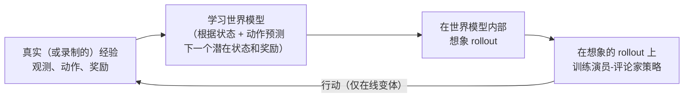

# 基于模型的强化学习

基于模型的强化学习是 [value-based-methods.md](value-based-methods.md) 和 [policy-gradient-methods.md](policy-gradient-methods.md) 中介绍的无模型方法的对应物：基于模型的智能体并不单纯通过与真实环境直接试错来学习，而是学习（或被给定）一个描述环境如何运作的模型，并利用这个模型提前规划或模拟。

## 世界模型

**名称与定义。** 世界模型（world model）是对环境如何演化的一种学习得到（或给定）的表示——给定当前状态和一个动作，接下来会出现什么状态（以及什么奖励）。一旦有了这样的模型，智能体就可以"想象"不同动作序列的可能后果，而无需真的在真实环境中执行它们，并利用这种想象中的前瞻来规划更好的决策，或生成额外的合成训练经验。

**为什么这在原理上很有价值。** 与真实世界交互往往昂贵、缓慢或有风险（机器人在随机探索时损坏自己，一局游戏要花真实的挂钟时间才能玩完，某些真实世界的试验根本不可能反复进行）。一个好的世界模型能让智能体获得"试一试"的大部分好处——看到可能会发生什么——而无需付出真正去做的代价。

## MuZero

**起源。** Schrittwieser 等（DeepMind），"Mastering Atari, Go, Chess and Shogi by Planning with a Learned Model"（2019/2020）。

**核心机制（简要但具体）。** MuZero 完全从数据中学习三个相互关联的组件，从未被告知它所掌握的游戏的真实规则：一个**表示函数（representation function）**（把原始观测，比如棋盘局面，映射为内部状态表示）；一个**动态函数（dynamics function）**（给定当前内部状态和一个动作，预测接下来的内部状态和奖励——这就是 MuZero 学到的世界模型，但值得注意的是，它在这个内部的抽象表示空间中运作，而不是试图预测原始像素或字面意义上的棋盘布局）；以及一个**预测函数（prediction function）**（从给定的内部状态估计价值和推荐策略）。这三部分一起用于一个树搜索规划过程（蒙特卡洛树搜索——一种系统性探索未来可能动作序列的方法：模拟许多可能的后续走法，并用结果判断哪个眼前的动作看起来最好）中，来决定每一步实际走法；三者根据所得计划与预测和真实结果的吻合程度进行联合训练。

**为什么重要。** 此前这一方向上的成功（如 DeepMind 的 AlphaGo 和 AlphaZero 系统）依赖于把游戏的确切规则作为一个手工编写的模拟器提供给系统用于规划。MuZero 的标志性成果是：在多种不同游戏（Atari、围棋、国际象棋、将棋）上达到或超越了这一水平，同时完全从经验中学习自己关于"规则"和动态的内部模型，从未被明确告知这些规则——证明了基于规划的方法并不严格需要人工提供的环境模拟器，只需要一个足够好的学习替代品。

## Dreamer：在世界模型内部学习行为

**名称与定义。** Dreamer 系列（Hafner 等，2019 年起）是一类基于模型的智能体：它们从经验中学习一个紧凑的世界模型，然后几乎完全在该模型生成的*想象*轨迹（rollout）上训练策略，而不是在真实环境步上训练。这个思路呼应了 Ha 与 Schmidhuber 的《World Models》（2018），后者展示了智能体可以在自己学到的、关于一个简单游戏的"梦境"中学会行动。

**核心机制（简述）。** 这个循环有三部分，反复运行：

解读：世界模型把观测（例如游戏画面）压缩成一个小的潜在状态（latent state），并学习预测在给定动作下该状态和奖励如何演变。然后在大量廉价的想象轨迹上训练策略（一个演员-评论家，见 [policy-gradient-methods.md](policy-gradient-methods.md)）。在经典的*在线*设置中，改进后的策略再回去收集更多真实经验，从而改进世界模型，如此循环。

**里程碑。** **DreamerV3**（Hafner 等，2023）在众多领域使用同一组固定超参数，并且是第一个在没有人类数据、也没有人工设计课程的情况下，从零开始在《我的世界》（Minecraft）中采集到钻石的算法——这是一项需要完成许多子目标（采集木头、制作工具、向更深处挖掘）的长时程任务。**Dreamer 4**（Hafner 等，2025）走得更远：它通过在一个学习得到的世界模型*内部*训练智能体，**完全基于离线数据**——一个固定的游戏录像数据集——学会了在 Minecraft 中采集钻石，在策略学习期间与真实游戏没有任何交互。这是迄今为止对基于模型方法核心承诺最有力的证明：如果世界模型足够好，真实交互就可以被想象所取代。

## 生成式交互世界模型：Genie 3 与 Genie 4

另一条工作路线从生成式视频的角度来构建世界模型（相关生成机制见 [diffusion-models.md](../04-generative-models/diffusion-models.md)）：训练一个大模型，使其根据用户或智能体的动作生成一个世界的*后续画面*，于是模型本身就成为一个可游玩、可探索的环境。

- **Genie（Bruce 等，Google DeepMind，2024）** 从无标注的互联网视频中学会生成可控的、类似 2D 游戏的环境，在没有动作标签的情况下推断出一组潜在动作。**Genie 2**（2024 年 12 月）将其扩展到 3D 环境。
- **Genie 3（2025 年 8 月）** 是一个**实时交互世界模型**：它根据文本提示生成一个可导航的世界，用户可以实时在其中移动，并且世界能在数分钟内保持一致（例如，记得你离开又返回的某个地点原来有什么）。
- **Genie 4（研究预览版，2026 年 10 月 27 日——据报道）** 增加了原生音频生成，据报道一致性可保持约两分钟，并正被探索用于**在模拟中预演机器人任务**（据报道）。截至本文撰写时，它是一个研究预览版，而非广泛可用的产品，其能力主要来自开发者自己的描述。

**它们与 MuZero 和 Dreamer 的关系。** MuZero 的模型小而抽象、针对特定任务——只预测规划所需的东西（价值、策略、奖励）。Dreamer 的模型是针对单一环境的紧凑潜在模拟器。Genie 式模型则规模巨大、通用，并为开放式世界预测原始像素（如今还有音频）。它们本身并不是 RL 算法；它们与 RL 的关联在于充当**学习得到的模拟器**，可以在其中训练或评估智能体。

## 用世界模型预演机器人任务

**思路。** 机器人学是基于模型的 RL 的样本效率论证最切中要害的领域：真实机器人交互缓慢、昂贵，还可能损坏硬件。经典机器人学使用人工构建的物理模拟器；较新的思路是使用一个*学习得到*的世界模型——在大量视频和机器人数据上训练——让机器人策略在真实世界尝试之前，先在想象中反复预演某项任务（拿起这个物体、打开那个抽屉），或者在不上硬件运行的情况下评估候选策略。据报道 Genie 4 正被探索用于机器人任务预演，这是这一方向上一个备受关注的例子。

**诚实的保留意见。** 这正是下一节所说的"模型被利用"问题最尖锐的形式。生成式世界模型可能产生视觉上令人信服、物理上却错误的结果（物体相互穿透、抓取动作在想象中"成功"而在现实中会滑脱），而一个针对这种模型优化的策略会毫不犹豫地利用这些错误。模拟表现与真实表现之间的差距——**模拟到现实差距（sim-to-real gap）**——是核心的未解问题。截至 2026 年末，用世界模型为机器人做预演是一个有前景演示的活跃研究方向，而不是对真实世界测试的成熟替代。

## 样本效率：相对无模型方法的核心动机

**核心权衡。** 无模型方法（Q 学习、DQN、PPO，以及 [value-based-methods.md](value-based-methods.md) 和 [policy-gradient-methods.md](policy-gradient-methods.md) 中的其余方法）通常需要与环境进行大量真实交互才能学到良好行为，因为每一点学习信号都直接来自实际的试错。基于模型的方法一旦拥有一个相当准确的模型，就能从该模型中生成大量*额外的*"想象"经验——提前规划，或在模拟的轨迹上训练——从而显著提高**样本效率（sample efficiency）**（达到给定性能水平需要多少真实世界交互）。

**问题所在。** 这一好处完全取决于学到的模型确实准确到值得信任。一个不准确的世界模型可能让智能体围绕那些在真实环境中并不会发生的后果信心满满地做规划——模型中的错误会在一条很长的想象轨迹上不断累积，智能体最终"学到"的策略可能是针对其有缺陷的内部模型而非现实优化的。这是整个基于模型方法的核心权衡，值得坦率说明：可能获得好得多的样本效率，代价是一个真正更难的学习问题（首先要学到一个准确的模型），以及模型被利用这类失效模式的真实风险——而无模型方法在构造上就不必担心这一点（因为它们从不针对一个可能出错的内部模型做规划）。

## 现状

截至 2026 年末，基于模型的 RL 比 MuZero 以来的任何时候都更受瞩目，原因有二：Dreamer 4 证明了策略可以完全在一个学习得到的世界模型内部、仅凭离线数据学会；而大型生成式世界模型（Genie 3，以及据报道的 Genie 4 预览版）让"一个关于开放式世界的学习型模拟器"变得具体可感。机器人学是这些脉络有望汇合的主要领域，尽管这种汇合仍处于研究阶段。

MuZero 式规划和 Dreamer 式想象训练，仍然主要活跃于那些状态与动作概念清晰明确、且样本效率确实最为关键的领域（游戏、模拟控制、机器人研究），而不是作为整个强化学习领域的通用默认方案。对于与本仓库其余部分最相关的具体应用——用于 LLM 训练与对齐的 RL（见 [rl-for-llms.md](rl-for-llms.md) 和 [rlhf-and-alignment.md](../05-training-methodology/rlhf-and-alignment.md)）——截至 2026 年末，标准做法仍是无模型的策略梯度方法（PPO 及其无评论家的 GRPO 系列后代，外加免 RL 的 DPO 替代方案），而不是基于显式世界模型的规划；语言生成那种巨大而开放的特性，使得学习一个明确、可信的关于"这场对话接下来会发生什么"的世界模型，比在定义良好的游戏环境中要困难得多，问题边界也模糊得多。

## 比较表

| 方法 | 是否学习/使用模型？ | 样本效率 | 风险 |
|---|---|---|---|
| 无模型（Q 学习、DQN、PPO） | 否 | 较低（需要更多真实交互） | 没有模型被利用的风险 |
| 基于模型（世界模型、MuZero 式规划） | 是 | 较高，前提是模型准确 | 不断累积的模型误差可能误导规划 |
| 想象训练（Dreamer 系列） | 是——学习型潜在模拟器 | 高；Dreamer 4 仅凭离线数据学会 | 策略可能利用世界模型的错误 |
| 生成式交互世界模型（Genie 式） | 它们*本身就是*学习型模拟器 | 对具身任务可能非常高 | 物理上错误但看似合理的输出；模拟到现实差距 |

## 与其他算法的关系

- 基于模型的 RL 是 [value-based-methods.md](value-based-methods.md) 和 [policy-gradient-methods.md](policy-gradient-methods.md) 中无模型方法在结构上的直接对应物。
- Dreamer 的策略学习就是在想象而非真实经验上运行的演员-评论家训练（见 [policy-gradient-methods.md](policy-gradient-methods.md)）。
- Genie 式世界模型是大型生成式视频模型；其底层生成机制与 [diffusion-models.md](../04-generative-models/diffusion-models.md) 和 [autoregressive-generation.md](../04-generative-models/autoregressive-generation.md) 相关。
- MuZero 的树搜索规划过程建立在 AlphaGo/AlphaZero 的思想之上（更广泛的历史背景见 [08-history/timeline-2017-2023.md](../08-history/timeline-2017-2023.md)）。
- 从概念上讲，这里的样本效率动机与合成数据生成（见 [curriculum-and-data-strategies.md](../05-training-methodology/curriculum-and-data-strategies.md)）在监督/自监督场景中的价值相似——两者都是为了获得比原始的、真实的、由人类/环境提供的数据本身更多的学习信号的策略，并且都伴随着类似的风险（模型生成的数据或模型生成的经验会放大模型已有的错误），本仓库在两处都对此做了提示。

## 来源

- Schrittwieser 等，"Mastering Atari, Go, Chess and Shogi by Planning with a Learned Model"（2019，2020 年正式发表）
- Silver 等，"Mastering the game of Go without human knowledge"（2017）[AlphaGo Zero，直接前身背景]
- Ha 与 Schmidhuber，"World Models"（2018）
- Hafner 等，"Mastering Diverse Domains through World Models"（2023）[DreamerV3；从零开始采集 Minecraft 钻石]
- Hafner 等，Dreamer 4（2025）[完全基于离线数据、在学习得到的世界模型内部学会采集 Minecraft 钻石]
- Bruce 等（Google DeepMind），"Genie: Generative Interactive Environments"（2024）
- Google DeepMind，Genie 2（2024 年 12 月）与 Genie 3（2025 年 8 月）发布公告 [实时交互世界模型]
- Google DeepMind，Genie 4 研究预览版（2026 年 10 月 27 日）[据报道：原生音频、约两分钟一致性、探索用于机器人任务预演]
