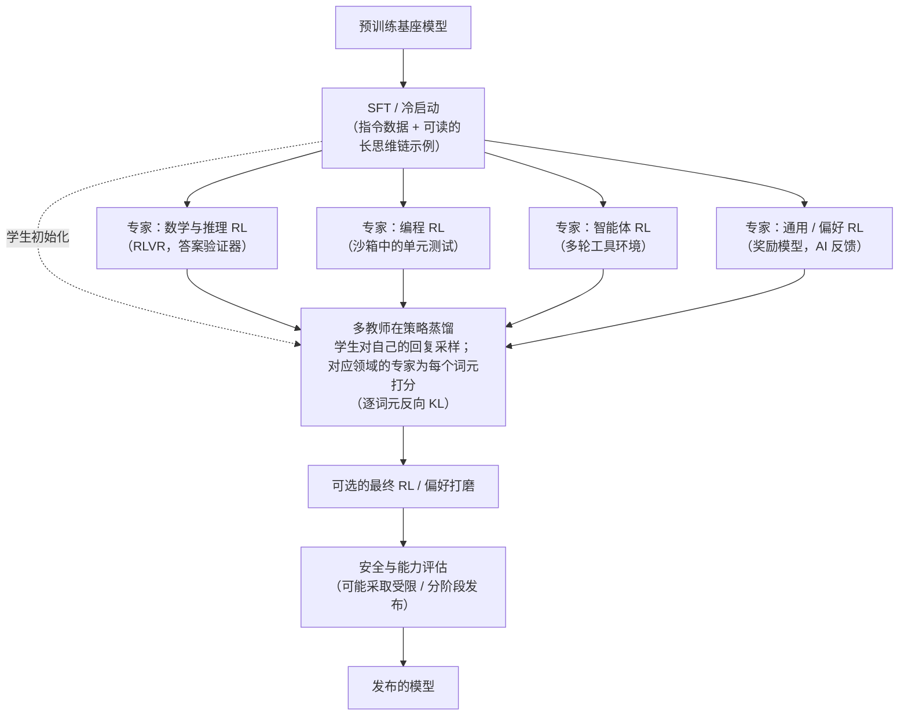

# 面向 LLM 的强化学习

本文件是一座专门的桥梁：一端是 [value-based-methods.md](value-based-methods.md)、[policy-gradient-methods.md](policy-gradient-methods.md) 和 [model-based-rl.md](model-based-rl.md) 中介绍的通用强化学习（RL）理论，另一端是它在训练大语言模型（LLM）上的具体应用。完整的 RLHF 流水线已在 [rlhf-and-alignment.md](../05-training-methodology/rlhf-and-alignment.md) 中从头到尾讲过，这里不再重复；本文件的任务是解释*通用 RL 概念如何映射到 LLM 这一具体场景*，然后梳理**面向推理的 RL** 这一方向——即针对可自动检验的奖励进行强化学习。在 2024 年到 2026 年末之间，它成为前沿语言模型**后训练**方式中最重要的一项变化（**后训练** = 预训练之后对模型所做的一切：微调、RL、蒸馏等）。

本文件后半部分刻意按时间标注。这个领域发展极快，诚实的描述方式是把它写成一串具体的、有出处的事件——o1（2024）、DeepSeek-R1（2025）、GRPO 改进系列论文（2025）、IMO 2025、智能体 RL，以及 2026 年转向用在策略蒸馏整合专家模型——并清楚区分哪些内容以可复现的细节公开发表过，哪些只是"据报道"。

## 把通用 RL 框架映射到 LLM 上

沿用 [value-based-methods.md](value-based-methods.md) 中马尔可夫决策过程（MDP）的术语：

- **状态（State）**——提示词加上当前回复中到目前为止已生成的所有词元。模型每生成一个新词元，状态就增长一个词元。
- **动作（Action）**——从模型的整个词表中选择下一个要生成的词元。与经典 RL 基准（如 Atari 游戏或棋类游戏）中常见的小而固定的动作空间（寥寥几种走法）相比，这是一个巨大的动作空间（每一步都有数万到十几万个可选词元）。
- **策略（Policy）**——语言模型本身：在给定当前状态时，它的下一词元概率分布恰好就是 [policy-gradient-methods.md](policy-gradient-methods.md) 意义上的策略 π(a|s; θ)。
- **奖励（Reward）**——对 RLHF 而言，是完整回复生成后由训练好的奖励模型（见 [rlhf-and-alignment.md](../05-training-methodology/rlhf-and-alignment.md)）给出的分数；对下文的可验证奖励方法而言，是直接检查最终输出是否正确而计算出的奖励。
- **回合（Episode）**——一次完整的"提示到回复"生成过程，从第一个生成的词元到回复结束词元。（在后文的智能体场景中，一个回合可以包含许多轮工具调用和工具输出。）

## 为什么 PPO 适合这个场景（以及为什么这是一个相当特殊的 RL 场景）

**契合之处。** PPO 的裁剪代理目标（见 [policy-gradient-methods.md](policy-gradient-methods.md)）限制了策略行为在单次更新中能改变多少——这与 RLHF 的一个关切天然吻合：不让语言模型的输出在任何单个训练步骤中偏离一个经过充分验证的起点（SFT 模型）太远、太不稳定，而这正是 KL 惩罚在 RLHF 目标中扮演的角色（见 [rlhf-and-alignment.md](../05-training-methodology/rlhf-and-alignment.md)）。

**与经典 RL 基准相比，这个场景有何特殊。** "把 LLM 当作 RL 环境"的场景有几个性质值得明确指出，因为它们与当初验证大部分策略梯度理论的游戏环境（Atari、围棋、国际象棋）有实质差别：动作空间（词表大小）比经典 RL 基准大得多；一个完整"回合"（一条生成的回复）可以非常长（数百到数万个词元/动作），而奖励通常只在最末尾才有（这叫**稀疏奖励**——反馈在一长串决策结束时只到达一次，而不是持续给出）；而且"环境"本身不像游戏那样有独立的动态——下一个状态完全、确定地由"把策略刚选中的词元追加上去"决定，没有外部随机性，也没有对手做出反应。这些性质正是 RLHF 在实践中依赖 [policy-gradient-methods.md](policy-gradient-methods.md) 中基于价值函数的**优势（advantage）**估计技术的部分原因（通常用一个学习得到的价值函数来估计从任意部分回复出发的期望总奖励，再配合 GAE 式的优势估计），以便把一个回合末尾的单一奖励信号转化为可用的逐词元训练信号——这也解释了为什么下文介绍的、完全省去学习型价值函数的无评论家（critic-free）GRPO 系列会如此有吸引力。

## 可验证奖励强化学习（RLVR）——核心思想

**思想。** 学习型奖励模型是从人类偏好比较中训练出来的，它本身只是对人类判断的一种不完美的、学习得到的近似（见 [rlhf-and-alignment.md](../05-training-methodology/rlhf-and-alignment.md) 中关于"奖励投机（reward hacking）"的讨论）。但有些任务存在客观可检验的正确答案——有确定数值答案的数学题、测试用例要么通过要么失败的编程题、解可以验证的逻辑谜题。对这类任务，奖励可以由一个叫做**验证器（verifier）**的小程序直接、自动地计算（最终答案是否与已知正确答案一致？代码是否通过测试套件？），而不需要一个独立的、不完美的、基于人类偏好训练的奖励模型。这种做法现在通常称为**可验证奖励强化学习（RL with verifiable rewards，RLVR）**。

**为什么这是一次独立的方法论转变。** 可验证奖励去掉了横亘在策略与真实目标之间的学习型代理，因此比学习型奖励模型的盲区难"钻空子"得多。直接以"你是否得到了正确答案"为训练目标，能让模型自行发现并强化那些真正更常通向正确答案的中间推理策略——检查自己的推导、换一种思路、把问题拆成子步骤——而不是去迎合奖励模型*认为*好的推理长什么样。

**并非真的"无法投机"。** 本文件早期版本称可验证奖励"无法被投机利用"，这说过头了。验证器的好坏取决于它的检查：基于薄弱测试套件的编程奖励，可以被专门针对测试用例写特判的代码满足；解析宽松的数学答案匹配器，也可能被格式错误的输出满足。诚实的说法是：可验证奖励比学习型奖励模型*难利用得多*，而残余的漏洞属于验证器的 bug，原则上可以被发现和修复。

**适用范围的限制。** RLVR 天然局限于正确性确实可以自动检验的领域。它无法直接推广到创意写作、微妙建议这类开放式任务，这些任务仍依赖基于偏好的奖励建模（RLHF/DPO 类方法，见 [rlhf-and-alignment.md](../05-training-methodology/rlhf-and-alignment.md)）或由 AI 评判的奖励。实践中，前沿流水线会把两者结合起来（见下文流水线一节）。

## 2024：推理模型与测试时计算（o1）

**发生了什么。** 2024 年 9 月，OpenAI 发布了 **o1**，这是第一个被广泛部署的**推理模型（reasoning model）**——一种被训练成在给出最终答案前先生成一段很长的内部**思维链（chain of thought）**（以词元形式写出的一系列中间推理步骤；该术语源自思维链提示，Wei 等，2022）并能有效利用它的模型。OpenAI 随附的文章《Learning to Reason with LLMs》指出，o1 是用大规模强化学习训练的，其性能既随更多的 RL 训练计算而提升，也随更多的**测试时计算（test-time compute）**——即在推理时让模型"思考"更久——而提升。

**为什么重要。** 在 o1 之前，主流的扩展叙事是"在预训练上投入更多计算"。o1 确立了第二条轴线：在*推理时*、针对每个问题，通过生成更多推理词元来投入计算。这常被称为**测试时计算扩展（test-time compute scaling）**或推理时扩展（其可能的走向见 [long-term-outlook.md](../09-roadmaps/long-term-outlook.md)）。它也改变了服务的成本结构，因为一个答案现在可能包含数千个隐藏的推理词元（见 [serving-and-batching.md](../06-inference-optimization/serving-and-batching.md)）。

**哪些*没有*公开。** OpenAI 没有公开训练算法、奖励设计或数据。开放研究社区关于*如何*构建这类模型的认识，主要来自下一个事件。

## 2025 年 1 月：DeepSeek-R1 与 R1-Zero

**发生了什么。** DeepSeek 以开放权重和一篇详细论文的形式发布了 **DeepSeek-R1** 和 **DeepSeek-R1-Zero**。两者都使用 **GRPO**（Group Relative Policy Optimization，组相对策略优化，提出于 DeepSeekMath，2024——简要介绍见 [rlhf-and-alignment.md](../05-training-methodology/rlhf-and-alignment.md)）进行了大规模 RLVR 训练。

**R1-Zero：仅靠 RL 涌现出推理。** R1-Zero 从一个预训练的*基座*模型出发——事先**没有**做任何监督微调——直接用简单的基于规则的奖励（最终答案是否正确、输出是否符合规定格式）进行 RL。论文报告，随着训练推进，回复长度稳步增长，并出现了回头检查先前步骤、尝试替代思路等行为，而这些行为从未被示范过——长思维链是从奖励信号中*涌现*出来的。论文也报告了 R1-Zero 的实际问题：可读性差，以及单条回复内混用多种语言。

**R1：实用的多阶段配方。** R1 用一条分阶段的流水线解决了这些问题：先用一小批可读的长思维链示例做"冷启动" SFT，然后进行面向推理的 RL，接着做一轮拒绝采样（生成许多答案、保留好的那些）并在更广泛的数据上做 SFT，最后再进行一个同时覆盖推理与通用有用性/无害性的 RL 阶段。这种"SFT → RL → SFT → RL"的形态成了开放推理模型的模板。

**蒸馏到小模型。** DeepSeek 还用 R1 生成的推理轨迹微调了若干小得多的开放稠密模型（标准的*离策略（off-policy）*蒸馏——学生模仿教师写出的文本；见 [pruning-and-distillation.md](../06-inference-optimization/pruning-and-distillation.md)）。论文报告，对小模型而言，从强推理教师蒸馏的效果好于直接在小模型上做大规模 RL。

**为什么重要。** R1 的影响与其说在于某个基准分数，不如说在于把推理模型的配方变得公开、可复现、而且便宜到足以照搬。几个月内，大多数开放权重实验室都加入了 RLVR 阶段，一大批论文开始剖析 GRPO 本身。

### 一个公式看懂 GRPO

对每个提示 q，从当前策略中采样一*组* G 条回复 o₁…o_G，并用验证器给每条打分，得到奖励 r₁…r_G。然后：

```
A_i         = ( r_i − mean(r_1..r_G) ) / std(r_1..r_G)                 # 每条回复一个优势值
ratio_{i,t} = π_θ(o_{i,t} | q, o_{i,<t}) / π_old(o_{i,t} | q, o_{i,<t})  # 逐词元计算，与 PPO 相同

J(θ) = (1/G) Σ_i  (1/|o_i|) Σ_t  min( ratio_{i,t}·A_i ,  clip(ratio_{i,t}, 1−ε, 1+ε)·A_i )   −  β·D_KL(π_θ ‖ π_ref)
```

逐项解读：优势 A_i 问的是"对同一个提示，这条回复比它的兄弟回复更好还是更差？"，并按该组分数的离散程度做归一化。回复 i 中的每个词元都共享这个优势值。内层的 `min(…clip…)` 就是 PPO 的裁剪代理目标（见 [policy-gradient-methods.md](policy-gradient-methods.md)），逐词元地应用。`1/|o_i|` 在每条回复的词元上取平均（|o_i| 是其长度），`1/G` 在组内取平均。最后一项是指向一个冻结参考模型的 KL 约束，与 RLHF 中相同。与 PPO 相比，学习型评论家（critic）不见了：组内均值*就是*基线。

## 2025：GRPO 改进系列（DAPO、Dr. GRPO、GSPO）

当许多团队大规模运行 GRPO 后，一些具体的失效模式浮现出来：**熵坍缩（entropy collapse）**（策略过早变得几乎确定，组内 G 个样本彼此雷同，探索停止——这里的*熵*衡量下一词元分布的分散程度）、在不携带信号的组上浪费计算、回复长度因错误原因而增长，以及训练**混合专家（Mixture-of-Experts，MoE）**模型（见 [mixture-of-experts.md](../03-deep-learning-architectures/mixture-of-experts.md)）时的不稳定。2025 年的三篇论文成为修复这些问题的标准参考。每一篇都只改动上面公式中的一两项。

### DAPO（字节跳动 Seed，2025）

《DAPO: An Open-Source LLM Reinforcement Learning System at Scale》提出了四项修复，并开源了代码：

- **Clip-Higher（解耦裁剪区间）。** 把对称裁剪区间 [1−ε, 1+ε] 换成 [1−ε_low, 1+ε_high]，其中 ε_high > ε_low。*直觉：* PPO 的上限对一个词元概率在单次更新中能增长多少的限制，是*与其当前概率成比例*的。取 ε = 0.2 时，概率为 0.01 的词元一步最多只能升到约 0.012，而概率为 0.9 的词元实际上不受约束。因此对称裁剪会系统性地阻止那些稀有但有益的词元——也就是"探索性"的词元——被提升，从而导致熵坍缩。只抬高上限，就给了它们成长空间；同时保持下限收紧，仍能防止策略过快地压低某些词元。
- **动态采样（Dynamic sampling）。** 如果一组中所有回复都正确（或全部错误），所有奖励都等于均值，于是每个优势都为零，这组不贡献任何梯度。DAPO 丢弃这类组，并持续采样，直到批次被真正携带信号的组填满。*直觉：* 不要把批次名额浪费在一个当前太简单或太难、学不到东西的问题上。
- **词元级策略梯度损失（Token-level policy-gradient loss）。** 不再先在每条回复内取平均、再在回复间取平均（`1/G · Σ 1/|o_i| Σ_t`），而是一次性在*整个批次的所有词元*上取平均。*直觉：* 若按回复取平均，长回复中每个词元的权重都比短回复中的低，长推理链中有用（或有害）的模式就会被低估。
- **超长奖励塑形（Overlong reward shaping）。** 达到最大长度被截断的回复会得到一个柔和的、随长度变化的惩罚，而不是被当作普通错误答案，从而减少奖励噪声。

DAPO 还在长思维链推理 RL 中去掉了指向参考模型的 KL 项，理由是在这种场景下，策略*本来就应该*远离其起点。

### Dr. GRPO（2025）

《Understanding R1-Zero-Like Training: A Critical Perspective》（Liu 等，2025）指出了 GRPO 归一化中的两个偏差，并提出"正确实现的 GRPO"（"GRPO Done Right"，即 **Dr. GRPO**），做法就是直接去掉它们：

- **`1/|o_i|` 带来的长度偏差。** 对*错误*答案（优势为负），除以长度意味着长错误答案中每个词元受到的惩罚比短错误答案中的更轻。于是模型被推向生成*更长*的错误答案。R1-Zero 式训练中报告的"回复越来越长"曲线，可能有一部分是损失函数造成的假象，而非推理变好的证据。修复：用一个常数（例如最大生成长度）归一化，而不是用每条回复自身的长度。
- **除以组内标准差带来的难度偏差。** 组内奖励几乎没有差异的问题——几乎全对或几乎全错，即太简单或太难——标准差很小，除以它会放大这些问题的优势，从而提高其权重。修复：使用 `A_i = r_i − mean(r)`，不做除法。

同一篇论文还指出，一些被归功于 RL 的"自我反思"行为在任何 RL 之前就已存在于基座模型中——这是一个有益的提醒，不要过度解读"涌现"之类的说法。

### GSPO（Qwen 团队，2025）

《Group Sequence Policy Optimization》（Zheng 等，Qwen 团队，2025）针对的是稳定性。它的论点是：*奖励*是赋给整条序列的，但 GRPO 的重要性比率和裁剪却是按*词元*进行的。每个逐词元比率都是一个带噪声的单样本估计，在数千个词元上累积起来，就会造成不稳定的更新。对 MoE 模型来说问题更严重：路由器在新旧策略下可能把同一个词元发往不同的专家，使得逐词元比率剧烈波动。

GSPO 的修复是为每条回复只计算一个比率——经长度归一化（几何平均）的序列似然比——并在序列层面做裁剪：

```
s_i(θ) = ( π_θ(o_i | q) / π_old(o_i | q) ) ^ (1/|o_i|)
J(θ)   = (1/G) Σ_i  min( s_i(θ)·A_i ,  clip(s_i(θ), 1−ε, 1+ε)·A_i )
```

逐项解读：π(o_i | q) 是整条回复的概率（即其各词元概率的乘积）；把比率开 |o_i| 次方，就把它变成逐词元的几何平均，使长回复和短回复处在同一尺度上。这样，被奖励的单位（序列）与被裁剪的单位就一致了。Qwen 团队报告，GSPO 的训练比 GRPO 更稳定，尤其是对 MoE 模型，并将其用于 Qwen3 系列模型的训练。

### 系列总结

| 算法 | 年份 | 相对 GRPO 改了什么 | 针对的问题 |
|---|---|---|---|
| PPO（作参照） | 2017 | 使用学习型评论家 + GAE | — |
| GRPO | 2024 | 用组内均值基线取代评论家 | 评论家的内存与复杂度 |
| DAPO | 2025 | Clip-Higher；动态采样；词元级损失；超长塑形 | 熵坍缩；无信号批次；长回复被低估 |
| Dr. GRPO | 2025 | 去掉按回复长度的归一化和标准差归一化 | 长度偏差；难度偏差 |
| GSPO | 2025 | 序列级比率与裁剪 | 词元比率噪声；MoE 不稳定 |

它们是*改进*而非对手：2025-2026 年的生产配方通常会混搭各篇论文中的部件（例如 Clip-Higher 加词元级平均再加动态过滤），而不是整套照搬某一篇。

## 2025 年 7 月：IMO 金牌水平的推理——一个里程碑

2025 年 7 月，Google DeepMind 的实验性推理模型（一种进阶的 Gemini **Deep Think** 配置）和 OpenAI 的实验性推理模型，分别被报道在**国际数学奥林匹克（IMO 2025）上达到金牌水平**，在比赛时限内写出了自然语言证明。作为背景：一年前（IMO 2024），DeepMind 的 AlphaProof 和 AlphaGeometry 2 达到了银牌水平，但它们是在形式化证明语言（Lean）中工作，并使用了长得多的计算时间。

**为什么对本文件而言是里程碑。** 奥赛证明*无法*由简单的答案匹配器检验——它们是冗长、开放式的论证。达到金牌水平表明，推理模型的训练（无论其中 RLVR、学习型评分器和测试时搜索各占多少）的泛化范围远超 RLVR 起步时的"短最终答案"类问题。

**诚实的保留意见。** 这两项结果都是公司对实验性、未发布系统的公告；训练细节没有公开，两次公告的评分安排也不相同。应把它们视为强有力的、被广泛报道的能力证据，而不是像 DeepSeek-R1 或 DAPO 结果那样可复现的科学成果。

## 智能体 RL：工具、代码沙箱与"RL 环境"

**有何不同。** 在**智能体强化学习（agentic RL）**中，一个回合不再是单条回复。模型会进行多轮行动：它写出一个工具调用（运行这段代码、搜索网页、编辑这个文件、执行这条 shell 命令），环境执行后返回一个观测，模型再继续——直到任务完成或步数预算用尽。奖励通常在最后由一个特定于任务的检查给出（仓库的测试现在通过了吗？要求的文件正确吗？）。

**为什么比单轮 RLVR 更难。**

- **真实的环境动态。** 与前文"追加一个词元"的环境不同，工具输出来自外部，有时还不确定。[value-based-methods.md](value-based-methods.md) 中的 MDP 框架在这里比在纯文本生成中更名副其实。
- **更长的时间跨度与更难的信用分配。** 几十次工具调用之后的一个成功或失败，必须被回溯分摊到所有这些调用上（**信用分配（credit assignment）**——判断哪些较早的决策应为结果承担功劳或责任）。
- **只在模型自己的词元上训练。** 工具输出被插入上下文，但并非由策略生成，因此通常会在损失中被掩蔽（mask）掉——策略梯度只作用于策略自己选择的词元。
- **基础设施。** 每次 rollout（展开采样）都需要一个隔离的**沙箱（sandbox）**（一个可随时丢弃的容器，模型的代码可以在其中安全运行），而且不同 rollout 的耗时差异很大，这推动系统转向异步生成 rollout。

**"RL 环境"成为投资热点。** 由于智能体 RL 的质量取决于它所训练的任务、沙箱和评分器，构建 **RL 环境**——为软件工程、网页浏览、数据分析等工作流打包好的"任务 + 沙箱 + 奖励检查器"组合——在 2025-2026 年成为一个主要的投资领域，既在实验室内部进行，也形成了一个专业供应商的市场。前面关于验证器的保留意见在这里更加适用：开放式环境中一个草率的评分器就是在邀请奖励投机（例如，一个编程智能体去修改测试而不是修复代码）。

## 2025-2026：分阶段流水线与多教师在策略蒸馏

### 分阶段的后训练流水线

随着实验室陆续加入推理 RL、智能体 RL 和通用偏好 RL，问题变成了如何把它们组合起来。把所有内容放进一次混合 RL 运行中，往往会让各领域相互干扰（一个领域的提升以另一个领域的退步为代价，而且各领域的奖励尺度差异极大）；严格地一个接一个训练，又有让模型遗忘先前阶段的风险。2026 年一个被报道的分阶段方案实例是 **GLM-5**，其报告描述了 SFT → 推理 RL → 智能体 RL → 通用 RL 的流程，并在阶段之间进行蒸馏以延续较早获得的能力（据报道）。

### 在策略蒸馏

**底层技术。** 经典蒸馏是**离策略（off-policy）**的：学生模仿教师写出的文本。问题在于测试时的不匹配——学生从未练习过从*自己的*错误中恢复，因为它只见过教师那些（更好的）轨迹（这被称为**暴露偏差（exposure bias）**）。**在策略蒸馏（on-policy distillation）**把这一点反过来：由*学生*生成回复，再由教师对这条回复的每个词元打分。它以广义知识蒸馏（Generalized Knowledge Distillation，GKD；Agarwal 等，2023/2024）的形式被形式化，并在 2025 年经 Thinking Machines Lab 的一篇文章在 LLM 后训练领域推广开来。

```
y ~ π_student(· | x)                                                   # 学生自己写出答案
loss(x, y) = Σ_t [ log π_student(y_t | x, y_<t) − log π_teacher(y_t | x, y_<t) ]   # 逐词元的反向 KL 估计
```

逐项解读：对学生实际生成的每个词元，比较学生认为它有多大可能，和教师认为它有多大可能。学生很自信而教师不认同的地方，该项很大，学生被推离这个选择；两者一致的地方，该项接近零。在学生自己的样本上取平均，这就是**反向 KL 散度** D_KL(student ‖ teacher) 的一个估计，而反向 KL 是*寻模式（mode-seeking）*的——它促使学生果断采纳教师会做的选择，而不是在所有可能之间含糊其辞（见 [loss-functions.md](../01-foundations/loss-functions.md)）。它有两个吸引人的性质：信号是**稠密**的（每个词元都有评分，不像 RLVR 那样只在回合末尾给一个奖励），而且是**在策略（on-policy）**的（学生恰好在它实际会遇到的状态分布上学习）。它既可以实现为直接的损失函数，也可以作为现有 RL 循环中的逐词元奖励。

### 多教师在策略蒸馏（MOPD）——2026 年的模式

到 2026 年，**多教师在策略蒸馏（multi-teacher on-policy distillation，MOPD）**被广泛报道为前沿的后训练模式（Lambert 与 Timbers 在 2026 年 6 月的综述中对此做了梳理）。其配方是：

1. 从一个共享的 SFT 检查点出发复制出若干副本，分别进行 RL，得到**领域专家**——一个数学推理模型、一个编程模型、一个智能体/工具使用模型、一个通用对话模型，等等。每个专家的 RL 运行都很"干净"：一个领域、一种奖励尺度、没有干扰。
2. 通过在策略蒸馏训练一个**学生**：对每个训练提示，学生采样一条回复，由该提示所属领域的专家教师提供逐词元目标（即上面的反向 KL 损失）。
3. 结果是一个整合了各专家能力的单一模型，而无需在一次 RL 运行中同时优化所有专家的奖励函数。

据报道，NVIDIA 的 **Nemotron 3 Ultra** 以这种方式使用了十个以上的教师（据报道）。各实验室的细节不尽相同，而且往往只部分公开。

### 一条 2026 年风格的后训练流水线

下图是上述各种已报道模式的**示意性综合**，并非任何单一实验室公开记载的配方。



## 哪些已验证，哪些只是据报道

- **以可复现细节公开发表的：** GRPO（DeepSeekMath，2024）、DeepSeek-R1/R1-Zero（2025，开放权重与论文）、DAPO（2025，开源代码）、Dr. GRPO（2025）、GSPO（2025）、在策略蒸馏（GKD，2023/24）。这些都可以、并且已经被独立团队复现。
- **只在高层次上披露的：** o1 的训练（2024）、IMO 2025 的系统，以及大多数闭源实验室的智能体 RL。它们的*能力*有公开使用或评测的充分记录；它们的*方法*则没有。
- **来自 2026 年技术报告和综述的报道：** 分阶段流水线的具体细节（如 GLM-5）和多教师在策略蒸馏的细节（如 Nemotron 3 Ultra 的教师数量）。其中的具体数字应视为厂商自报。
- **仍有争议的：** RLVR 在多大程度上教会了真正*新的*推理能力，又在多大程度上只是让基座模型更稳定地产出它原本偶尔就能产出的推理（Dr. GRPO 论文对基座模型的分析是这场讨论的一项依据）。本文件不站队，只指出这个问题尚无定论。

## 比较表

| 奖励 / 信号来源 | 适用范围 | 主要优势 | 主要局限 |
|---|---|---|---|
| 学习型奖励模型（经典 RLHF） | 广泛——任何可获得人类偏好判断的任务 | 通用，适用于开放式/主观任务 | 不完美的代理；易受奖励投机影响 |
| 直接偏好数据（DPO） | 与 RLHF 范围相同 | 训练更简单、更稳定 | 与 RLHF 同样依赖数据质量 |
| 可验证/自动奖励（RLVR） | 较窄——正确性可检验的任务（数学、代码、逻辑） | 直接的真值信号，难以投机得多 | 无法推广到开放式任务；验证器的 bug 仍可能被利用 |
| 环境任务完成奖励（智能体 RL） | 带最终检查的多轮工具/代码任务 | 训练真实的多步行为 | 沙箱昂贵；长时程信用分配困难；评分器质量至关重要 |
| 教师逐词元目标（在策略蒸馏） | 任何存在更强教师或专家教师的领域 | 稠密的在策略信号；可整合多个专家 | 上限受教师质量限制；每个学生样本都需教师推理 |

## 现状（截至 2026 年末）

使用 GRPO 系列算法的 RLVR 已成为前沿模型和开放权重模型共同的标准后训练阶段；而推理模型——被训练为可按需投入不同测试时计算——已是默认的产品形态，而非一种特殊模式。工具与代码环境中的智能体 RL 是剩余能力提升工作的主要集中地，RL 环境被视为战略资产。基于偏好的方法（RLHF、DPO、AI 反馈）对于大量没有自动检查手段的行为仍不可或缺。最新的一层——多教师在策略蒸馏——是实验室把许多专家 RL 运行整合进一个模型的方式；它被广泛报道，但截至 2026 年末，主要记载于技术报告中，而非受控的独立研究。

## 与其他算法的关系

- 本文件把 RL 理论映射到其上的完整 RLHF 训练流水线，在 [rlhf-and-alignment.md](../05-training-methodology/rlhf-and-alignment.md) 中有端到端的介绍——流水线本身请读那个文件，其下的 RL 理论框架以及 2024-2026 年推理 RL 的进展请读本文件。
- PPO 的机制，以及 GRPO/DAPO/GSPO 所修改的裁剪，见 [policy-gradient-methods.md](policy-gradient-methods.md)；本文描述的稀疏奖励、单回合信号场景，正是该文件中的优势估计（GAE）——以及取代它的组基线——在此应用中如此重要的原因。
- 在策略蒸馏是对 [pruning-and-distillation.md](../06-inference-optimization/pruning-and-distillation.md) 中经典知识蒸馏的扩展；其反向 KL 损失在 [loss-functions.md](../01-foundations/loss-functions.md) 中有解释。
- MoE 模型上 RL 的不稳定性（GSPO 的动机）与 [mixture-of-experts.md](../03-deep-learning-architectures/mixture-of-experts.md) 中的路由器行为相关。
- 面向推理的 RL 方向，与 [09-roadmaps/long-term-outlook.md](../09-roadmaps/long-term-outlook.md) 中关于测试时计算扩展的路线图讨论，以及 [08-history/timeline-2023-present.md](../08-history/timeline-2023-present.md) 中的历史叙述直接相关。
- 基于模型的 RL 与学习型世界模型（RL 的另一个分支，*并非* LLM 训练的标准方法）见 [model-based-rl.md](model-based-rl.md)。

## 来源

- Ouyang 等，"Training language models to follow instructions with human feedback"（2022）[InstructGPT——将 RLHF 应用于 LLM]
- Schulman、Wolski、Dhariwal、Radford、Klimov，"Proximal Policy Optimization Algorithms"（2017）[与 policy-gradient-methods.md 交叉引用]
- Wei 等，"Chain-of-Thought Prompting Elicits Reasoning in Large Language Models"（2022）[思维链一词的出处]
- OpenAI，"Learning to Reason with LLMs"（2024 年 9 月）[o1；RL 训练与测试时计算扩展——方法细节未公开]
- Shao 等（DeepSeek），"DeepSeekMath: Pushing the Limits of Mathematical Reasoning in Open Language Models"（2024）[GRPO]
- DeepSeek-AI，"DeepSeek-R1: Incentivizing Reasoning Capability in LLMs via Reinforcement Learning"（2025 年 1 月）[R1、R1-Zero、向小型稠密模型的蒸馏]
- Yu 等（字节跳动 Seed 及合作者），"DAPO: An Open-Source LLM Reinforcement Learning System at Scale"（2025）
- Liu 等，"Understanding R1-Zero-Like Training: A Critical Perspective"（2025）[Dr. GRPO]
- Zheng 等（阿里巴巴 Qwen 团队），"Group Sequence Policy Optimization"（2025）[GSPO]
- Google DeepMind 与 OpenAI 关于 IMO 2025 金牌水平表现的公告（2025 年 7 月）[据报道；实验性系统，方法未公开]
- Agarwal 等，"On-Policy Distillation of Language Models: Learning from Self-Generated Mistakes"（2023；ICLR 2024）[GKD]
- Thinking Machines Lab，"On-Policy Distillation"（博客文章，2025）
- Lambert 与 Timbers，关于 LLM 后训练实践的综述（2026 年 6 月）[多教师在策略蒸馏作为 2026 年的前沿模式]
- GLM-5 与 NVIDIA Nemotron 3 Ultra 技术报告（2026）[带跨阶段蒸馏的分阶段流水线；十个以上教师的在策略蒸馏——据报道]
