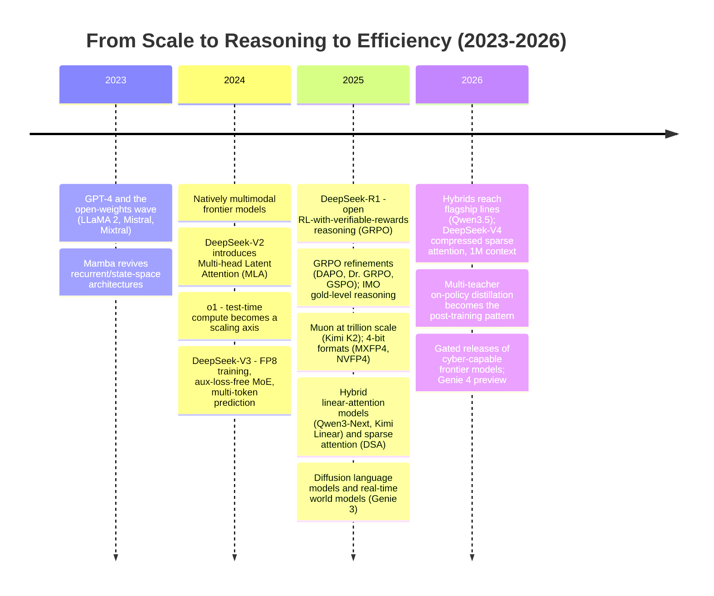

# 时间线：2023 年至今

这是四个历史文件中最新、也必然是最未尘埃落定的一个——这里的事件距本仓库的撰写时间（最后更新于 2026 年 11 月）很近，还没有像早期时代那样经过多年的回顾与学术复盘。根据本仓库的方法论（见 [scope-and-methodology.md](../00-overview/scope-and-methodology.md)），本文件只记录被广泛报道的进展，尽可能将其归因于具体的论文或技术报告，并把厂商自述的结论标注为"据报道"；真正面向未来的推测请见 [09-roadmaps](../09-roadmaps/)，那里的此类说法都明确标注了 `[Projection]`。

v3 更新（2026 年 11 月）把本文件早先以主题为主的版本，改写成了带日期、以技术为中心的编年史。这一时期的主线是**瓶颈发生了转移**：从"预训练能做多大？"（截至 2023 年），到"模型在推理时能思考多久？"（2024-2025 年），再到"如何低成本地服务超长上下文和超长推理轨迹，以及如何训练智能体？"（2025-2026 年）。

## 时间线图

## 2023 年：GPT-4、开放权重与循环结构的回归

**发生了什么。** GPT-4（OpenAI，2023 年 3 月）确立了当年的前沿水准；与此同时，Meta 的 LLaMA 2（2023 年 7 月）、Mistral 7B（2023 年 9 月）和 Mixtral 8x7B（2023 年 12 月）建立起一个有竞争力的开放权重生态。其中 Mixtral 让稀疏混合专家模型（见 [mixture-of-experts.md](../03-deep-learning-architectures/mixture-of-experts.md)）在开源社区得到广泛使用。2023 年 12 月，Gu 和 Dao 提出的 **Mamba** 表明，选择性状态空间模型可以在语言建模上匹敌同等规模的 Transformer，并且以线性时间运行——这让循环架构重新成为严肃的研究方向（见 [state-space-models.md](../03-deep-learning-architectures/state-space-models.md)）。

**为何对这段历史重要。** 与 2020-2022 年相比，最佳开放权重模型与最佳闭源模型之间的差距大幅缩小，尽管闭源前沿实验室在任一时间点通常仍保有最强的系统。事后看来，Mamba 的意义与其说是"取代 Transformer"，不如说是"提供了一种廉价的层类型，后来被混入 Transformer 之中"——见下文 2025 年部分。

## 2024 年：多模态、更便宜的注意力与测试时计算

**原生多模态前沿模型。** 前沿研发从"每种模态一个独立模型再拼接起来"，转向用同一套权重训练能处理文本、图像、音频（以及越来越多的视频）的单一模型——GPT-4o（2024 年 5 月）和 Gemini 系列是常被引用的例子。"原生多模态"成为标配，而非附加功能。

**长上下文与更便宜的注意力。** 上下文窗口从数万个 token 增长到数十万乃至更多。这给 KV 缓存带来的成本压力（见 [kv-cache-and-attention-optimization.md](../06-inference-optimization/kv-cache-and-attention-optimization.md)）推动了一系列注意力机制的重新设计，其中最有影响力的是 DeepSeek-V2（2024 年 5 月）中的**多头潜在注意力（Multi-head Latent Attention, MLA）**：每个 token 只缓存一个很小的压缩潜在向量，而不是每个注意力头完整的键和值。

**测试时计算（2024 年 9 月）。** OpenAI 的 **o1** 是第一个被广泛部署的*推理模型*：它通过强化学习训练，在回答之前先生成一条很长的内部思维链。其核心发现是：允许模型在推理时"思考"得越久，准确率就会持续提升——**测试时计算（test-time compute）**由此成为与预训练算力并列的第二条扩展轴（见 [rl-for-llms.md](../07-reinforcement-learning/rl-for-llms.md)）。

**大规模训练效率（2024 年 12 月）。** DeepSeek-V3（总参数 671B / 激活参数 37B）在一份公开技术报告中记录了若干后来被广泛效仿的技术：前沿规模的 **FP8 混合精度训练**（见 [quantization.md](../06-inference-optimization/quantization.md)）、MoE 路由器的**无辅助损失负载均衡**，以及**多 token 预测（MTP）**训练目标——其额外的预测头还可以兼作投机解码的草稿模型（见 [speculative-decoding.md](../06-inference-optimization/speculative-decoding.md)）。同一时期，**Muon** 优化器（2024 年）出现在训练竞速和研究场景中（见 [optimization-algorithms.md](../01-foundations/optimization-algorithms.md)）。

## 2025 年：开放的推理模型、RL 改进与高效架构

**DeepSeek-R1（2025 年 1 月）。** DeepSeek 以开放权重发布了 R1 和 R1-Zero，并附上详细报告：使用 **GRPO**，针对可自动验证的奖励（数学答案、单元测试）进行大规模强化学习。R1-Zero 表明，直接在基座模型上做 RL、无需监督微调，就能涌现出长思维链行为；随后推理能力又被蒸馏进小得多的稠密模型。它的影响与其说在于某个具体基准分数，不如说在于把推理模型的配方公开了。几个月内，一系列 GRPO 改进相继出现——**DAPO**、**Dr. GRPO** 和 **GSPO**——各自修正了某种特定的偏差或不稳定性（见 [rl-for-llms.md](../07-reinforcement-learning/rl-for-llms.md) 和 [policy-gradient-methods.md](../07-reinforcement-learning/policy-gradient-methods.md)）。

**推理里程碑。** 2025 年 7 月，据报道 Google DeepMind 和 OpenAI 的实验性推理模型在国际数学奥林匹克（IMO）题目上达到了金牌水平——这是一个象征性的标志，说明经 RL 训练的推理能力在大约一年内进步了多少。

**优化器与数值格式。** Moonshot 的 Kimi K2（2025 年 7 月，总参数约 1T / 激活参数 32B）使用 **MuonClip** 训练——即 Muon 加上防止注意力 logit 爆炸的"QK-clip"保护机制——这是 Muon 在万亿参数规模上的首次公开验证。OpenAI 的开放权重模型 **gpt-oss**（2025 年 8 月）直接以 **MXFP4**（一种 4 位微缩放浮点格式）发布其 MoE 权重；NVIDIA 则报告用 **NVFP4** 在 10T token 上预训练了一个 12B 模型，质量接近 FP8（2025 年 9 月；见 [quantization.md](../06-inference-optimization/quantization.md)）。

**混合注意力与稀疏注意力。** 针对长上下文成本的两种互补方案进入了大型生产模型。*混合架构*把廉价的**线性注意力**层——尤其是维护固定大小循环状态的 **Gated DeltaNet**——与少量全注意力层交错排列，例如 Qwen3-Next（2025 年 9 月，约 3 层线性 : 1 层全注意力）和 Kimi Linear（2025 年 10 月），此前已有 Jamba 和 NVIDIA 的 Nemotron-H 等混合模型（见 [state-space-models.md](../03-deep-learning-architectures/state-space-models.md)）。*稀疏注意力*保留完整注意力，但让每个查询只关注过去 token 中被选中的一个子集——DeepSeek-V3.2 的 **DeepSeek 稀疏注意力（DSA）**使用一个轻量的"闪电索引器（lightning indexer）"挑选 top-k 个 token（见 [kv-cache-and-attention-optimization.md](../06-inference-optimization/kv-cache-and-attention-optimization.md)）。Qwen 的**门控注意力（gated attention）**论文（一个能消除注意力汇聚点的输出门）获得了 NeurIPS 2025 最佳论文奖。

**推理服务。** 把预填充（prefill）和解码（decode）拆分到不同的 GPU 池上，再加上激进的前缀缓存，成为主流的服务实践（见 [serving-and-batching.md](../06-inference-optimization/serving-and-batching.md)）——部分推动力来自推理模型：它们的输出非常长，使解码成为主要成本。

**自回归文本之外。** **扩散语言模型**——通过迭代地并行"揭开"大量被掩码的 token 来生成文本，而不是一次生成一个——从研究（LLaDA）走向产品（Inception 的 Mercury；Google 实验性的 Gemini Diffusion）；见 [diffusion-models.md](../04-generative-models/diffusion-models.md)。Google DeepMind 的 **Genie 3**（2025 年 8 月）展示了可实时漫游的生成世界，Dreamer 4 则完全在学到的世界模型内部学会了一项困难的 Minecraft 任务（见 [model-based-rl.md](../07-reinforcement-learning/model-based-rl.md)）。在表格数据机器学习方面，**TabPFN v2**（《自然》，2025 年 1 月）表明，一个预训练的 Transformer 在小数据集上可以与调优后的梯度提升树相竞争（见 [ensemble-methods.md](../02-classical-ml/ensemble-methods.md)）。

**前沿发布节奏。** 闭源前沿以每个实验室每隔几个月一次的节奏推进——包括 GPT-5（2025 年 8 月）、Gemini 3 Pro 和 Claude Opus 4.5（2025 年 11 月）——推理、工具使用和编程智能体是主要竞争维度。

## 2026 年（截至 11 月）：前沿的效率、蒸馏与分级发布

**混合架构进入旗舰产品线。** 2026 年初的 Qwen3.5 把实验性的 Qwen3-Next 中 3:1 的 Gated DeltaNet : 门控注意力布局带入了阿里巴巴的主力模型线，这有力地表明：至少对一个主要的开放权重模型家族而言，混合架构已从实验变为默认选择。

**DeepSeek-V4（2026 年 4 月，据报道）。** DeepSeek 的技术报告描述了一个总参数 1.6T / 激活参数 49B 的 MoE（V4-Pro）和一个 284B / 13B 的变体（V4-Flash），两者都支持 100 万 token 上下文。其架构基于**压缩稀疏注意力（Compressed Sparse Attention, CSA）**与**重度压缩注意力（Heavily Compressed Attention, HCA）**的混合——把一组 token 压缩成单个 KV 条目，再在压缩后的历史加上一个近期 token 窗口上做稀疏或稠密注意力——同时采用**流形约束超连接（mHC）**（残差连接的一种稳定化推广，见 [transformer-architecture.md](../03-deep-learning-architectures/transformer-architecture.md)）和 Muon 优化器。报告称，在相同的长上下文长度下，其每 token FLOPs 约为 V3.2 的四分之一，KV 缓存约为十分之一。

**后训练向在线策略蒸馏收敛。** 随着 RL 训练越来越昂贵，且在一次 RL 训练中混合多种技能会导致能力相互干扰，2026 年前沿训练配方中被广泛报道的一种模式是：先用 RL 分别训练若干专家模型（数学、代码、智能体工具使用等），再通过**多教师在线策略蒸馏（multi-teacher on-policy distillation）**把它们合并进一个学生模型——学生自己生成输出，教师逐 token 打分（见 [rl-for-llms.md](../07-reinforcement-learning/rl-for-llms.md) 和 [pruning-and-distillation.md](../06-inference-optimization/pruning-and-distillation.md)）。为智能体训练构建逼真的 **RL 环境**成为一个主要投入方向。

**研究界的认可。** ICML 2026（7 月，首尔）的两篇杰出论文奖都授予了扩散相关研究——其中一篇质疑任意生成顺序对扩散语言模型究竟有多大帮助——时间检验奖则授予了 2016 年的 A3C 论文。《麻省理工科技评论》把机制可解释性列入 2026 年十大突破性技术（见 [open-problems.md](../09-roadmaps/open-problems.md)）。持续学习领域研究活跃但仍处早期（Google 的 Nested Learning；测试时训练方法），尚无前沿规模的解决方案。

**分级发布。** 2026 年，前沿实验室开始因其最强模型的进攻性网络安全能力而分阶段开放访问——据报道会先让经过审核的网络防御者提前或独家使用，再广泛发布——美国也在 2026 年 6 月签署了一项关于前沿 AI 与网络安全的行政令（据报道）。这是否会成为持久的行业惯例，目前尚无定论。

**世界模型。** Google DeepMind 于 2026 年 10 月预览了 **Genie 4**（据报道），增加了原生音频和更长的场景一致性，并将其部分定位为在仿真中预演机器人任务的手段。

## 事后回看本文件早先的主题

| 主题（2026 年年中时的表述） | 目前的记录显示（2026 年 11 月） |
|---|---|
| 开放权重竞争与 MoE | 开放 MoE 模型总参数达到 1T 以上，而每个 token 只激活百分之几（Kimi K2、DeepSeek-V4） |
| 多模态融合 | 已是基本预期；竞争转向推理与智能体能力 |
| 长上下文扩展 | 开放模型达到 100 万 token 上下文；难点在于成本（KV 缓存）和实际可用性，由 MLA、稀疏/压缩注意力和混合架构来应对 |
| 基于可验证奖励的 RL | 成为推理模型训练的核心（o1、R1）；经 DAPO/GSPO 改进；越来越多地与在线策略蒸馏结合 |
| 智能体/工具使用训练 | 沙箱环境中的智能体 RL 已是标准的后训练阶段；可靠性仍是开放问题 |

## 关于撰写如此贴近当下的历史

从构造上说，本文件是本仓库历史叙事中最有可能在几年后显得不完整、或权重分配不同的部分——这里被视为重要的某些事件，可能并不像现在看起来那样具有持久意义；而一些尚未被广泛报道的安静进展，回头看可能更为重要。2026 年的若干条目依据的是厂商技术报告或媒体报道，在撰写时尚未被独立复现，因此都标注了"据报道"。这正是本仓库要在本文件（被广泛报道的过去/当前进展）与 [09-roadmaps](../09-roadmaps/)（明确标注的前瞻性推测）之间划出清晰界线的原因。

## 与其他文件的关系

- 本文件直接承接 [timeline-2017-2023.md](timeline-2017-2023.md)，是本仓库编年叙事的最新一段；[09-roadmaps](../09-roadmaps/) 从这里接续，进入明确的推测领域。
- 推理模型与基于可验证奖励的 RL：[rl-for-llms.md](../07-reinforcement-learning/rl-for-llms.md)。长上下文成本与注意力重新设计：[kv-cache-and-attention-optimization.md](../06-inference-optimization/kv-cache-and-attention-optimization.md) 和 [state-space-models.md](../03-deep-learning-architectures/state-space-models.md)。低精度格式：[quantization.md](../06-inference-optimization/quantization.md)。扩散语言模型：[diffusion-models.md](../04-generative-models/diffusion-models.md)。

## 来源

- OpenAI, "GPT-4 Technical Report" (2023)
- Touvron et al. (Meta), "Llama 2: Open Foundation and Fine-Tuned Chat Models" (2023); Jiang et al. (Mistral AI), "Mixtral of Experts" (2024)
- Gu & Dao, "Mamba: Linear-Time Sequence Modeling with Selective State Spaces" (2023)
- DeepSeek-AI, "DeepSeek-V2: A Strong, Economical, and Efficient Mixture-of-Experts Language Model" (2024) [MLA]
- OpenAI, "Learning to Reason with LLMs" (2024 年 9 月) [o1，测试时计算]
- DeepSeek-AI, "DeepSeek-V3 Technical Report" (2024 年 12 月)
- DeepSeek-AI, "DeepSeek-R1: Incentivizing Reasoning Capability in LLMs via Reinforcement Learning" (2025)
- Yu et al. (ByteDance Seed), "DAPO: An Open-Source LLM Reinforcement Learning System at Scale" (2025); Liu et al., "Understanding R1-Zero-Like Training: A Critical Perspective" (2025) [Dr. GRPO]; Zheng et al. (Qwen), "Group Sequence Policy Optimization" (2025)
- Kimi Team (Moonshot AI), "Kimi K2: Open Agentic Intelligence" (2025) [MuonClip]; Kimi Team, "Kimi Linear" (2025)
- OpenAI, gpt-oss 模型卡 (2025 年 8 月) [MXFP4]；NVIDIA, "Pretraining Large Language Models with NVFP4" (arXiv 2509.25149, 2025; v2 2026)
- Qwen Team, Qwen3-Next (2025) 与 Qwen3.5 (2026) 模型发布；Qiu et al. (Qwen), "Gated Attention for Large Language Models" (NeurIPS 2025)
- DeepSeek-AI, DeepSeek-V3.2 (2025) [DeepSeek 稀疏注意力]；DeepSeek-AI, "mHC: Manifold-Constrained Hyper-Connections" (2025/2026)；DeepSeek-AI, DeepSeek-V4 技术报告 (2026 年 4 月) [所引数据来自二手报道的总结]
- Nie et al., "Large Language Diffusion Models" (LLaDA, 2025)；Inception Labs, Mercury 发布公告 (2025-2026，厂商自述)
- Google DeepMind, Genie 3 (2025 年 8 月) 与 Genie 4 研究预览 (2026 年 10 月，据报道)；Hafner et al., "Training Agents Inside of Scalable World Models" (Dreamer 4, 2025)
- Hollmann et al., "Accurate predictions on small data with a tabular foundation model" (Nature, 2025) [TabPFN v2]
- Behrouz et al. (Google), "Nested Learning: The Illusion of Deep Learning Architectures" (NeurIPS 2025)
- Lambert & Timbers, 前沿后训练配方综述 (2026 年 6 月) [多教师在线策略蒸馏模式]
- ICML 2026 获奖公告 (2026 年 7 月)；《麻省理工科技评论》, "10 Breakthrough Technologies 2026"
- 关于 2026 年前沿模型分级发布及 2026 年 6 月美国前沿 AI 与网络安全行政令的媒体报道（据报道；本文未独立核实）
