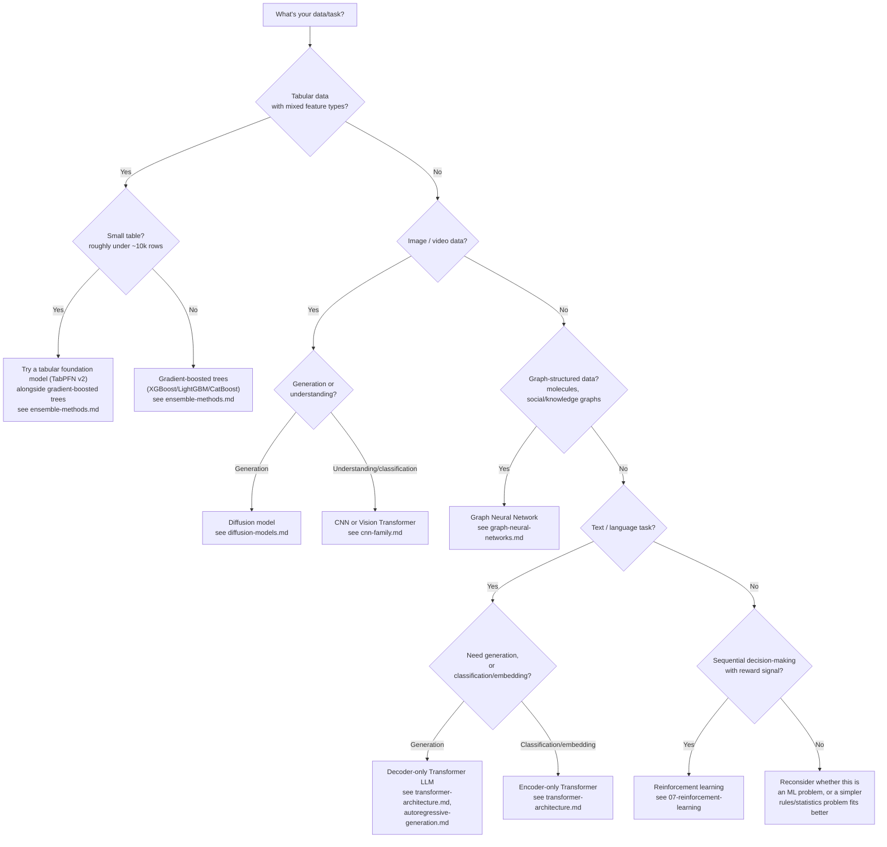

# 何时使用什么

这是从本仓库其余部分综合而来的实用决策指南——这里不引入任何新算法。先用决策树快速筛选一遍，再阅读其下方的解释文字，了解每个分支背后的理由。

## 决策树：选择建模方法

## 经典机器学习 vs. 深度学习

**在以下情况使用经典机器学习（尤其是梯度提升树——见 [ensemble-methods.md](../02-classical-ml/ensemble-methods.md)）：** 数据是表格形式、特征数量适中、数据集规模相对于有竞争力的深度模型所需而言偏小到中等，并且可解释性或快速迭代很重要。对于非常小的表格，现在值得在提升树之外再试一试预训练的表格基础模型，例如 TabPFN v2（2025 年）——它无需针对每个数据集调参，几秒钟内就能完成上下文内预测——但对于中大型表格数据，提升树仍是默认选择。正如 [ensemble-methods.md](../02-classical-ml/ensemble-methods.md) 所述，这并不是"退而求其次"——在真正的表格数据上，梯度提升树经常*优于*深度学习，原因是结构性的（特征异质且不平滑；相对于有竞争力的深度模型规模，数据集偏小），并不会因为更多的研究投入而消失。

**在以下情况使用深度学习：** 数据具有有意义的空间、序列或关系结构（图像、音频、文本、图），架构可以将其作为归纳偏置加以利用（见 [cnn-family.md](../03-deep-learning-architectures/cnn-family.md)、[transformer-architecture.md](../03-deep-learning-architectures/transformer-architecture.md)、[graph-neural-networks.md](../03-deep-learning-architectures/graph-neural-networks.md)），和/或有足够的数据让学习到的表示胜过人工设计的特征。

## 选择优化器

根据 [optimization-algorithms.md](../01-foundations/optimization-algorithms.md)：几乎任何深度学习训练任务都**默认使用 AdamW**，除非你有特定理由不这样做。对于有工程能力进行验证的大规模预训练，**Muon（配合类似 QK-clip 的保护机制）**如今是针对矩阵形状权重的一个可信、且经过生产验证的替代方案——它在 2025-2026 年被用于万亿参数规模。只有在进行大规模预训练、并且有工程能力在你的具体设置上把替代方案与 AdamW 对比验证时，才考虑 Lion 或 Sophia；在跨大量加速器扩展到非常大的批量时，专门考虑 LAMB/LARS。

## 选择生成模型家族

根据 [04-generative-models](../04-generative-models/)：**对于图像/视频/音频，默认使用扩散模型**（见 [diffusion-models.md](../04-generative-models/diffusion-models.md)），除非你确实需要类似 GAN 的单次前向快速采样（见 [gans.md](../04-generative-models/gans.md)）或精确的似然计算（基于流的模型——见 [flow-based-models.md](../04-generative-models/flow-based-models.md)），截至 2026 年末，这两者都是较窄的小众场景。**对于文本，自回归的仅解码器生成是默认选择**（见 [autoregressive-generation.md](../04-generative-models/autoregressive-generation.md)）——目前还没有主流替代方案能在开放式文本生成上取代它。当原始生成速度/延迟是硬性约束、并且你能接受生态尚不成熟时，**扩散语言模型**（见 [diffusion-models.md](../04-generative-models/diffusion-models.md)）值得评估。

## 选择微调方法

根据 [finetuning-and-peft.md](../05-training-methodology/finetuning-and-peft.md)：将预训练模型适配到新任务或新领域时，**默认使用 LoRA**；**当硬件内存是硬性约束时使用 QLoRA**；**全量微调留给**最高任务性能值得付出明显更高计算/内存成本的情况，或进行大规模继续预训练而非狭窄任务适配的情况。

## 选择对齐/后训练方法

根据 [rlhf-and-alignment.md](../05-training-methodology/rlhf-and-alignment.md)：如果你想要一个更简单、更稳定且无需 RL 基础设施的流程，偏好微调**默认使用 DPO**；如果你确实需要一个独立、可复用的奖励模型，或需要对训练进行更细粒度的基于 RL 的控制，**使用完整的 RLHF**；对于正确性可自动检验的领域（数学、代码、逻辑），**使用基于可验证奖励的 RL**（见 [rl-for-llms.md](../07-reinforcement-learning/rl-for-llms.md)），并把它与面向开放式任务的偏好方法叠加使用，而不是替代后者。在基于可验证奖励的 RL 内部，**从带有 DAPO/Dr. GRPO 修正的 GRPO 起步**，**对大型 MoE 模型优先采用 GSPO 式的序列级比率**。如果你需要一个模型同时擅长多项经 RL 训练的专长，2026 年的做法是**分别训练专家模型，再用在线策略蒸馏把它们合并**，而不是把所有东西混在一次 RL 训练里；如果你只需要一个更小的模型具备某个更强模型的技能，从该模型做在线策略蒸馏通常比自己跑 RL 便宜得多。

## 选择推理优化

根据 [06-inference-optimization](../06-inference-optimization/)：**几乎总是应用 FlashAttention 和连续批处理**——它们近乎免费的收益，且没有质量权衡（见 [kv-cache-and-attention-optimization.md](../06-inference-optimization/kv-cache-and-attention-optimization.md) 和 [serving-and-batching.md](../06-inference-optimization/serving-and-batching.md)）。当内存/成本是硬性约束、并且你能验证精度影响对你的用例可接受时，**应用量化**（见 [quantization.md](../06-inference-optimization/quantization.md)）。当延迟很重要、并且你能维护一个匹配良好的草稿模型，或使用无需单独草稿模型的变体（Medusa、EAGLE 式草稿头、模型自身的多 token 预测头，或前瞻解码）时，**应用投机解码**（见 [speculative-decoding.md](../06-inference-optimization/speculative-decoding.md)）。当你知道长上下文、高并发服务是优先事项时，**在训练时就选择 GQA 式架构**（它不像这里的其他技术那样容易事后加装）——而对于非常长的上下文（数十万到数百万 token），可以考虑 2024-2026 年出现的更强的架构选项：**MLA**、**稀疏/压缩注意力**或**混合线性注意力布局**（见 [kv-cache-and-attention-optimization.md](../06-inference-optimization/kv-cache-and-attention-optimization.md) 和 [state-space-models.md](../03-deep-learning-architectures/state-space-models.md)）。在新一代加速器上，**FP8 是稳妥的默认选择，而 4 位浮点格式（MXFP4/NVFP4）**越来越成为高性价比之选（见 [quantization.md](../06-inference-optimization/quantization.md)）；在大规模服务中，尤其是输出很长的推理模型，**应将预填充与解码分离，并开启前缀缓存**（见 [serving-and-batching.md](../06-inference-optimization/serving-and-batching.md)）。

## 与其他文件的关系

- 本文件的指导是对 [algorithm-comparison-master.md](algorithm-comparison-master.md) 和 [compute-cost-comparison.md](compute-cost-comparison.md) 的实用提炼——这些指导所依据的比较数据请阅读这两个文件。
- 关于这里任何建议背后的完整机制和理由，请顺着交叉链接进入相应章节的文件。
