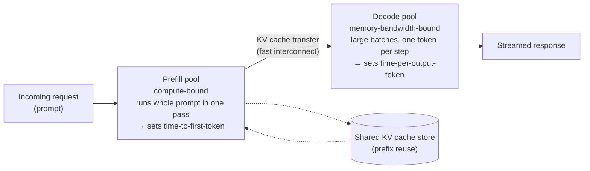

# Serving and Batching

This file covers how requests to a deployed LLM are actually scheduled and processed efficiently in production — the systems-level layer that sits on top of everything else in this section (quantization, KV cache management, speculative decoding) and determines how those techniques translate into real-world throughput and latency. It moves from batching (static and continuous), to the two phases of every request (prefill and decode) and why modern systems increasingly run them on separate hardware, to prefix caching, and finally to how reasoning models' long outputs have reshaped the serving workload.

## The throughput vs. latency tradeoff, framed

**Throughput** is how many requests (or tokens) a serving system can process per unit of time, in aggregate, across all users. **Latency** is how long any single request takes to get its response, from the perspective of the user waiting for it. These two goals are frequently in tension: batching many requests together (processing them simultaneously) tends to improve throughput (better utilization of the accelerator's parallel compute capacity — running one request at a time on a GPU built for massive parallelism leaves most of its capacity idle) but can increase individual latency (a request might have to wait for a batch to fill up, or share compute with other concurrent requests, before finishing). Most of the design choices in this file are, at bottom, different points on this same tradeoff curve.

For LLMs, latency is usually split into two numbers users actually feel: **time to first token (TTFT)** — how long before the response starts appearing — and **time per output token (TPOT)**, also called inter-token latency — how fast the response streams once it has started. As the prefill/decode section below explains, these two are governed by different phases of the computation.

## Static batching

**Mechanism.** Collect a fixed group of requests, process them together as one batch from start to finish, and only start a new batch once the entire previous batch has completely finished (every request in it has generated its full response).

**Limitation.** Because generated response lengths vary a lot (some responses are one sentence, others are pages long), a static batch is only as fast as its *slowest* member — shorter requests in the batch finish early but their allocated compute slot sits idle, waiting for the longest request in the batch to complete, before the system can start serving new requests in that slot. This wastes a substantial amount of potential throughput, especially as response-length variance grows.

## Continuous (dynamic) batching

**Mechanism.** Rather than waiting for an entire batch to finish before starting new work, continuously monitor the batch and, as soon as any individual request in it finishes generating its response, immediately swap in a new waiting request to take that freed-up slot — the batch's composition changes dynamically, request by request, rather than being fixed for its entire duration.

**Why it mattered.** This directly fixes static batching's central inefficiency: no accelerator capacity sits idle waiting for the single longest request in a batch to finish, since finished requests are replaced immediately rather than at the end of a fixed batch cycle. Continuous batching (sometimes called dynamic batching) has been widely reported to substantially improve achievable serving throughput relative to static batching, and is a standard, expected feature of modern high-throughput LLM serving systems as of late 2026.

**How this interacts with the KV cache.** Continuously swapping requests in and out of a batch means the serving system needs to efficiently allocate and free KV cache memory (see [kv-cache-and-attention-optimization.md](kv-cache-and-attention-optimization.md)) for individual requests on the fly, without needing to reshuffle or defragment the memory used by every other request still in progress — which is exactly the problem PagedAttention's block/page-table design (covered in that file) was built to solve efficiently. Continuous batching and PagedAttention-style memory management are, in practice, complementary techniques that are typically deployed together, not separately.

## Prefill vs. decode: two very different workloads

Every LLM request has two phases, and they stress the hardware in opposite ways.

- **Prefill** processes the whole prompt at once: all prompt tokens go through the model in one big parallel forward pass, filling the KV cache. That means large matrix-matrix multiplications that do a lot of arithmetic for each byte of weights loaded from memory. Prefill is **compute-bound** — limited by how fast the chip can do math — and it determines TTFT.
- **Decode** then generates the response one token at a time. Each step does only a small amount of math per sequence, yet it must read *all* the model's weights plus that request's entire KV cache from GPU memory. Decode is **memory-bandwidth-bound** — limited by how fast data can be moved from memory to the compute units — and it determines TPOT.

The useful concept here is **arithmetic intensity**: the number of arithmetic operations performed per byte moved from memory. Prefill has high arithmetic intensity (many tokens share each weight read); decode has low arithmetic intensity (one token per sequence per weight read). Batching many decode requests together raises decode's intensity, which is why batching matters so much — but the batch size is in turn capped by how much KV cache fits in memory.

**The interference problem.** When both phases share the same GPUs, a long new prompt's prefill can occupy the GPU for a while, stalling every in-progress decode in the batch — users see the stream "hiccup." One mitigation that keeps the phases on the same GPUs is **chunked prefill** (popularized by Sarathi-Serve, Agrawal et al., 2024): split long prefills into chunks and mix them into ongoing decode steps so neither phase starves the other.

## Prefill/decode disaggregation

**Name & definition.** **Disaggregated serving** (prefill/decode disaggregation) runs the prefill phase and the decode phase on *separate pools* of GPUs. A request is prefilled on a prefill worker; its KV cache is then transferred over a fast interconnect to a decode worker, which generates the response.



**Why it helps.** Each pool can be configured for its own bottleneck: the prefill pool for raw compute and fast TTFT, the decode pool for large batches and memory bandwidth (even with different parallelism settings or hardware types). Prefill bursts no longer disrupt decoding streams, and the two pools can be scaled independently as the mix of long prompts vs. long outputs shifts. DistServe framed the goal as maximizing **goodput** — the number of requests per second that meet *both* their TTFT and TPOT targets — rather than raw throughput.

**Tradeoffs.** Moving the KV cache between machines costs network bandwidth and adds a little latency, and the system is more complex to operate (two pools to balance, cache transfer to orchestrate). For small deployments or short-prompt workloads, colocated serving with chunked prefill can be simpler and nearly as good.

**Origin and adoption.** DistServe (Zhong et al., 2024) and Splitwise (Patel et al., 2024) made the research case; Moonshot AI's Mooncake (the serving platform behind its Kimi assistant, 2024–25) built a KV-cache-centric disaggregated architecture that also pools KV cache in CPU memory and storage; NVIDIA's open-source Dynamo framework (2025) made disaggregated serving with KV-cache-aware request routing broadly available. By 2025 disaggregation had gone mainstream for large-scale serving.

## Prefix caching (SGLang RadixAttention)

**The observation.** Many requests begin with the same tokens: a long system prompt, the same few-shot examples, tool definitions for an agent, or — most importantly — the entire earlier history of a multi-turn chat or agent session, resent with every new turn. Recomputing the prefill for that shared prefix every time is pure waste.

**The fix.** Keep the KV cache of previous requests around, and when a new request arrives, reuse the cached KV entries for the longest prefix it shares with something already in cache; only the new suffix needs prefill.

**RadixAttention.** Zheng et al., "SGLang: Efficient Execution of Structured Language Model Programs" (2024), organizes cached KV entries in a **radix tree** — a prefix tree whose edges are labeled with token sequences — so finding the longest cached prefix is a simple tree walk, and requests that branch from a shared prefix (several samples from one prompt, the branches of a search over reasoning paths) share the common part automatically. Least-recently-used leaves are evicted when memory runs low, and the scheduler can favor requests whose prefixes are already cached. Other stacks implement the same idea differently (vLLM, for example, hashes fixed-size KV blocks), and commercial APIs expose it to customers as discounted pricing for cached input tokens.

```
 Radix tree of cached prefixes (each edge = a run of tokens with its KV cache stored):

 [system prompt + tool definitions]
        ├── [user turn 1] ── [assistant turn 1] ── [user turn 2]   ← agent session A
        └── [few-shot examples] ─┬── [question X]                  ← request B
                                 └── [question Y]                  ← request C (reuses everything above it)
```

**Interplay with disaggregation.** In a multi-GPU fleet, a request should ideally be routed to a worker that already holds its prefix — "KV-cache-aware routing," a central feature of systems like Mooncake and Dynamo.

## Reasoning models: when decode dominates

**What changed.** Reasoning models — starting with OpenAI's o1 (Sep 2024) and, in open weights, DeepSeek-R1 (Jan 2025) — spend **test-time compute** (also called inference-time scaling: using more computation at answer time, here in the form of more generated "thinking" tokens) to improve accuracy. A single answer can involve thousands of reasoning tokens before the visible response. See [rl-for-llms.md](../07-reinforcement-learning/rl-for-llms.md) for how these models are trained.

**What that does to serving.**
- **Decode dominates.** Output tokens now often far exceed input tokens, so most GPU time goes to the memory-bandwidth-bound decode phase. Every technique that speeds up decode — smaller KV caches (MLA, sparse and compressed attention; see [kv-cache-and-attention-optimization.md](kv-cache-and-attention-optimization.md)), lower-precision weights ([quantization.md](quantization.md)), and speculative decoding ([speculative-decoding.md](speculative-decoding.md)) — becomes more valuable.
- **KV caches grow large and live long.** A request accumulates cache throughout a long generation and holds it until it finishes, which limits batch size and makes memory management and cache size reduction even more important.
- **Output lengths are long-tailed.** Some requests think briefly, some for a very long time — exactly the variance that continuous batching handles and static batching cannot.
- **Agentic workloads add prefix reuse.** Agents call tools and come back many times with a growing shared context, which makes prefix caching and cache-aware routing a large win.

In short, the 2024–2026 shift toward test-time compute moved the center of gravity of LLM serving from "process prompts fast" toward "stream long outputs cheaply," and disaggregation, prefix caching, and decode-side optimizations are the systems response.

## Reference systems: vLLM, SGLang, TensorRT-LLM, and Dynamo

**vLLM.** An open-source LLM serving system (the system that introduced PagedAttention — see [kv-cache-and-attention-optimization.md](kv-cache-and-attention-optimization.md)) built specifically around continuous batching and efficient, paged KV cache memory management, widely adopted across the open-source and research community as a high-throughput serving solution.

**SGLang.** An open-source serving system (Zheng et al., 2024) that introduced RadixAttention prefix caching, and which, alongside vLLM, is among the most widely used open-source LLM serving engines (widely reported).

**TensorRT-LLM (NVIDIA).** A serving/inference-optimization toolkit that applies hardware-specific compilation and kernel optimization (tailored specifically to NVIDIA GPU architectures) alongside techniques like continuous batching and quantization support, aimed at maximizing throughput and minimizing latency specifically on NVIDIA hardware.

**NVIDIA Dynamo (2025).** An open-source orchestration layer for serving across many GPUs that adds disaggregated prefill/decode and KV-cache-aware routing on top of engines such as vLLM, SGLang, and TensorRT-LLM.

**Why these are worth naming.** These systems are widely-used, concrete, real-world examples that combine essentially every technique covered across this section — quantization (see [quantization.md](quantization.md)), efficient KV cache management, continuous batching, prefix caching, disaggregation, and speculative decoding (see [speculative-decoding.md](speculative-decoding.md)) — into deployable serving stacks, illustrating that these techniques are used in combination in practice, not as isolated academic curiosities.

## How KV cache management interacts with batching decisions

Tying together this section's core throughline: the KV cache's memory footprint (see [kv-cache-and-attention-optimization.md](kv-cache-and-attention-optimization.md)) directly limits how many concurrent requests can be batched together within a fixed memory budget — a larger per-request KV cache (from longer contexts, or from an architecture without MQA/GQA/MLA-style cache-size reduction) means fewer requests can be batched simultaneously, which directly reduces achievable throughput. This is why architectural choices (decided at pretraining time), quantization (applied to the model and sometimes the KV cache itself), PagedAttention-style memory management and prefix caching (applied at serving time), and disaggregation (applied at the cluster level) all ultimately serve the same downstream goal from different angles: fitting more useful concurrent work into a fixed amount of expensive accelerator memory, which is the central resource constraint that essentially every technique in this section of the repository is, in one way or another, trying to relax.

## Comparison table

| Approach | Throughput | Latency for short requests | Handles variable response length well? |
|---|---|---|---|
| Static batching | Lower (idle slots while waiting for longest request) | Can be poor (short requests wait for whole batch) | No |
| Continuous (dynamic) batching | Higher (slots refilled immediately) | Better (finished requests exit immediately) | Yes |

| Technique | Problem it addresses | Main cost / tradeoff | Example systems |
|---|---|---|---|
| Chunked prefill | Long prefills stalling in-progress decodes on shared GPUs | Slightly slower prefill; scheduling complexity | Sarathi-Serve; supported in vLLM, SGLang |
| Prefill/decode disaggregation | Compute-bound and bandwidth-bound phases interfering; can't tune for both | KV cache transfer between machines; operational complexity | DistServe, Splitwise, Mooncake, NVIDIA Dynamo |
| Prefix caching | Recomputing prefill for shared prompts and chat/agent history | Memory to hold cached prefixes; eviction policy | SGLang RadixAttention, vLLM automatic prefix caching |
| KV-cache-aware routing | Requests landing on workers that don't hold their prefix | Router needs cluster-wide view of cache contents | Mooncake, NVIDIA Dynamo |

## Relationship to other algorithms

- Continuous batching's efficiency gains are directly enabled by the KV cache memory management covered in [kv-cache-and-attention-optimization.md](kv-cache-and-attention-optimization.md); PagedAttention's block structure is also what makes block-level prefix sharing cheap.
- Quantization (see [quantization.md](quantization.md)) reduces per-request memory footprint, directly increasing the number of requests that can be batched within a fixed memory budget, and lower-precision weights speed up the bandwidth-bound decode phase.
- Speculative decoding (see [speculative-decoding.md](speculative-decoding.md)) and batching are complementary throughput levers, both commonly deployed together in production serving stacks.
- Reasoning models and test-time compute (see [rl-for-llms.md](../07-reinforcement-learning/rl-for-llms.md)) are the main reason decode-phase efficiency has become the dominant serving concern.

## Sources

- Yu et al., "Orca: A Distributed Serving System for Transformer-Based Generative Models" (2022) — widely credited with introducing continuous/iteration-level batching for LLM serving
- Kwon et al., "Efficient Memory Management for Large Language Model Serving with PagedAttention" (2023) [vLLM]
- Zheng et al., "SGLang: Efficient Execution of Structured Language Model Programs" (2024) [RadixAttention prefix caching]
- Agrawal et al., "Taming Throughput-Latency Tradeoff in LLM Inference with Sarathi-Serve" (2024) [chunked prefill]
- Zhong et al., "DistServe: Disaggregating Prefill and Decoding for Goodput-optimized Large Language Model Serving" (2024)
- Patel et al., "Splitwise: Efficient Generative LLM Inference Using Phase Splitting" (2024)
- Qin et al., "Mooncake: A KVCache-centric Disaggregated Architecture for LLM Serving" (2024; Moonshot AI / Kimi)
- NVIDIA, Dynamo open-source inference framework (2025) [disaggregated serving, KV-cache-aware routing]
- OpenAI, "Learning to Reason with LLMs" (o1, Sep 2024); DeepSeek-AI, "DeepSeek-R1" (2025) [reasoning models and test-time compute]
