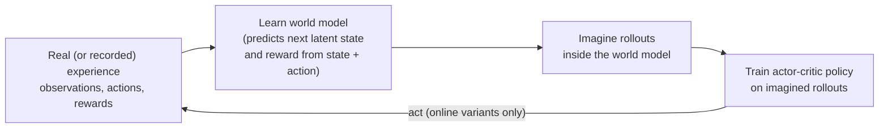

# Model-Based RL

Model-based reinforcement learning is the counterpart to the model-free methods covered in [value-based-methods.md](value-based-methods.md) and [policy-gradient-methods.md](policy-gradient-methods.md): rather than learning purely from direct trial-and-error interaction with the real environment, a model-based agent learns (or is given) a model of how the environment behaves, and uses that model to plan or simulate ahead.

## World models

**Name & definition.** A world model is a learned (or given) representation of how an environment evolves — given the current state and an action, what state (and reward) comes next. Once you have such a model, an agent can "imagine" the likely consequences of different action sequences without actually having to execute them in the real environment, and use that imagined lookahead to plan better decisions or to generate additional synthetic training experience.

**Why this is valuable in principle.** Real-world interaction is often expensive, slow, or risky (a robot damaging itself while exploring randomly, a game taking real wall-clock time to play out, a real-world trial being simply impossible to run many times). A good world model lets an agent get much of the benefit of "trying things out" — seeing what would likely happen — without paying the real cost of doing so.

## MuZero

**Origin.** Schrittwieser et al. (DeepMind), "Mastering Atari, Go, Chess and Shogi by Planning with a Learned Model" (2019/2020).

**Core mechanism (brief but concrete).** MuZero learns three connected components, entirely from data, without ever being told the actual rules of the games it's mastering: a **representation function** (maps raw observations, like a board position, into an internal state representation), a **dynamics function** (predicts what internal state and reward come next, given a current internal state and an action — MuZero's learned world model, but notably operating in this internal, abstract representation space rather than trying to predict raw pixels or a literal board layout), and a **prediction function** (estimates both a value and a recommended policy from a given internal state). These three pieces are used together inside a tree-search planning procedure (a Monte Carlo Tree Search — a systematic way of exploring possible future action sequences by simulating many possible continuations and using the results to judge which immediate action looks best) to decide on each actual move, and are all trained jointly based on how well the resulting plans and predictions actually matched real outcomes.

**Why it mattered.** Earlier successes in this vein (like DeepMind's AlphaGo and AlphaZero systems) relied on being given the exact rules of the game as a hand-coded simulator to plan against. MuZero's headline result was matching or exceeding that level of performance across multiple different games (Atari, Go, chess, shogi) while learning its own internal model of the "rules" and dynamics purely from experience, without ever being explicitly told them — demonstrating that planning-based approaches don't strictly require a hand-given environment simulator, only a good enough learned substitute.

## Dreamer: learning behavior inside a world model

**Name & definition.** The Dreamer family (Hafner et al., 2019 onward) are model-based agents that learn a compact world model from experience and then train their policy almost entirely on *imagined* rollouts generated by that model, rather than on real environment steps. The idea echoes Ha & Schmidhuber's "World Models" (2018), which showed an agent could learn to act inside its own learned "dream" of a simple game.

**Core mechanism (brief).** The loop has three parts that run repeatedly:

Walkthrough: the world model compresses observations (for example, game frames) into a small latent state and learns to predict how that state and the reward evolve given an action. The policy (an actor-critic, see [policy-gradient-methods.md](policy-gradient-methods.md)) is then trained on many cheap imagined trajectories. In the classic *online* setting, the improved policy goes back to collect more real experience, which improves the world model, and so on.

**Milestones.** **DreamerV3** (Hafner et al., 2023) used a single fixed set of hyperparameters across many domains and was the first algorithm to collect diamonds in Minecraft from scratch, without human data or hand-designed curricula — a long-horizon task requiring many sub-goals (gather wood, craft tools, mine deeper). **Dreamer 4** (Hafner et al., 2025) went further: it learned Minecraft diamond collection **purely from offline data** — a fixed dataset of recorded gameplay — by training the agent *inside* a learned world model, with no interaction with the real game during policy learning. That is the strongest demonstration so far of the core model-based promise: if the world model is good enough, real interaction can be replaced by imagination.

## Generative interactive world models: Genie 3 and Genie 4

A second line of work approaches world models from the generative-video side (see [diffusion-models.md](../04-generative-models/diffusion-models.md) for the generative machinery): train a large model to produce the *next frames* of a world in response to user or agent actions, so the model itself becomes a playable, explorable environment.

- **Genie (Bruce et al., Google DeepMind, 2024)** learned to generate controllable 2-D game-like environments from unlabeled internet video, inferring a set of latent actions without action labels. **Genie 2** (December 2024) extended this to 3-D environments.
- **Genie 3 (August 2025)** is a **real-time interactive world model**: from a text prompt it generates a navigable world that a user can move through live, keeping the world consistent for minutes (for example, remembering what was in a location you walked away from and returned to).
- **Genie 4 (research preview, 27 October 2026 — reported)** adds native audio generation and, reportedly, about two minutes of consistency, and is being explored as a way to **rehearse robot tasks in simulation** (reported). As of this writing, it is a research preview, not a broadly available product, and its capabilities are known mainly from the developer's own description.

**How these relate to MuZero and Dreamer.** MuZero's model is small, abstract, and task-specific — it predicts only what is needed to plan (values, policies, rewards). Dreamer's model is a compact latent simulator for one environment. Genie-style models are huge, general, and predict raw pixels (and now audio) for open-ended worlds. They are not RL algorithms in themselves; their relevance to RL is as **learned simulators** in which agents could be trained or evaluated.

## World models for robot-task rehearsal

**The idea.** Robotics is the domain where model-based RL's sample-efficiency argument bites hardest: real robot interaction is slow, expensive, and can break hardware. Classic robotics uses hand-built physics simulators; the newer idea is to use a *learned* world model — trained on large amounts of video and robot data — so that a robot policy can rehearse a task (pick up this object, open that drawer) many times in imagination before trying it in the real world, or so that candidate policies can be evaluated without running them on hardware. Genie 4's reported exploration for robot-task rehearsal is one high-profile example of this direction.

**Honest caveats.** This is the model-exploitation problem from the next section in its most acute form. A generative world model can produce visually convincing but physically wrong outcomes (objects that pass through each other, grasps that "succeed" in imagination but would slip in reality), and a policy optimized against such a model will happily exploit those errors. The gap between simulated and real performance — the **sim-to-real gap** — is the central open problem. As of late 2026, world-model rehearsal for robots is an active research direction with promising demonstrations, not an established replacement for real-world testing.

## Sample efficiency: the core motivation vs. model-free methods

**The core tradeoff.** Model-free methods (Q-learning, DQN, PPO, and the rest of [value-based-methods.md](value-based-methods.md) and [policy-gradient-methods.md](policy-gradient-methods.md)) generally require a very large number of real interactions with the environment to learn good behavior, since every bit of learning signal comes directly from actual trial and error. Model-based methods, once they have a reasonably accurate model, can generate large amounts of *additional*, "imagined" experience from that model — planning ahead, or training on simulated rollouts — substantially improving **sample efficiency** (how much real-world interaction is needed to reach a given level of performance).

**The catch.** This benefit is entirely conditional on the learned model actually being accurate enough to trust. An inaccurate world model can lead an agent to plan confidently around consequences that don't actually happen in the real environment — errors in the model can compound over a long imagined rollout, and the agent may end up "learning" a policy that's well-optimized for its flawed internal model rather than for reality. This is the central, honestly-stated tradeoff of the whole model-based approach: potentially much better sample efficiency, purchased at the cost of a genuinely harder learning problem (learning an accurate model in the first place) and a real risk of model-exploitation failure modes that model-free methods, by construction, don't have to worry about (since they never plan against an internal model that could be wrong).

## Current status

As of late 2026, model-based RL is more visible than at any point since MuZero, for two reasons: Dreamer 4 showed that a policy can be learned entirely inside a learned world model from offline data, and large generative world models (Genie 3, and the reported Genie 4 preview) made "a learned simulator of an open-ended world" concrete. Robotics is the main area where these threads are expected to converge, though that convergence is still at the research stage.

MuZero-style planning and Dreamer-style imagination training remain most prominent in domains with a clear, well-defined notion of state and action and where sample efficiency genuinely matters most (games, simulated control, robotics research), rather than as a general-purpose default across all of reinforcement learning. For the specific application most relevant to the rest of this repository — RL applied to LLM training and alignment (see [rl-for-llms.md](rl-for-llms.md) and [rlhf-and-alignment.md](../05-training-methodology/rlhf-and-alignment.md)) — model-free policy gradient methods (PPO and its critic-free GRPO-family descendants, plus the RL-free DPO alternative) remain the standard approach as of late 2026, rather than explicit world-model-based planning; the enormous, open-ended nature of language generation makes learning an explicit, trustworthy world model of "what happens next in this conversation" a substantially harder and less clearly-scoped problem than it is in a well-defined game environment.

## Comparison table

| Approach | Learns/uses a model? | Sample efficiency | Risk |
|---|---|---|---|
| Model-free (Q-learning, DQN, PPO) | No | Lower (needs more real interaction) | No model-exploitation risk |
| Model-based (world models, MuZero-style planning) | Yes | Higher, if the model is accurate | Compounding model errors can mislead planning |
| Imagination training (Dreamer family) | Yes — learned latent simulator | High; Dreamer 4 learned from offline data only | Policy may exploit world-model errors |
| Generative interactive world models (Genie-style) | They *are* the learned simulator | Potentially very high for embodied tasks | Physically wrong but plausible outputs; sim-to-real gap |

## Relationship to other algorithms

- Model-based RL is the direct structural counterpart to the model-free methods in [value-based-methods.md](value-based-methods.md) and [policy-gradient-methods.md](policy-gradient-methods.md).
- Dreamer's policy learning is actor-critic training (see [policy-gradient-methods.md](policy-gradient-methods.md)) run on imagined rather than real experience.
- Genie-style world models are large generative video models; their underlying generative machinery is related to [diffusion-models.md](../04-generative-models/diffusion-models.md) and [autoregressive-generation.md](../04-generative-models/autoregressive-generation.md).
- MuZero's tree-search planning procedure builds on ideas from AlphaGo/AlphaZero (referenced in [08-history/timeline-2017-2023.md](../08-history/timeline-2017-2023.md) in broader historical context).
- The sample-efficiency motivation here parallels, at a conceptual level, why synthetic data generation (see [curriculum-and-data-strategies.md](../05-training-methodology/curriculum-and-data-strategies.md)) is valuable in supervised/self-supervised settings — both are strategies for getting more learning signal than raw, real, human/environment-provided data alone would offer, with an analogous risk (model-generated data or model-generated experience compounding a model's existing errors) that this repository flags in both places.

## Sources

- Schrittwieser et al., "Mastering Atari, Go, Chess and Shogi by Planning with a Learned Model" (2019, published 2020)
- Silver et al., "Mastering the game of Go without human knowledge" (2017) [AlphaGo Zero, direct predecessor context]
- Ha & Schmidhuber, "World Models" (2018)
- Hafner et al., "Mastering Diverse Domains through World Models" (2023) [DreamerV3; Minecraft diamonds from scratch]
- Hafner et al., Dreamer 4 (2025) [Minecraft diamond collection learned purely from offline data inside a learned world model]
- Bruce et al. (Google DeepMind), "Genie: Generative Interactive Environments" (2024)
- Google DeepMind, Genie 2 (December 2024) and Genie 3 (August 2025) announcements [real-time interactive world model]
- Google DeepMind, Genie 4 research preview (27 October 2026) [reported: native audio, ~2-minute consistency, exploration for robot-task rehearsal]
