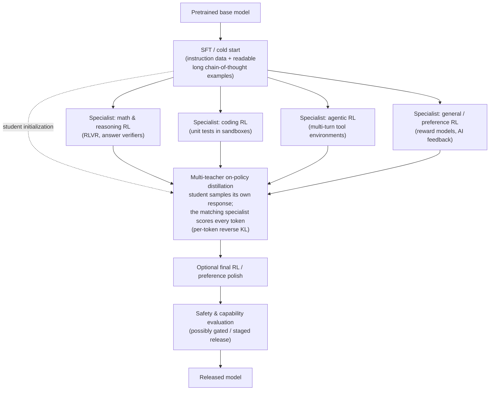

# RL for LLMs

This file is the dedicated bridge between the general reinforcement learning theory covered in [value-based-methods.md](value-based-methods.md), [policy-gradient-methods.md](policy-gradient-methods.md), and [model-based-rl.md](model-based-rl.md), and its specific application to training large language models. Rather than duplicating the full RLHF pipeline (covered end to end in [rlhf-and-alignment.md](../05-training-methodology/rlhf-and-alignment.md)), this file's job is to explain *how the general RL concepts map onto the specific case of an LLM*, and then to walk through the **RL-for-reasoning** direction — reinforcement learning against automatically checkable rewards — that, between 2024 and late 2026, became the single most important change in how frontier language models are post-trained (**post-training** = everything done to a model after pretraining: fine-tuning, RL, distillation).

The second half of this file is deliberately dated. The field moved fast, and the honest way to describe it is as a sequence of specific, cited events — o1 (2024), DeepSeek-R1 (2025), the GRPO refinement papers (2025), IMO 2025, agentic RL, and the 2026 shift toward consolidating specialist models with on-policy distillation — with a clear line between what was published in reproducible detail and what was only reported.

## Mapping the general RL framing onto LLMs

Using the Markov Decision Process vocabulary from [value-based-methods.md](value-based-methods.md):

- **State** — the prompt plus whatever tokens have been generated so far in the current response. Each time the model generates a new token, the state grows by one token.
- **Action** — choosing which token to generate next, from the model's entire vocabulary. This is a huge action space (tens of thousands to over a hundred thousand possible tokens at every single step) compared to the small, fixed action spaces (a handful of possible moves) common in classic RL benchmarks like Atari games or board games.
- **Policy** — the language model itself: its next-token probability distribution, given the current state, is exactly a policy π(a|s; θ) in the sense covered in [policy-gradient-methods.md](policy-gradient-methods.md).
- **Reward** — for RLHF specifically, the score assigned by a trained reward model (see [rlhf-and-alignment.md](../05-training-methodology/rlhf-and-alignment.md)) once a full response is complete; for the verifiable-reward approaches below, a reward computed by directly checking whether the final output is correct.
- **Episode** — one full prompt-to-response generation, from the first generated token to the end-of-response token. (In the agentic setting covered later, one episode can span many turns of tool calls and tool outputs.)

## Why PPO fits this setting (and why it's a genuinely unusual RL setting)

**The fit.** PPO's clipped surrogate objective (see [policy-gradient-methods.md](policy-gradient-methods.md)) constrains how much the policy's behavior can change in a single update — this maps naturally onto the RLHF concern of not letting a language model's outputs drift too erratically from a well-validated starting point (the SFT model) in any single training step, which is exactly the role the KL penalty plays in the RLHF objective (see [rlhf-and-alignment.md](../05-training-methodology/rlhf-and-alignment.md)).

**What makes this setting unusual, relative to classic RL benchmarks.** A few properties of the LLM-as-RL-environment setting are worth naming explicitly, since they differ meaningfully from the game-playing environments (Atari, Go, chess) where much of policy gradient theory was originally validated: the action space (vocabulary size) is enormous compared to classic RL benchmarks; a full "episode" (one generated response) can be very long (hundreds to tens of thousands of tokens/actions) with reward typically only available at the very end (a **sparse reward** setting — feedback arrives once, at the end of a long sequence of decisions, rather than continuously); and the "environment" itself doesn't have independent dynamics the way a game does — the next state is fully and deterministically determined by appending whatever token the policy itself just chose, with no external randomness or opponent to react to. These properties are part of why RLHF in practice leans on the value-function-based **advantage** estimation techniques from [policy-gradient-methods.md](policy-gradient-methods.md) (typically a learned value function estimating expected total reward from any partial response, paired with GAE-style advantage estimation) to convert a single end-of-episode reward signal into a usable per-token training signal — and also why the critic-free GRPO family described below, which skips that learned value function entirely, turned out to be so attractive.

## RL with verifiable rewards (RLVR) — the core idea

**The idea.** Rather than relying on a learned reward model trained from human preference comparisons (which is itself an imperfect, learned approximation of human judgment — see the "reward hacking" discussion in [rlhf-and-alignment.md](../05-training-methodology/rlhf-and-alignment.md)), some tasks have an objectively checkable correct answer — a math problem with a specific numerical answer, a coding problem with test cases that either pass or fail, a logic puzzle with a verifiable solution. For these tasks, the reward can be computed directly and automatically (did the final answer match the known correct answer? did the code pass the test suite?) by a small program called a **verifier**, rather than by a separate, imperfect, human-preference-trained reward model. This is now usually called **RL with verifiable rewards (RLVR)**.

**Why this matters as a distinct methodological shift.** A verifiable reward removes the learned proxy that sits between the policy and the true objective, so it is far harder to "game" than a learned reward model's blind spots. Training directly on "did you reach the correct answer" lets the model discover and reinforce whatever intermediate reasoning strategies actually lead to correct answers more often — checking its work, trying an alternative approach, breaking a problem into sub-steps — rather than optimizing toward what a reward model *believes* good reasoning looks like.

**Not quite "unhackable."** Earlier versions of this file called verifiable rewards unhackable; that overstates it. A verifier is only as good as its checks: a coding reward based on a weak test suite can be satisfied by code that special-cases the tests, and a math answer-matcher with loose parsing can be satisfied by malformed output. The honest statement is that verifiable rewards are *much harder* to exploit than learned reward models, and that the remaining exploits are bugs in the verifier that can, in principle, be found and fixed.

**The scope limit.** RLVR is naturally limited to domains where correctness is genuinely, automatically checkable. It doesn't directly extend to open-ended tasks like creative writing or nuanced advice, which still rely on preference-based reward modeling (RLHF/DPO-style methods, see [rlhf-and-alignment.md](../05-training-methodology/rlhf-and-alignment.md)) or AI-judged rewards. In practice, frontier pipelines combine both (see the pipeline section below).

## 2024: reasoning models and test-time compute (o1)

**What happened.** In September 2024 OpenAI released **o1**, the first widely-deployed **reasoning model** — a model trained to produce a long internal **chain of thought** (a sequence of intermediate reasoning steps written out as tokens before the final answer; the term comes from chain-of-thought prompting, Wei et al., 2022) and to use it productively. OpenAI's accompanying post, "Learning to Reason with LLMs," stated that o1 was trained with large-scale reinforcement learning, and that its performance improved both with more RL training compute and with more **test-time compute** — i.e., letting the model "think" longer at inference time.

**Why it mattered.** Before o1, the dominant scaling story was "spend more compute on pretraining." o1 established a second axis: spend compute *at inference time*, per question, by generating more reasoning tokens. This is often called **test-time compute scaling** or inference-time scaling (see [long-term-outlook.md](../09-roadmaps/long-term-outlook.md) for where it may lead). It also changes serving economics, since a single answer may now involve thousands of hidden reasoning tokens (see [serving-and-batching.md](../06-inference-optimization/serving-and-batching.md)).

**What was *not* disclosed.** OpenAI did not publish the training algorithm, the reward design, or the data. Everything the open research community learned about *how* to build such a model came primarily from the next event.

## January 2025: DeepSeek-R1 and R1-Zero

**What happened.** DeepSeek released **DeepSeek-R1** and **DeepSeek-R1-Zero** with open weights and a detailed paper. Both were trained with large-scale RLVR using **GRPO** (Group Relative Policy Optimization, introduced in DeepSeekMath, 2024 — see [rlhf-and-alignment.md](../05-training-methodology/rlhf-and-alignment.md) for the short version).

**R1-Zero: reasoning emerging from RL alone.** R1-Zero started from a pretrained *base* model — with **no** supervised fine-tuning first — and ran RL with simple rule-based rewards (is the final answer correct, and is the output in the required format). Over training, the paper reports, responses grew steadily longer and behaviors such as re-checking earlier steps and trying alternative approaches appeared without ever being demonstrated — a long chain of thought *emerged* from the reward signal. The paper also reports R1-Zero's practical problems: poor readability and mixing of languages within one response.

**R1: the practical multi-stage recipe.** R1 fixed those problems with a staged pipeline: a small "cold-start" SFT set of readable long chain-of-thought examples, then reasoning-focused RL, then a round of rejection sampling (generate many answers, keep the good ones) plus SFT on broader data, then a final RL stage covering both reasoning and general helpfulness/harmlessness. This "SFT → RL → SFT → RL" shape became a template for open reasoning models.

**Distillation to small models.** DeepSeek also fine-tuned several much smaller dense open models on reasoning traces generated by R1 (standard, *off-policy* distillation — the student imitates text the teacher wrote; see [pruning-and-distillation.md](../06-inference-optimization/pruning-and-distillation.md)). The paper reported that, for small models, distilling from a strong reasoning teacher worked better than running large-scale RL on the small model directly.

**Why it mattered.** R1's impact was less about any single benchmark than about making the reasoning-model recipe public, reproducible, and cheap enough to copy. Within months, most open-weight labs had RLVR stages, and a wave of papers dissected GRPO itself.

### GRPO in one equation

For each prompt q, sample a *group* of G responses o₁…o_G from the current policy and score each with the verifier to get rewards r₁…r_G. Then:

```
A_i         = ( r_i − mean(r_1..r_G) ) / std(r_1..r_G)                 # one advantage per response
ratio_{i,t} = π_θ(o_{i,t} | q, o_{i,<t}) / π_old(o_{i,t} | q, o_{i,<t})  # per-token, as in PPO

J(θ) = (1/G) Σ_i  (1/|o_i|) Σ_t  min( ratio_{i,t}·A_i ,  clip(ratio_{i,t}, 1−ε, 1+ε)·A_i )   −  β·D_KL(π_θ ‖ π_ref)
```

Walkthrough: the advantage A_i asks "was this response better or worse than its siblings for the same prompt?", normalized by how spread out the group's scores were. Every token in response i gets that same advantage. The inner `min(…clip…)` is PPO's clipped surrogate (see [policy-gradient-methods.md](policy-gradient-methods.md)) applied token by token. The `1/|o_i|` averages over the tokens of each response (|o_i| is its length), and `1/G` averages over the group. The final term is a KL leash to a frozen reference model, as in RLHF. Compared with PPO, the learned critic is gone: the group mean *is* the baseline.

## 2025: the GRPO refinement family (DAPO, Dr. GRPO, GSPO)

Once many groups ran GRPO at scale, specific failure modes showed up: **entropy collapse** (the policy becomes nearly deterministic too early, so all G samples look alike and exploration stops — *entropy* here measures how spread out the next-token distribution is), wasted compute on groups that carry no signal, response lengths that grew for the wrong reasons, and instability when training **Mixture-of-Experts** (MoE) models (see [mixture-of-experts.md](../03-deep-learning-architectures/mixture-of-experts.md)). Three 2025 papers became the standard references for fixing them. Each changes one or two terms in the equation above.

### DAPO (ByteDance Seed, 2025)

"DAPO: An Open-Source LLM Reinforcement Learning System at Scale" introduced four fixes, released with open code:

- **Clip-Higher (decoupled clip range).** Replace the symmetric clip range [1−ε, 1+ε] with [1−ε_low, 1+ε_high], where ε_high > ε_low. *Intuition:* PPO's ceiling caps how much a token's probability can grow in one update *in proportion to its current probability*. With ε = 0.2, a token at probability 0.01 can only rise to about 0.012 in one step, while a token at 0.9 is effectively unconstrained. The symmetric clip therefore systematically stops rare-but-good tokens — the "exploratory" ones — from being promoted, which drives entropy collapse. Raising only the ceiling gives them room to grow, while keeping the floor tight still prevents the policy from crushing tokens too quickly.
- **Dynamic sampling.** If every response in a group is correct (or every one is wrong), all rewards equal the mean, so every advantage is zero and the group contributes no gradient. DAPO drops such groups and keeps sampling until the batch is filled with groups that actually carry signal. *Intuition:* don't spend a batch slot on a question that is currently too easy or too hard to learn from.
- **Token-level policy-gradient loss.** Instead of averaging within each response and then across responses (`1/G · Σ 1/|o_i| Σ_t`), average over *all tokens in the batch* at once. *Intuition:* with per-response averaging, each token of a long response counts for less than each token of a short one, so useful (or harmful) patterns inside long reasoning chains are under-weighted.
- **Overlong reward shaping.** Responses truncated at the maximum length get a soft, length-dependent penalty rather than being treated like ordinary wrong answers, which reduces reward noise.

DAPO also dropped the KL-to-reference term for long chain-of-thought reasoning RL, on the argument that the policy is *supposed* to move far from its starting point there.

### Dr. GRPO (2025)

"Understanding R1-Zero-Like Training: A Critical Perspective" (Liu et al., 2025) identified two biases in GRPO's normalization and proposed "GRPO Done Right" (**Dr. GRPO**), which simply removes them:

- **Length bias from `1/|o_i|`.** For a *wrong* answer (negative advantage), dividing by length means each token of a long wrong answer is penalized less than each token of a short wrong answer. The model is thus nudged toward producing *longer* wrong answers. Part of the "responses keep getting longer" curve reported for R1-Zero-style training may therefore be an artifact of the loss, not evidence of better reasoning. Fix: normalize by a constant (such as the maximum generation length) instead of each response's own length.
- **Difficulty bias from dividing by the group's std.** Questions where the group's rewards barely vary — nearly all right or nearly all wrong, i.e., too easy or too hard — have a small std, so dividing by it inflates their advantages and up-weights them. Fix: use `A_i = r_i − mean(r)` without the division.

The same paper also argued that some "self-reflection" behaviors credited to RL are already present in base models before any RL, which is a useful caution against over-reading emergence claims.

### GSPO (Qwen team, 2025)

"Group Sequence Policy Optimization" (Zheng et al., Qwen team, 2025) targets stability. Its argument: the *reward* is assigned to a whole sequence, but GRPO's importance ratio and clipping operate per *token*. Each per-token ratio is a noisy single-sample estimate, and over thousands of tokens that noise accumulates into unstable updates. The problem is worse for MoE models, where the router may send the same token to different experts under the old and new policies, making per-token ratios swing wildly.

GSPO's fix is to compute one ratio per response — the length-normalized (geometric-mean) sequence likelihood ratio — and clip at the sequence level:

```
s_i(θ) = ( π_θ(o_i | q) / π_old(o_i | q) ) ^ (1/|o_i|)
J(θ)   = (1/G) Σ_i  min( s_i(θ)·A_i ,  clip(s_i(θ), 1−ε, 1+ε)·A_i )
```

Walkthrough: π(o_i | q) is the probability of the whole response (the product of its token probabilities); raising the ratio to the power 1/|o_i| turns it into a per-token geometric average so that long and short responses live on the same scale. Now the unit that is rewarded (the sequence) is the same as the unit that is clipped. The Qwen team reported that GSPO trained more stably than GRPO, particularly for MoE models, and used it in training the Qwen3 models.

### Summary of the family

| Algorithm | Year | What it changes vs. GRPO | Problem it targets |
|---|---|---|---|
| PPO (for reference) | 2017 | Uses a learned critic + GAE | — |
| GRPO | 2024 | Group-mean baseline replaces the critic | Memory/complexity of the critic |
| DAPO | 2025 | Clip-higher; dynamic sampling; token-level loss; overlong shaping | Entropy collapse; zero-signal batches; long-response under-weighting |
| Dr. GRPO | 2025 | Removes per-response length normalization and std normalization | Length bias; difficulty bias |
| GSPO | 2025 | Sequence-level ratio and clipping | Token-ratio noise; MoE instability |

These are *refinements*, not rivals: production recipes in 2025-2026 typically mix and match pieces (for example, clip-higher plus token-level averaging plus dynamic filtering) rather than adopting one paper wholesale.

## July 2025: IMO gold-medal-level reasoning — a milestone

In July 2025, experimental reasoning models from Google DeepMind (an advanced Gemini **Deep Think** configuration) and OpenAI were each reported to achieve **gold-medal-level performance at the International Mathematical Olympiad (IMO 2025)**, writing natural-language proofs within the competition's time limits. For context, a year earlier (IMO 2024) DeepMind's AlphaProof and AlphaGeometry 2 had reached silver-medal standard, but by working in a formal proof language (Lean) with much longer compute time.

**Why it is a milestone for this file.** Olympiad proofs are *not* checkable by a simple answer-matcher — they are long, open-ended arguments. Gold-level performance suggests that reasoning-model training (whatever its exact mix of RLVR, learned graders, and test-time search) generalizes well beyond the short-final-answer problems RLVR started on.

**Honest caveats.** Both results were company announcements about experimental, unreleased systems; the training details were not published, and the grading arrangements differed between the two announcements. Treat them as strong, widely-reported evidence of capability, not as reproducible science in the way the DeepSeek-R1 or DAPO results are.

## Agentic RL: tools, code sandboxes, and "RL environments"

**What changes.** In **agentic RL**, an episode is no longer a single response. The model acts over multiple turns: it writes a tool call (run this code, search the web, edit this file, execute this shell command), the environment executes it and returns an observation, and the model continues — until the task is done or a step budget runs out. The reward usually comes at the end from a task-specific check (do the repository's tests now pass? is the requested file correct?).

**Why it is harder than single-turn RLVR.**

- **Real environment dynamics.** Unlike the "append a token" environment described earlier, tool outputs are external and sometimes non-deterministic. The MDP framing from [value-based-methods.md](value-based-methods.md) applies more literally here than for plain text generation.
- **Longer horizons and harder credit assignment.** A single success or failure at the end of dozens of tool calls must be spread back over all of them (**credit assignment** — working out which earlier decisions deserve credit or blame for an outcome).
- **Training only on the model's own tokens.** Tool outputs are inserted into the context but were not generated by the policy, so they are normally masked out of the loss — the policy gradient applies only to tokens the policy chose.
- **Infrastructure.** Each rollout needs an isolated **sandbox** (a disposable container where the model's code can run safely), and rollouts take very different amounts of time, which pushes systems toward asynchronous rollout generation.

**"RL environments" as an investment area.** Because the quality of agentic RL depends on the tasks, sandboxes, and graders it is trained against, building **RL environments** — packaged task + sandbox + reward-checker bundles for software engineering, browsing, data analysis, and other workflows — became a major investment area in 2025-2026, both inside labs and as a market for specialist vendors. The same caveat as for verifiers applies with more force: a sloppy grader in an open-ended environment is an invitation to reward hacking (for example, a coding agent that edits the tests instead of fixing the code).

## 2025-2026: staged pipelines and multi-teacher on-policy distillation

### Staged post-training pipelines

As labs added reasoning RL, agentic RL, and general preference RL, the question became how to combine them. Training everything in one mixed RL run tends to make domains interfere with each other (gains in one area costing another, and reward scales that differ wildly across domains); training them strictly one after another risks the model forgetting earlier stages. A reported 2026 example of the staged answer is **GLM-5**, whose report describes SFT → reasoning RL → agentic RL → general RL, with distillation between stages to carry earlier capabilities forward (reported).

### On-policy distillation

**The underlying technique.** Classic distillation is **off-policy**: the student imitates text that the teacher wrote. The trouble is a mismatch at test time — the student never practiced recovering from *its own* mistakes, because it only ever saw the teacher's (better) trajectories (this is called **exposure bias**). **On-policy distillation** flips it: the *student* generates the response, and the teacher grades every token of that response. It was formalized as Generalized Knowledge Distillation (GKD; Agarwal et al., 2023/2024) and popularized for LLM post-training by a 2025 Thinking Machines Lab write-up.

```
y ~ π_student(· | x)                                                   # the student writes its own answer
loss(x, y) = Σ_t [ log π_student(y_t | x, y_<t) − log π_teacher(y_t | x, y_<t) ]   # per-token reverse-KL estimate
```

Walkthrough: for each token the student actually produced, compare how likely the student thought it was with how likely the teacher thinks it is. Where the student is confident but the teacher is not, the term is large and the student is pushed away from that choice; where they agree, the term is near zero. Averaged over the student's own samples, this is an estimate of the **reverse KL divergence** D_KL(student ‖ teacher), which is *mode-seeking* — it pushes the student to commit to what the teacher would do rather than hedge across everything (see [loss-functions.md](../01-foundations/loss-functions.md)). Two properties make it attractive: the signal is **dense** (a grade on every token, unlike RLVR's single end-of-episode reward), and it is **on-policy** (the student learns on exactly the distribution of states it will actually visit). It can be implemented as a direct loss or as a per-token reward inside an existing RL loop.

### Multi-teacher on-policy distillation (MOPD) — the 2026 pattern

By 2026, **multi-teacher on-policy distillation** was widely reported as the frontier post-training pattern (surveyed by Lambert & Timbers, June 2026). The recipe:

1. Start several copies from a shared SFT checkpoint and run separate RL to produce **domain specialists** — a math-reasoning model, a coding model, an agentic/tool-use model, a general-chat model, and so on. Each specialist's RL run is clean: one domain, one reward scale, no interference.
2. Train a single **student** by on-policy distillation: for each training prompt, the student samples a response, and the specialist teacher for that prompt's domain provides per-token targets (the reverse-KL loss above).
3. The result is one model that consolidates the specialists' capabilities, without ever having had to optimize all their reward functions in one RL run.

NVIDIA's **Nemotron 3 Ultra** was reported to use more than ten teachers in this way (reported). Details vary by lab and are often only partially disclosed.

### A 2026-style post-training pipeline

The diagram below is an **illustrative composite** of the reported patterns above, not any single lab's documented recipe.



## What is verified vs. reported

- **Published in reproducible detail:** GRPO (DeepSeekMath, 2024), DeepSeek-R1/R1-Zero (2025, open weights and paper), DAPO (2025, open code), Dr. GRPO (2025), GSPO (2025), on-policy distillation (GKD, 2023/24). These can be, and have been, re-run by independent groups.
- **Disclosed only at a high level:** o1's training (2024), the IMO 2025 systems, and most closed-lab agentic RL. Their *capabilities* are well-documented by public use or evaluation; their *methods* are not.
- **Reported from 2026 technical reports and surveys:** the specifics of staged pipelines (e.g., GLM-5) and multi-teacher on-policy distillation (e.g., Nemotron 3 Ultra's teacher count). Treat individual numbers as vendor-reported.
- **Still debated:** how much RLVR teaches genuinely *new* reasoning ability versus making a base model more reliably produce reasoning it could already occasionally produce (the Dr. GRPO paper's base-model analysis is one input to this debate). This file does not take a side beyond noting the question is open.

## Comparison table

| Reward / signal source | Applicable to | Main strength | Main limitation |
|---|---|---|---|
| Learned reward model (classic RLHF) | Broad — any task with human preference judgments available | General-purpose, works for open-ended/subjective tasks | Imperfect proxy; vulnerable to reward hacking |
| Direct preference data (DPO) | Same scope as RLHF | Simpler, more stable training | Same underlying data-quality dependence as RLHF |
| Verifiable/automatic reward (RLVR) | Narrower — tasks with checkable correctness (math, code, logic) | Direct ground-truth signal, much harder to game | Doesn't extend to open-ended tasks; verifier bugs can still be exploited |
| Environment task-completion reward (agentic RL) | Multi-turn tool/code tasks with a final check | Trains real multi-step behavior | Expensive sandboxes; long-horizon credit assignment; grader quality critical |
| Teacher per-token targets (on-policy distillation) | Any domain where a stronger or specialist teacher exists | Dense, on-policy signal; consolidates specialists | Capped by teacher quality; needs teacher inference on every student sample |

## Current status (as of late 2026)

RLVR with GRPO-family algorithms is a standard post-training stage for frontier and open-weight models alike, and reasoning models — trained to spend variable test-time compute — are the default product shape rather than a special mode. Agentic RL in tool and code environments is where much of the remaining capability work is focused, with RL environments treated as a strategic asset. Preference-based methods (RLHF, DPO, AI feedback) remain necessary for the large fraction of behavior that has no automatic check. The newest layer, multi-teacher on-policy distillation, is how labs consolidate many specialist RL runs into one model; it is widely reported but, as of late 2026, documented mostly in technical reports rather than controlled independent studies.

## Relationship to other algorithms

- The full RLHF training pipeline this file maps RL theory onto is covered end to end in [rlhf-and-alignment.md](../05-training-methodology/rlhf-and-alignment.md) — read that file for the pipeline, this file for the RL-theory framing underneath it and the 2024-2026 reasoning-RL developments.
- PPO's mechanics, and the clipping that GRPO/DAPO/GSPO modify, are covered in [policy-gradient-methods.md](policy-gradient-methods.md); the sparse-reward, single-episode-signal setting described here is why advantage estimation (GAE) from that file — and the group baselines that replace it — matter so much in this application.
- On-policy distillation extends the classic knowledge distillation covered in [pruning-and-distillation.md](../06-inference-optimization/pruning-and-distillation.md); its reverse-KL loss is explained in [loss-functions.md](../01-foundations/loss-functions.md).
- Instability of RL on MoE models (GSPO's motivation) connects to router behavior in [mixture-of-experts.md](../03-deep-learning-architectures/mixture-of-experts.md).
- The reasoning-focused RL direction connects directly to the roadmap discussion of test-time compute scaling in [09-roadmaps/long-term-outlook.md](../09-roadmaps/long-term-outlook.md) and to the historical narrative in [08-history/timeline-2023-present.md](../08-history/timeline-2023-present.md).
- Model-based RL and learned world models (a different branch of RL that is *not* the standard approach for LLM training) are covered in [model-based-rl.md](model-based-rl.md).

## Sources

- Ouyang et al., "Training language models to follow instructions with human feedback" (2022) [InstructGPT — RLHF applied to LLMs]
- Schulman, Wolski, Dhariwal, Radford, Klimov, "Proximal Policy Optimization Algorithms" (2017) [cross-referenced from policy-gradient-methods.md]
- Wei et al., "Chain-of-Thought Prompting Elicits Reasoning in Large Language Models" (2022) [origin of the chain-of-thought term]
- OpenAI, "Learning to Reason with LLMs" (September 2024) [o1; RL training and test-time compute scaling — method details not disclosed]
- Shao et al. (DeepSeek), "DeepSeekMath: Pushing the Limits of Mathematical Reasoning in Open Language Models" (2024) [GRPO]
- DeepSeek-AI, "DeepSeek-R1: Incentivizing Reasoning Capability in LLMs via Reinforcement Learning" (January 2025) [R1, R1-Zero, distillation to small dense models]
- Yu et al. (ByteDance Seed and collaborators), "DAPO: An Open-Source LLM Reinforcement Learning System at Scale" (2025)
- Liu et al., "Understanding R1-Zero-Like Training: A Critical Perspective" (2025) [Dr. GRPO]
- Zheng et al. (Qwen team, Alibaba), "Group Sequence Policy Optimization" (2025) [GSPO]
- Google DeepMind and OpenAI announcements of gold-medal-level IMO 2025 performance (July 2025) [reported; experimental systems, methods not published]
- Agarwal et al., "On-Policy Distillation of Language Models: Learning from Self-Generated Mistakes" (2023; ICLR 2024) [GKD]
- Thinking Machines Lab, "On-Policy Distillation" (blog post, 2025)
- Lambert & Timbers, survey of LLM post-training practice (June 2026) [multi-teacher on-policy distillation as the 2026 frontier pattern]
- GLM-5 and NVIDIA Nemotron 3 Ultra technical reports (2026) [staged pipelines with cross-stage distillation; >10-teacher on-policy distillation — reported]
