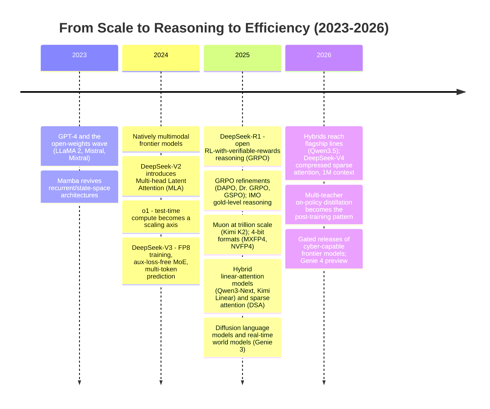

# Timeline: 2023 - Present

This is the most recent, and necessarily the least settled, of the four history files — events here are closer to the writing of this repository (last updated November 2026) and haven't had the benefit of years of hindsight and academic post-mortems the way earlier eras have. Per this repository's methodology (see [scope-and-methodology.md](../00-overview/scope-and-methodology.md)), this file sticks to widely-reported developments, attributes them to specific papers or technical reports where possible, and marks vendor-reported claims as such; for genuinely forward-looking speculation, see [09-roadmaps](../09-roadmaps/), where such claims are clearly labeled `[Projection]`.

The v3 update (November 2026) replaced the earlier, mostly thematic version of this file with a dated, technique-focused chronology. The organizing idea of the period is that **the bottleneck moved**: from "how big can we pretrain?" (through 2023), to "how much can a model think at inference time?" (2024-2025), to "how cheaply can we serve very long contexts and very long reasoning traces, and how do we train agents?" (2025-2026).

## Timeline diagram

## 2023: GPT-4, open weights, and the return of recurrence

**What happened.** GPT-4 (OpenAI, March 2023) set the frontier bar for the year, while Meta's LLaMA 2 (July 2023), Mistral 7B (September 2023), and Mixtral 8x7B (December 2023) established a competitive open-weight ecosystem; Mixtral in particular brought sparse Mixture-of-Experts (see [mixture-of-experts.md](../03-deep-learning-architectures/mixture-of-experts.md)) into widespread open use. In December 2023, Gu and Dao's **Mamba** showed that a selective state space model could match Transformers of similar size on language modeling while running in linear time — reviving recurrent architectures as a serious research direction (see [state-space-models.md](../03-deep-learning-architectures/state-space-models.md)).

**Why it matters to this history.** The gap between the best open-weight and best closed models narrowed considerably relative to 2020-2022, though closed frontier labs generally kept the lead on the most capable systems at any given time. Mamba's significance turned out to be less "replace the Transformer" than "supply a cheap layer type that later got mixed into Transformers" — see 2025 below.

## 2024: multimodality, cheaper attention, and test-time compute

**Natively multimodal frontier models.** Frontier development shifted from separate per-modality models glued together toward single models trained to handle text, images, audio and (increasingly) video in one set of weights — GPT-4o (May 2024) and the Gemini family being widely-cited examples. "Natively multimodal" became a standard expectation rather than an add-on.

**Long context and cheaper attention.** Context windows grew from tens of thousands of tokens to hundreds of thousands and beyond. The cost pressure this put on the KV cache (see [kv-cache-and-attention-optimization.md](../06-inference-optimization/kv-cache-and-attention-optimization.md)) drove a run of attention redesigns, the most influential being **Multi-head Latent Attention (MLA)** in DeepSeek-V2 (May 2024), which caches one small compressed latent vector per token instead of full per-head keys and values.

**Test-time compute (September 2024).** OpenAI's **o1** was the first widely-deployed *reasoning model*: trained with reinforcement learning to produce a long internal chain of thought before answering. Its headline finding was that accuracy keeps improving as you let the model "think" longer at inference time — **test-time compute** became a second scaling axis next to pretraining compute (see [rl-for-llms.md](../07-reinforcement-learning/rl-for-llms.md)).

**Training efficiency at scale (December 2024).** DeepSeek-V3 (671B total / 37B active parameters) documented, in an open technical report, several techniques that became widely copied: **FP8 mixed-precision training** at frontier scale (see [quantization.md](../06-inference-optimization/quantization.md)), **auxiliary-loss-free load balancing** for MoE routers, and a **multi-token prediction (MTP)** training objective whose extra head can double as a speculative-decoding drafter (see [speculative-decoding.md](../06-inference-optimization/speculative-decoding.md)). Over the same period the **Muon** optimizer (2024) appeared in speed-running and research settings (see [optimization-algorithms.md](../01-foundations/optimization-algorithms.md)).

## 2025: open reasoning, RL refinements, and efficient architectures

**DeepSeek-R1 (January 2025).** DeepSeek released R1 and R1-Zero with open weights and a detailed report: large-scale RL against automatically verifiable rewards (math answers, unit tests) using **GRPO**, with R1-Zero showing long chain-of-thought behaviors emerging from RL on a base model without supervised fine-tuning, and reasoning then distilled into much smaller dense models. Its impact was less about any single benchmark than about making the reasoning-model recipe public. A family of GRPO refinements followed within months — **DAPO**, **Dr. GRPO**, and **GSPO** — each fixing a specific bias or instability (see [rl-for-llms.md](../07-reinforcement-learning/rl-for-llms.md) and [policy-gradient-methods.md](../07-reinforcement-learning/policy-gradient-methods.md)).

**Reasoning milestones.** In July 2025, experimental reasoning models from Google DeepMind and OpenAI were reported to reach gold-medal-level performance on International Mathematical Olympiad problems — a symbolic marker of how far RL-trained reasoning had come in about a year.

**Optimizers and number formats.** Moonshot's Kimi K2 (July 2025, roughly 1T total / 32B active parameters) was trained with **MuonClip** — Muon plus a "QK-clip" safeguard against exploding attention logits — the first public validation of Muon at trillion-parameter scale. OpenAI's open-weight **gpt-oss** models (August 2025) shipped their MoE weights natively in **MXFP4**, a 4-bit microscaling floating-point format, and NVIDIA reported pretraining a 12B model on 10T tokens in **NVFP4** with near-FP8 quality (September 2025; see [quantization.md](../06-inference-optimization/quantization.md)).

**Hybrid and sparse attention.** Two complementary answers to long-context cost moved into large production models. *Hybrid architectures* interleave cheap **linear-attention** layers — notably **Gated DeltaNet**, which keeps a fixed-size recurrent state — with occasional full-attention layers, e.g. Qwen3-Next (September 2025, roughly 3 linear : 1 full) and Kimi Linear (October 2025), following earlier hybrids like Jamba and NVIDIA's Nemotron-H (see [state-space-models.md](../03-deep-learning-architectures/state-space-models.md)). *Sparse attention* keeps full attention but lets each query look at only a selected subset of past tokens — DeepSeek-V3.2's **DeepSeek Sparse Attention** uses a lightweight "lightning indexer" to pick the top-k tokens (see [kv-cache-and-attention-optimization.md](../06-inference-optimization/kv-cache-and-attention-optimization.md)). Qwen's **gated attention** paper (an output gate that removes attention sinks) received a NeurIPS 2025 best paper award.

**Serving.** Disaggregating prefill and decode onto separate GPU pools, plus aggressive prefix caching, became mainstream serving practice (see [serving-and-batching.md](../06-inference-optimization/serving-and-batching.md)) — driven partly by reasoning models, whose very long outputs make decoding the dominant cost.

**Beyond autoregressive text.** **Diffusion language models** — which generate text by iteratively unmasking many tokens in parallel rather than one at a time — moved from research (LLaDA) toward products (Inception's Mercury; Google's experimental Gemini Diffusion); see [diffusion-models.md](../04-generative-models/diffusion-models.md). Google DeepMind's **Genie 3** (August 2025) showed real-time, navigable generated worlds, and Dreamer 4 learned a hard Minecraft task purely inside a learned world model (see [model-based-rl.md](../07-reinforcement-learning/model-based-rl.md)). In tabular ML, **TabPFN v2** (Nature, January 2025) showed a pretrained Transformer competing with tuned gradient-boosted trees on small datasets (see [ensemble-methods.md](../02-classical-ml/ensemble-methods.md)).

**Frontier cadence.** The closed frontier moved in releases every few months per lab — GPT-5 (August 2025), and Gemini 3 Pro and Claude Opus 4.5 (November 2025) among them — with reasoning, tool use and coding agents as the main competitive axes.

## 2026 (through November): efficiency at the frontier, distillation, and gated releases

**Hybrids enter flagship lines.** Early 2026's Qwen3.5 carried the 3:1 Gated DeltaNet : gated-attention layout from the experimental Qwen3-Next into Alibaba's main model line, a strong signal that hybrids had moved from experiment to default for at least one major open-weight family.

**DeepSeek-V4 (April 2026, reported).** DeepSeek's technical report describes a 1.6T-total / 49B-active MoE (V4-Pro) and a 284B / 13B variant (V4-Flash), both with 1M-token context, built on a hybrid of **Compressed Sparse Attention** and **Heavily Compressed Attention** — compressing groups of tokens into single KV entries and attending sparsely or densely over the compressed history plus a window of recent tokens — together with **manifold-constrained hyper-connections (mHC)**, a stabilized generalization of the residual connection (see [transformer-architecture.md](../03-deep-learning-architectures/transformer-architecture.md)), and the Muon optimizer. The report claims roughly a quarter of the per-token FLOPs and a tenth of the KV cache of V3.2 at the same long context length.

**Post-training consolidates around on-policy distillation.** As RL runs got more expensive and mixing many skills in one RL run caused capabilities to interfere, a pattern widely reported across 2026 frontier recipes is to train separate specialist models with RL (math, code, agentic tool use, etc.) and then merge them into one student via **multi-teacher on-policy distillation**, in which the student generates its own outputs and the teachers grade them token by token (see [rl-for-llms.md](../07-reinforcement-learning/rl-for-llms.md) and [pruning-and-distillation.md](../06-inference-optimization/pruning-and-distillation.md)). Building realistic **RL environments** for agentic training became a major investment area.

**Research recognition.** ICML 2026 (Seoul, July) gave both Outstanding Paper awards to diffusion research — one questioning how much arbitrary generation order actually helps diffusion language models — and its Test of Time award to the 2016 A3C paper. MIT Technology Review listed mechanistic interpretability among its 2026 breakthrough technologies (see [open-problems.md](../09-roadmaps/open-problems.md)). Continual learning saw active but early-stage research (Google's Nested Learning; test-time training methods), without a frontier-scale solution.

**Gated releases.** In 2026, frontier labs began staging access to their most capable models because of their offensive-cybersecurity capabilities — reportedly giving vetted cyber defenders early or exclusive access before broad release — and a US executive order on frontier AI and cybersecurity was signed in June 2026 (reported). Whether this becomes a durable norm is not yet settled.

**World models.** Google DeepMind previewed **Genie 4** in October 2026 (reported), adding native audio and longer scene consistency, and positioned it partly as a way to rehearse robot tasks in simulation.

## How the earlier themes of this file look in hindsight

| Theme (as framed mid-2026) | What the record now shows (Nov 2026) |
|---|---|
| Open-weights competition and MoE | Open MoE models reached 1T+ total parameters with only a few percent active per token (Kimi K2, DeepSeek-V4) |
| Multimodal convergence | Now a baseline expectation; competition moved to reasoning and agentic capability |
| Long-context scaling | 1M-token contexts in open models; the hard problem is cost (KV cache) and actual usability, addressed by MLA, sparse/compressed attention, and hybrids |
| RL on verifiable rewards | Became the core of reasoning-model training (o1, R1); refined by DAPO/GSPO; increasingly combined with on-policy distillation |
| Agentic/tool-use training | Agentic RL in sandboxed environments is a standard post-training stage; reliability remains an open problem |

## A note on writing history this close to the present

This file is, by construction, the part of this repository's historical narrative most likely to look incomplete or differently-weighted in hindsight a few years from now — some events treated here as significant may prove less durably important than they currently appear, and some quieter developments not yet widely reported may retrospectively turn out to matter more. Several 2026 entries rest on vendor technical reports or press coverage that had not been independently replicated at the time of writing; they are marked "reported." This is exactly why this repository draws a firm line between this file (widely-reported past/current developments) and [09-roadmaps](../09-roadmaps/) (explicitly labeled forward-looking speculation).

## Relationship to other files

- This file continues directly from [timeline-2017-2023.md](timeline-2017-2023.md) and is the most recent point in this repository's chronological narrative; [09-roadmaps](../09-roadmaps/) picks up from here into explicitly speculative territory.
- Reasoning models and RL on verifiable rewards: [rl-for-llms.md](../07-reinforcement-learning/rl-for-llms.md). Long-context cost and attention redesigns: [kv-cache-and-attention-optimization.md](../06-inference-optimization/kv-cache-and-attention-optimization.md) and [state-space-models.md](../03-deep-learning-architectures/state-space-models.md). Low-precision formats: [quantization.md](../06-inference-optimization/quantization.md). Diffusion language models: [diffusion-models.md](../04-generative-models/diffusion-models.md).

## Sources

- OpenAI, "GPT-4 Technical Report" (2023)
- Touvron et al. (Meta), "Llama 2: Open Foundation and Fine-Tuned Chat Models" (2023); Jiang et al. (Mistral AI), "Mixtral of Experts" (2024)
- Gu & Dao, "Mamba: Linear-Time Sequence Modeling with Selective State Spaces" (2023)
- DeepSeek-AI, "DeepSeek-V2: A Strong, Economical, and Efficient Mixture-of-Experts Language Model" (2024) [MLA]
- OpenAI, "Learning to Reason with LLMs" (September 2024) [o1, test-time compute]
- DeepSeek-AI, "DeepSeek-V3 Technical Report" (December 2024)
- DeepSeek-AI, "DeepSeek-R1: Incentivizing Reasoning Capability in LLMs via Reinforcement Learning" (2025)
- Yu et al. (ByteDance Seed), "DAPO: An Open-Source LLM Reinforcement Learning System at Scale" (2025); Liu et al., "Understanding R1-Zero-Like Training: A Critical Perspective" (2025) [Dr. GRPO]; Zheng et al. (Qwen), "Group Sequence Policy Optimization" (2025)
- Kimi Team (Moonshot AI), "Kimi K2: Open Agentic Intelligence" (2025) [MuonClip]; Kimi Team, "Kimi Linear" (2025)
- OpenAI, gpt-oss model card (August 2025) [MXFP4]; NVIDIA, "Pretraining Large Language Models with NVFP4" (arXiv 2509.25149, 2025; v2 2026)
- Qwen Team, Qwen3-Next (2025) and Qwen3.5 (2026) model releases; Qiu et al. (Qwen), "Gated Attention for Large Language Models" (NeurIPS 2025)
- DeepSeek-AI, DeepSeek-V3.2 (2025) [DeepSeek Sparse Attention]; DeepSeek-AI, "mHC: Manifold-Constrained Hyper-Connections" (2025/2026); DeepSeek-AI, DeepSeek-V4 technical report (April 2026) [reported figures as summarized in secondary coverage]
- Nie et al., "Large Language Diffusion Models" (LLaDA, 2025); Inception Labs, Mercury announcements (2025-2026, vendor claims)
- Google DeepMind, Genie 3 (August 2025) and Genie 4 research preview (October 2026, reported); Hafner et al., "Training Agents Inside of Scalable World Models" (Dreamer 4, 2025)
- Hollmann et al., "Accurate predictions on small data with a tabular foundation model" (Nature, 2025) [TabPFN v2]
- Behrouz et al. (Google), "Nested Learning: The Illusion of Deep Learning Architectures" (NeurIPS 2025)
- Lambert & Timbers, frontier post-training recipe survey (June 2026) [multi-teacher on-policy distillation pattern]
- ICML 2026 award announcements (July 2026); MIT Technology Review, "10 Breakthrough Technologies 2026"
- Press coverage of 2026 gated frontier releases and the June 2026 US executive order on frontier AI and cybersecurity (reported; not independently verified here)
